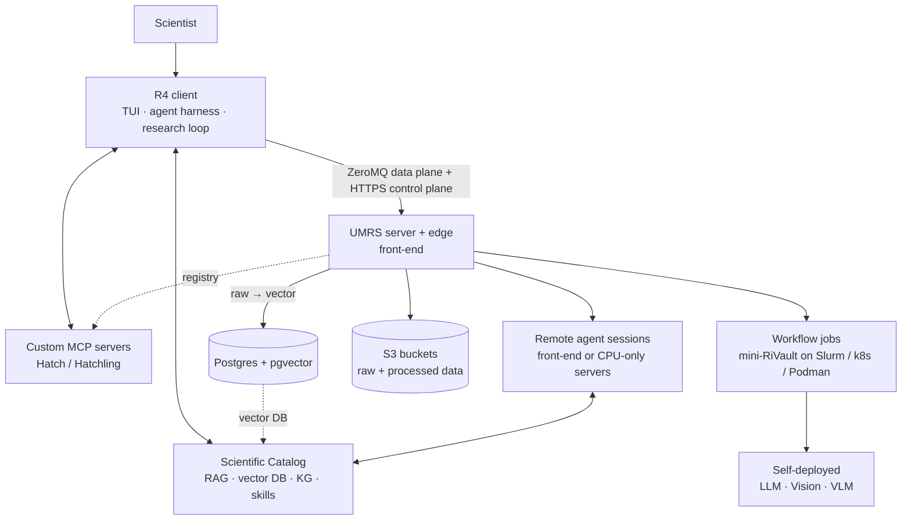

# R4 + UMRS — Architecture

**Status as of 2026-09-22.** This file has two layers, kept apart on purpose:
the **target architecture** from [docs/R4-UMRS-DESIGN.md](docs/R4-UMRS-DESIGN.md),
and the **implementation map** of what the tree does today. Where they
differ, the difference is a numbered row in
[docs/R4-UMRS-GAP-ANALYSIS-2026-09-22.md](docs/R4-UMRS-GAP-ANALYSIS-2026-09-22.md)
(cited as `D-nn`). Decisions live in [docs/adr/](docs/adr/README.md).

---

## 1. Target architecture

Four pillars: R4 (where the scientist works), UMRS (where compute, data and
models live), the Scientific Catalog (what the agents know) and custom MCP
servers (what the agents can do). R4 talks to UMRS over an authenticated,
encrypted transport pair — a ZeroMQ data plane and an HTTPS control plane,
both terminated by UMRS ([ADR-059](docs/adr/059-transport-and-edge-dual-transport-umrs-edge.md));
everything heavy runs behind UMRS. (Corrected 2026-10-18: this said "one
channel", the design before its 2026-09-22 amendment.)

| Pillar | Responsibilities (design) |
|---|---|
| R4 | TUI as the single entry point; agent harness; skills; context control; multi-agent team-up; local and remote session control; project and workflow management; the plan → execute → observe → update-catalog loop that pauses for the scientist and ends in a paper or product. R4 never talks to a scheduler, bucket or database directly. |
| UMRS | Accounts and quotas; the client–server transport (ZeroMQ/CurveZMQ/ZAP data plane + HTTPS control plane through its edge process, ADR-059); workflow-job scheduling on Slurm / Kubernetes / Podman; remote agent-session scheduling on the front-end or CPU-only servers; self-deployment of LLM / Vision / VLM servers in mini-RiVault sandboxes; raw → vector conversion into Postgres + pgvector; S3 storage by project; MCP registry. UMRS is the parent process of everything it launches. |
| Scientific Catalog | One portable, versioned bundle per domain or project: source materials, RAG index + vectors, knowledge graph (entities, relations, procedures, results, provenance), skills, MCP server definitions, metadata (domain, contributors, version, provenance, licence). Grows by explicit ingestion and semi-automatically from loop cycles; exportable and importable between installations. |
| Custom MCP servers | Built and published with Hatch, discovered, pulled and run with Hatchling; registered in UMRS with version, owner and required placement (local / front-end / trusted host); hardware-bound servers only on trusted hosts and reached through UMRS. |
| mini-RiVault | The one sandbox type: a firewalled Podman container around every job, agent session and model server, with controlled ingress/egress and mounted data only. |

Security is meant to be explainable as one gateway (UMRS: server + edge
process), one sandbox type (mini-RiVault), one authenticated transport pair
(ZeroMQ/Curve/ZAP data plane + HTTPS control plane) and two stores (S3,
Postgres + pgvector) — the design's wording since ADR-059 (this file said
"one transport" until 2026-10-18).

---

## 2. Implementation map (2026-09-22)

### 2.1 Components and where the code lives

| Component | Code | Status vs design |
|---|---|---|
| R4 CLI / SDK | `r4/src/r4/` — `client.py`, `_cli/` (≈65 command groups), `config.py`, `_transport_router.py`, `umrs_transport.py` (ZeroMQ), `curve_session.py` | Implemented; transport dual (D-01) |
| Companion agent (harness) | `r4/src/r4/companion/` — `agent.py`, `tools.py`, `permissions.py`, `context.py`, `skills.py`, `harness/`, `session*.py`, `knowledge_*_tools.py`, `acp_session.py` | Implemented (D-26, D-28) |
| Console (TUI) | `packages/r4-tui-v3/` (Bun + OpenTUI; routes `work`, `tasks`, `knowledge`, `catalog`, `sessions`, `loop`, `research`, `code`, `infrastructure`, `settings`); bridge protocol v1 over JSONL to the companion | Primary surface; other surfaces still shipped (D-25) |
| Skills | `r4/src/r4/companion/builtin/` (27 groups, Agent Skills `SKILL.md`), user/project skill dirs, `umrs/src/umrs/skills/` + `/umrs/skills` registry | Implemented; not in the catalog bundle (D-27) |
| Multi-agent | `r4/src/r4/teamup/` (VibeCodeHPC roles), `r4/src/r4/teams/` + `packages/r4-teamengine-spi/` (ADR-020) + `engines/r4-engine-langgraph/`, `r4/src/r4/research_loop/team.py`, companion sub-agents; team plans (ADR-092, branch `feat/adr-092-team-plans`): `r4-contracts/.../team_engine/plan.py`, `r4/src/r4/teams/plan/`, `r4/src/r4/teams/agent_broker.py` | Fragmented (D-29); one seam (ADR-072), plans proposed (ADR-092) |
| Research loop | Server: `umrs/src/umrs/knowledge/loop.py` hosted by `research_loop_job` (`umrs/src/umrs/jobs/research_loop_backend.py`, `knowledge/loop_hosting.py`, ADR-036). Client: `companion/science_loop.py`, `research_loop/orchestrator.py`, `agent/research_director.py` | Fragmented; no catalog-grounded output (D-32, D-45) |
| Remote sessions (venues) | `umrs/src/umrs/venues/` (`frontend_service.py`, `frontend_podman.py`, `egress_nft.py`), `umrs/src/umrs/api/companion_venue.py`, `r4/src/r4/venue_worker.py`, `venue_rail.py`; job kind `frontend_session` (ADR-046 A2) | Landed repo-side 2026-09-21; front-end venue only (D-09, D-48) |
| UMRS server core | `umrs/src/server_umrs.py`, `umrs/src/umrs/core/` (ZeroMQ `MessageQueue`, CURVE/ZAP), `umrs/src/umrs/server/http_sidecar.py` (FastAPI router registry), `umrs/src/umrs/api/` (26 lane-classified families) | Implemented |
| Durable jobs | `umrs/src/umrs/jobs/` (Job/Attempt, scheduler, reconciler, backends per `JobType`: index build, embedding, pipeline, workflow, endpoint provision, model download, knowledge ingest/understand/embed/verify/export/reindex, companion worker, frontend session, research loop, vision infer, batch infer, model eval, fine-tune gated) | Implemented (ADR-002/004/044/047) |
| Orchestration | `umrs/src/umrs/orchestrator/` — `slurm_podman_backend.py` (preferred), `slurm_backend.py` (Singularity, legacy), `kubernetes_backend.py`, `compose_backend.py`, `hybrid/`, `site_config.py` + `site_profiles/` | Podman path preferred; Singularity still present (D-12) |
| mini-RiVault runtime | `umrs/src/umrs/mini-rivault-llm/` (`serve-model.yaml` compose profiles `harness` / `vllm` / `vision-bentoml`, `serve-model.slurm`, `venue.sh`, `assert-offline.sh`, `attempt_budget.sh`) | Compute sandbox; no named profile contract (D-13) |
| Models | `umrs/src/umrs/model_registry/` (scopes system/project/user, versions, certification, capability detection), `umrs/src/umrs/api/llm.py` (OpenAI-compatible proxy to LiteLLM), `umrs/src/umrs/vision_service/` (BentoML; SAM3, MAE, HMAE) | LLM + vision implemented; VLM path undocumented (D-10); no single inference contract (D-11) |
| Knowledge spine | `umrs/src/umrs/knowledge/` (ingest, understand, extract, ontology, graph registry, proposals, verify, bundle export/import, planner, loop), `knowledge_graph/`, `knowledge_model/`, `scientific_memory/`, `embeddings_api/`, `search_api/`, `evidence/`, `experiment_registry/`; migrations 0055–0093 | Implemented as pieces; no catalog object (D-39) |
| Vector store | Postgres + pgvector: `memory_vectors` (0010, HNSW), `knowledge_node_embeddings` (0075), embedding jobs in `umrs/src/umrs/inference/embeddings.py`, `jobs/vector_version_store.py` | Text implemented; image partial; video absent (D-14, D-15) |
| Retrieval core (ADR-093, branch `feat/adr-093-retrieval`) | `umrs/src/umrs/knowledge/retrieval/` (pipeline, dense, lexical + fusion, hydrate, cutoff + calibrate, rerank, expand, graph_lane, profiles), `GET /umrs/rag/retrieve` + `/umrs/rag/passages/{id}` (`api/rag_retrieve.py`), migrations 0120/0121; R4: `r4_contracts/retrieval.py`, `context_pack.py`, `models.py`, `r4/src/r4/model_scale.py`, `companion/retrieval_router.py`, `citation_check.py`; eval `benchmarks/retrieval/` | Built and measured on the branch; proposed (D-60) |
| Data catalog | `umrs/src/umrs/data_catalog/`, `catalog_objects` (0054), `/umrs/catalog`; `asset_index/` read-model for the console `/catalog` | Implemented (this is the *data* catalog, not the Scientific Catalog) |
| Knowledge bundle | `umrs/src/umrs/knowledge/bundle_export.py` / `bundle_import.py` (`r4-kb` v1.2, HMAC-signed), `r4/src/r4/knowledge_bundle.py`, job `KNOWLEDGE_EXPORT` | Partial catalog export (D-40) |
| MCP | `umrs/src/umrs/mcp/` + `/umrs/mcp/*`; `mcp-servers/` (`r4_mcp` servers, `hatch-registry/` with six default packages, stdio adapters); `r4/src/r4/integrations/hatchling.py`, `r4/src/r4/mcp.py` | Registry + Hatch tooling implemented; placement/trust classes absent (D-19…D-24) |
| Accounts and policy | `umrs/src/umrs/admin/user_store.py` (JSON user files), `umrs/src/umrs/shared/auth.py`, `api/projects.py` (ADR-051), `companion_trust/` (server-side trust allowlist, ADR-035), `grants/` (ADR-041), `api/agent_quota.py`, `api/quota_status.py` | Partial (D-06) |
| Gateway (edge) | `gateway/nginx/` (routes `/gw/*`, rate limits, X-Accel downloads), `gateway/sidecar/main.py` (JWT validation, audit) | Today's authentication edge; not in the design (D-02) |
| Transport security | `umrs/src/umrs/core/zmq_security.py`, `session_curve_provider.py`, `api/zmq_sessions.py`; umrs-front runs session-CURVE | ZAP implemented; identity from JWT (D-03) |
| Egress control | EgressGuard (`umrs/src/umrs/security/`, `mcp-servers/src/r4_mcp/egress_guard.py`), tiers system/project/user, `assert-offline.sh`, frontend-venue `egress-net` + nftables (`venues/egress_nft.py`) | Implemented per tier; convergence ADR-040 open |
| Inference proxy for remote sessions | `umrs/src/umrs/infer_proxy/` (credential-injecting, sealed sources, ADR-046) | Implemented |
| Provenance | `umrs/src/umrs/a2l/` (ADR-034), `artifact_registry/`, execution manifests (ADR-002 amendment), OTel (`server/otel.py`) | Partial (D-52, D-45) |
| Object store | `S3_BACKEND` abstraction (ADR-055): SeaweedFS on umrs-front, MinIO elsewhere; per-project external stores by locator (ADR-077, `umrs/src/umrs/shared/storage/project_storage.py`, `r4 project storage`) | Partial fleet cutover (D-17); ADR-077 leg 2 (knowledge plane on bound stores) open |
| Shared contracts | `r4-contracts/src/r4_contracts/` (recipes, scheduler, skills, MCP, research, provenance, taint, workflows, team engine) | Implemented (ADR-005) |
| Validators | `tools/` (24 registered validators, `tools/enforcement_maturity_scorer.py`), `scripts/ci-lint-local.sh` | Live |

### 2.2 Transport today versus target

| | Design | Today |
|---|---|---|
| Control plane | HTTPS to UMRS's edge process (ADR-059) | HTTPS to the gateway (`/gw/*`) → UMRS HTTP sidecar; JWT validated by the auth sidecar |
| Data plane | ZeroMQ + CurveZMQ + ZAP | ZeroMQ control port 50110 + data ports 50111–50118, direct TCP from the client (no SSH tunnels), CURVE session keys minted at `r4 auth login`; operations routed by `r4/src/r4/config.py` (`OPERATION_ZMQ_ELIGIBLE`: status, models, jobs, workflows, file upload/download, embedding export; `OPERATION_GATEWAY_ONLY`: chat, MCP) |
| Identity | ZAP keys managed by UMRS accounts | JWT login (admin-issued or OIDC) → session-CURVE keypair with TTL; long-lived account keys on the user record (`curve_public_key`, revocation) accepted by ZAP on the same path (D-03 Implemented, umrs `5b4a1263`, `0df7daf9`) |
| Versioning | versioned public protocol | protocol v1.0 over both lanes ([docs/R4-UMRS-PROTOCOL.md](docs/R4-UMRS-PROTOCOL.md), `r4_contracts.protocol.PROTOCOL_VERSION`, ZeroMQ handshake `READY!:v1.0`); bridge JSONL v1 (D-04 Implemented) |

The transport decision is taken: ADR-059 (Accepted 2026-09-22) amended the
design to this dual transport, and the gap analysis marks D-01/D-02/D-50
Implemented by design amendment. New client features use the HTTP families
and new data movement uses ZeroMQ. The neighbouring rows D-03 (ZAP keys from
UMRS accounts), D-04 (versioned protocol) and D-05 (no plaintext channel) are
Implemented too. See ADR-001, ADR-003, ADR-014, ADR-059. (Corrected 2026-10-18: this
paragraph still called D-01/D-02/D-50 an open decision; the Design column
above said ZeroMQ for both planes; the identity and versioning "Today" cells
described 2026-09-22 and now follow gap rows D-03 and D-04.)

### 2.3 Sandboxes today

| Workload | Sandbox today | Design target |
|---|---|---|
| LLM / vision endpoint on a GPU node | podman-compose stack launched by the Slurm wrapper; offline at boot; EgressGuard per tier | mini-RiVault `model-server` profile |
| Workflow job | same stack (`umrs_job` / `python_exec` / `shell_exec` steps run under the endpoint's attempt) | mini-RiVault `gpu-job` |
| Remote agent session | rootless Podman on the front-end, `egress-net`, credential-injecting proxy; nftables guard privileged/opt-in | mini-RiVault `cpu-agent` |
| Embedding / ingest compute | in the UMRS server process | mini-RiVault `embedding-job` (D-12) |
| Default MCP runtimes | host venv under `/opt/umrs/mcp-runtimes` (privileged Ansible cadence) | `mcp-trusted` profile on a trusted host (D-21) |

### 2.4 Durable planes

| Plane | Authority | Notes |
|---|---|---|
| Postgres (+ pgvector) | jobs, attempts, endpoints, models, projects, knowledge graph, vectors, data catalog, sessions journal, trust, grants, audit, A2L | migrations under `umrs/src/umrs/migrations/` (latest 0100 on 2026-09-21) |
| S3 | raw uploads, attempt-scoped job outputs, bundles, RAG payloads | presigned URLs are internal to compute nodes; per-user `s3cfg` delivery is gap D-16 |
| User records | JSON files under the server's `user_files/` | gap D-06 |
| Client cache | SQLite session store on the workstation, mirrored to Postgres | ADR-036 amendment 1, ADR-057 |

### 2.5 Deployment profiles

The R-CCS sites are several deployments of one repository, all through
`deploy/ansible/bootstrap.sh --profile <name>`. That Ansible deployment is
kept in the development repository and is not part of the public tree
(2026-11-07); with the public repository, deploy with
[deploy/standalone](deploy/standalone/README.md) on one host, or with your own
site tooling starting from the UMRS templates in `umrs/deploy/templates/`.
The R-CCS profiles are:

| Profile | Hosts | Notes |
|---|---|---|
| `umrs-front` | `data0` front-end + RCCS and AI4S clusters (bdrt, octopus sub-profiles) | one independent UMRS stack **per cluster** on the same host (gap D-47); two-cadence converge (main without sudo, privileged for Apache TLS and default MCP runtimes); SeaweedFS object store |
| `rccs-cloud` | RCCS login node + Slurm | login-direct single cluster |
| `bdrt`, `octopus` | satellite clusters behind reverse SSH tunnels to data0 (ADR-018) | |
| `atom-k8s` | Kind/K3s | Kubernetes execution authority |

Environment principle: every deployment is `site.yaml` + `.env`; code never
hardcodes ports or keys.

---

## 3. Invariants that are enforced today

These hold in the tree and are checked by validators or tests; they remain
binding regardless of the open design decisions.

| Invariant | Enforcement |
|---|---|
| `r4` never imports `umrs`; `gateway` imports neither; `r4-contracts` is stdlib-only; UMRS foundation modules (`core`, `jobs`, `model_registry`, `mcp`, `rag`, `pipeline_sdk`, `orchestrator`, `security`, `shared`) never import `umrs.api` or `umrs.server` | `tools/import_boundary_validator.py`, `tools/contracts_fence.py` (ADR-005, ADR-053) |
| One `execution_authority` per job, chosen once | `umrs/tests/test_slurm_orchestration_authority.py` (ADR-004) |
| Inference containers boot offline; model weights are pre-staged or fetched only by `MODEL_DOWNLOAD` jobs; only `MODEL_DOWNLOAD` and `KNOWLEDGE_INGEST` have (allowlisted) egress | `assert-offline.sh`, EgressGuard tests (ADR-006, ADR-015) |
| Presigned S3 URLs never reach external clients | `umrs/tests/test_files_download.py`, `tests/test_gateway_route_characterization.py` (2026-10-18: cited `gateway/tests/test_security_contracts.py`, deleted in `0aac3ec2`) |
| Agent-originated knowledge mutation requires a recorded user decision; `knowledge_graph_decide` never auto-approves | `umrs/src/umrs/api/_knowledge_mutation_guard.py` (migration 0069) |
| Every `umrs/api` router is mounted by the sidecar registry or does not exist | `umrs/tests/test_surface_characterization.py` (ADR-053) |
| Lint, complexity (max 9) and boundary gates on every changed Python file in every tree including the submodule; baselines only shrink | `scripts/ci-lint-local.sh` (ADR-052) |
| Host checkouts are read-only deploy inputs; deployment is Ansible only | ADR-019 amendment, nightly converge check |

---

## 4. Where to go next

- Decisions and their rollout blocks: [docs/adr/README.md](docs/adr/README.md).
- Per-area detail written before the design reset (implementation as of their dates): `docs/architecture/design/` (components, security, dataflow, APIs), `docs/architecture/runtime/` (UMRS runtime spec, topology, communication), `docs/architecture/boundaries/`.
- Operator guarantees: [PLATFORM_CONTRACT.md](PLATFORM_CONTRACT.md).
- Order of work: ROADMAP.md.
