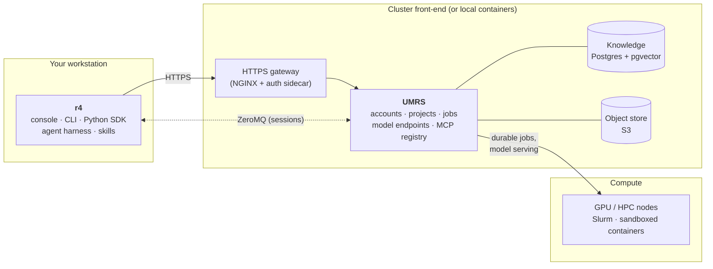
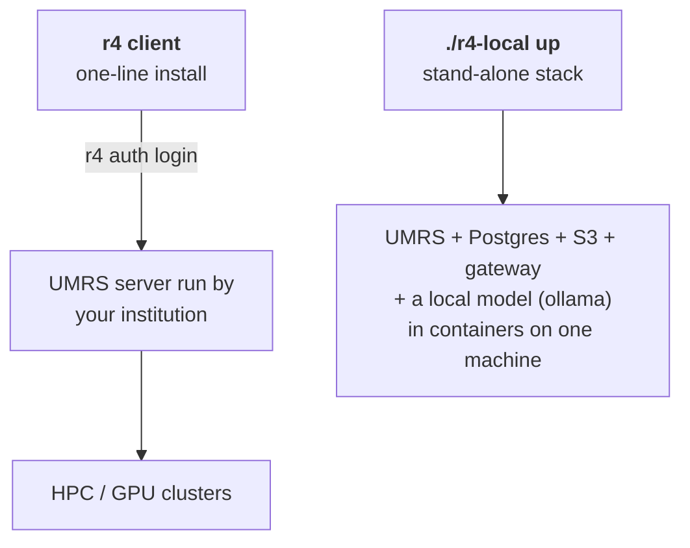

# R4

**An AI platform for working scientists.**
Your tools, your compute, your science.

[](https://github.com/R-CCS-HPBD/r4/actions/workflows/ci.yaml)
[](https://github.com/R-CCS-HPBD/r4/releases)
[](LICENSE)
[](r4/pyproject.toml)
[-lightgrey.svg)](#requirements)
[](https://github.com/UMRS-org/umrs)

**Connected R-CCS sites** (live status; [details](https://github.com/R-CCS-HPBD/r4/blob/status/status/STATUS.md)):

[](https://github.com/R-CCS-HPBD/r4/blob/status/status/STATUS.md)
[](https://github.com/R-CCS-HPBD/r4/blob/status/status/STATUS.md)
[](https://github.com/R-CCS-HPBD/r4/blob/status/status/STATUS.md)
[](https://github.com/R-CCS-HPBD/r4/blob/status/status/STATUS.md)
[](https://github.com/R-CCS-HPBD/r4/blob/status/status/STATUS.md)
[](https://github.com/R-CCS-HPBD/r4/blob/status/status/STATUS.md)
[](https://github.com/R-CCS-HPBD/r4/blob/status/status/STATUS.md)
[](https://github.com/R-CCS-HPBD/r4/blob/status/status/STATUS.md)

---

## What R4 is

R4 is pronounced "are for", as in *"___ are for ___"*: simulations are for
materials discovery, your tools are for your science.

It lets a research group's own **knowledge, tools and compute** be used
directly by AI agents. It is built for scientists whose daily work already
depends on HPC and GPU clusters, image and video analysis, instruments or
in-house codes, and who should not have to become experts in AI pipelines to
get an agent that knows their field.

- **You work in R4**, on your own machine: a terminal console, a command
  line, a Python SDK and an agent harness.
- **UMRS does the heavy lifting**, on a cluster front-end or in containers on
  your laptop: accounts, data transfer, durable jobs on Slurm clusters,
  self-hosted models in sandboxes, object storage, vector and graph storage,
  and an MCP tool registry.
- **R4 never talks to a scheduler, a bucket or a database directly.**
  Everything goes through UMRS.



UMRS is its own open-source project,
[UMRS-org/umrs](https://github.com/UMRS-org/umrs), included here as the git
submodule `umrs/`.

> **Status.** R4 is under active development (0.2.0 release candidates).
> Interfaces still change between releases; see [CHANGELOG.md](CHANGELOG.md).

## What you can do with it

- **Work in one console.**
  `r4 console` is a terminal UI for chat, tasks, knowledge, sessions,
  workflows and infrastructure. The same functions are available as `r4 ...`
  commands, a Python SDK (`from r4 import Client`), a VS Code extension and
  Jupyter magics.
- **Give the agent your group's knowledge.**
  Import papers, protocols, notes and code (`r4 project import`,
  `r4 project init`). UMRS stores them and builds a knowledge graph and a
  vector index, and the agent answers with citations to your own documents
  (`r4 knowledge query`). The result, the project's *Scientific Catalog*, can
  be versioned, pinned and exported.
- **Run workflows on real compute.**
  Upload and trigger workflows as durable jobs on HPC and GPU clusters
  (`r4 workflow`, `r4 job`), with importers for Snakemake, CWL and Nextflow.
  Workflows shared with your project can be exported (`r4 workflow export`).
- **Serve your own models.**
  Bring up LLM, vision and VLM endpoints on a GPU cluster inside sandboxes
  (`r4 endpoint up`), or use an OpenAI-compatible service you already have
  (`r4 source`).
- **Connect your own tools.**
  Wrap instrument APIs, job templates or analysis codes once as MCP servers
  with Hatch and Hatchling (`r4 mcp hatch ...`), so any agent can call them
  under the platform's permission rules.
- **Extend the agent.**
  Skills in the Agent Skills `SKILL.md` format, per user or per project;
  permission modes from "ask first" to autopilot; multi-agent teams
  (`r4 team`).
- **Run sessions locally or remotely.**
  Start an agent session on the front-end server and reconnect to it later
  from the console.
- **Run a research loop.**
  A server-hosted loop plans and runs experiments within GPU-hour and
  wall-clock budgets, stops to ask you at decision points, and can be
  replayed from its trace.

## Quick start

There are two ways in:

| | Use it when | Start with |
|---|---|---|
| **(a) The r4 client** | your institution runs a UMRS server and gave you a token | [the one-line install](#a-the-r4-client-against-an-existing-umrs-server) |
| **(b) The stand-alone stack** | you want the whole platform on your own machine | [`./r4-local up`](#b-the-stand-alone-local-stack) |



### (a) The r4 client, against an existing UMRS server

**1. Install** (macOS and Linux; on Windows, inside
[WSL2](https://learn.microsoft.com/windows/wsl/install) — a native Windows
install comes later):

```bash
curl -fsSL https://raw.githubusercontent.com/R-CCS-HPBD/r4/main/scripts/install-r4.sh | bash
```

The installer:

1. uses your [uv](https://docs.astral.sh/uv/), or installs it with the
   official installer;
2. downloads the newest release's client bundle (release candidates
   included) and checks every package against the release's `SHA256SUMS`;
3. installs `r4` and `umrs` into `~/.local/bin` (Python 3.12, fetched by uv
   if needed);
4. fetches the console binary (`r4 tui install`).

If `~/.local/bin` is not on your `PATH`, it prints the line to add.

| To | Do |
|---|---|
| Pin a release | `curl -fsSL ... \| R4_VERSION=v0.2.0-rc4 bash` |
| Upgrade | run the same command again |
| Uninstall | `uv tool uninstall r4`, then `rm -f ~/.local/share/r4/bin/r4-tui` |

Keep the rest of `~/.local/share/r4` when uninstalling: it holds the trash
where R4 puts files it deletes for you. Other settings (`R4_SKIP_TUI=1`, a
mirror through `R4_RELEASE_BASE_URL`, `R4_TUI_HOME`, ...) are listed at the
top of [scripts/install-r4.sh](scripts/install-r4.sh), which is also attached
to every release as `install.sh`.

<details>
<summary>Install from source instead</summary>

```bash
git clone --recurse-submodules https://github.com/R-CCS-HPBD/r4.git
cd r4
python3 -m venv .venv && source .venv/bin/activate
pip install -e ./r4-contracts -e ./packages/r4-teamengine-spi -e ./science -e ./r4 -e "./umrs/src[client]"
```

`make install-client` does the same, using `uv` when it is installed.

</details>

**2. Log in:**

```bash
r4 onboard            # guided first-run setup: server, login, project, model
```

or by hand (paste the token your administrator issued at the hidden prompt):

```bash
r4 auth login --gateway-url https://<your-server> --api-key-stdin
r4 health full        # check the connection
```

**3. Start working:**

```bash
r4 project register mylab && r4 project switch mylab   # create the project on the server
r4 project import mylab ./papers ./protocols && r4 project init
r4 chat "What does our standard analysis do first?"
r4 console            # the terminal console
```

`r4 project create` alone makes a project on your machine only. The
knowledge, job and loop commands need it registered on the server
(`r4 project register`, which also records it locally).

### (b) The stand-alone local stack

The whole platform in containers on one machine, for one scientist: UMRS,
Postgres with pgvector, an S3 object store, the gateway and a local model
served by ollama.

Supported on Linux (Docker Engine or rootless podman), macOS (podman machine
or Docker Desktop) and Windows through WSL2.

```bash
git clone --recurse-submodules https://github.com/R-CCS-HPBD/r4.git
cd r4
./r4-local up
```

`./r4-local up`:

1. checks the host and prints the exact fix for anything missing;
2. picks a model that fits your memory (override with `--model NAME`);
3. pulls the prebuilt UMRS server image
   `ghcr.io/r-ccs-hpbd/r4-standalone-umrs` (linux/amd64 and linux/arm64), so
   only the two small gateway images are built on your machine;
4. starts the stack and installs the r4 client from this checkout into
   `.venv`;
5. registers the stack as the r4 source `standalone`;
6. finishes with a smoke test: one chat, one document ingested, one question
   answered from it.

Anything outside the checkout is changed only with your yes (or `--yes`).
Your active r4 source is left as it was, so select the stack explicitly:

```bash
R4_SOURCE=standalone .venv/bin/r4 chat "hello"
# or
source .venv/bin/activate && export R4_SOURCE=standalone
r4 console
```

| Command | What it does |
|---|---|
| `./r4-local up` | start the stack; on a working stack it only checks |
| `./r4-local down` | stop it and keep your data |
| `./r4-local status`, `doctor`, `logs` | inspect it |
| `./r4-local register` | issue a fresh 30-day token |

> The stand-alone stack is for development and evaluation: do not put
> sensitive research data in it yet.

Details, profiles, GPU use and model choices:
[deploy/standalone/README.md](deploy/standalone/README.md).

## Requirements

| | The r4 client (a) | The stand-alone stack (b) |
|---|---|---|
| OS | Linux or macOS; Windows through WSL2 | Linux, macOS, or Windows through WSL2 (native Windows is not supported) |
| Software | none beyond `curl` (the installer brings uv and Python) | git, Python 3, curl, nc, openssl; Docker Compose v2 or podman 4.7+ with `podman compose`; `uv` (its install line is printed when missing) |
| Memory, disk | no special needs | 16 GB RAM (on a 16 GB Mac, run the model with your own native ollama); about 15 GB of disk |
| GPU | not needed | optional; CPU-only works |
| Network | access to your UMRS server | internet for image and model pulls |

The console binary (`r4 tui install`) comes from this repository's releases,
for Linux (x86_64, arm64) and macOS (Apple silicon and Intel). From a source
checkout you can run the console from source instead: install
[bun](https://bun.sh) 1.3.14 or newer, then `make tui-deps`; `r4 console`
then prefers the checkout's console over the release binary.

Running UMRS on a real cluster front-end is an operator task: see
[the deployment chapter](docs/user-manual/16-deployment.md) for the
requirements and deployment modes. The Ansible playbooks and inventories
R-CCS uses for its own sites are not part of this repository.

## Documentation

| You want | Read |
|---|---|
| What the platform is and who it is for | [Introduction](docs/getting-started/introduction.md) |
| To use a deployed platform | [User guide](docs/getting-started/user-guide.md), [User manual](docs/user-manual/README.md) |
| The local stack | [Stand-alone deployment](docs/user-manual/29-standalone-deployment.md), [operator reference](deploy/standalone/README.md) |
| Several servers, local and remote | [Platform sources](docs/user-manual/11-sources.md) |
| Command and API reference | [CLI](docs/user-manual/13-cli-reference.md), [console](docs/r4/TUI_REFERENCE.md), [Python SDK](docs/r4/reference/sdk.md) |
| Your own tools as MCP servers | [MCP tools](docs/user-manual/08-mcp.md), [mcp-servers/](mcp-servers/README.md) |
| When something goes wrong | [Troubleshooting](docs/getting-started/troubleshooting.md) |
| The design and its decisions | [Design](docs/R4-UMRS-DESIGN.md), [what runs today](docs/R4-UMRS-PLATFORM-OVERVIEW.md), [architecture](ARCHITECTURE.md), [ADRs](docs/adr/README.md) |
| To develop R4 | [Developer guide](docs/onboarding/developer.md), [doc map](docs/README.md), [CONTRIBUTING.md](CONTRIBUTING.md) |

## Repository layout

| Path | What it is |
|---|---|
| `r4/` | The r4 client: CLI, SDK, agent harness, skills, sessions |
| `packages/r4-tui-v3/` | The terminal console (`r4 console`) |
| `vscode-extension/`, `packages/r4-web/` | Editor extension and web console |
| `r4-contracts/` | Data shapes shared by client and server |
| `umrs/` | UMRS, as a git submodule ([UMRS-org/umrs](https://github.com/UMRS-org/umrs)) |
| `gateway/` | The HTTPS edge in front of UMRS (NGINX and an auth sidecar) |
| `mcp-servers/` | Platform MCP servers and the default Hatch registry |
| `deploy/` | The stand-alone stack (`deploy/standalone/`), air-gap image and model manifest tools, an oauth2-proxy example |
| `docs/` | Guides, manual, design, ADRs |

## License

R4 is licensed under the [Apache License 2.0](LICENSE).

UMRS, included as the `umrs/` submodule, is a separate project, also
licensed under Apache-2.0. Third-party material bundled in the tree keeps its
own licence where it states one.

## Contributing and security

Contributions are welcome: issues, documentation fixes and pull requests.
Read [CONTRIBUTING.md](CONTRIBUTING.md) first.

This repository is published from a private development repository. Accepted
pull requests are ported there with credit to their authors and appear here
in the next sync.

**Security issues:** please do not report them in public issues. Use GitHub
private vulnerability reporting instead (the **Security** tab of this
repository, then **Report a vulnerability**). The full policy is in
[SECURITY.md](SECURITY.md).

## Acknowledgement

R4 is developed and operated at the RIKEN Center for Computational Science
(R-CCS), Japan. UMRS is developed jointly by Inria, France, and RIKEN R-CCS,
Japan.
