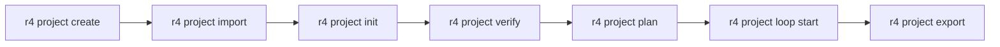

# R4 Platform Quickstart

> **日本語版**: [QUICKSTART_JA.md](./QUICKSTART_JA.md)

> From zero to first AI research project in ~30 minutes.

## Table of Contents

1. [Prerequisites](#1-prerequisites)
2. [Quick Setup](#2-quick-setup)
3. [Knowledge Ingestion](#3-knowledge-ingestion)
4. [Research Planning](#4-research-planning)
5. [Knowledge Export](#5-knowledge-export)
6. [Troubleshooting](#6-troubleshooting)

---

## 1. Prerequisites

### Required Software

| Component | Version | Purpose |
|-----------|---------|---------|
| Slurm | 23+ (or compose mock) | Job scheduling |
| Podman or Docker | 4+ | Container runtime |
| PostgreSQL | 15+ (with pgvector) | Metadata storage |
| Python | 3.11+ | CLI runtime |
| r4 CLI | latest | Research orchestration |

### Environment Setup

```bash
# Set the orchestrator (Slurm for HPC, compose for dev, kubernetes for cloud)
export RIVAULT_ORCHESTRATOR=slurm       # HPC (RCCS)
# or
export RIVAULT_ORCHESTRATOR=compose     # Development (mock)
# or
export RIVAULT_ORCHESTRATOR=kubernetes  # Cloud

# Point the CLI at your Gateway
export GATEWAY_URL=http://localhost:8080
```

### Verify Installation

```bash
# CLI version
r4 --version

# Gateway connectivity
r4 project list
```

Expected output:

```
┌─────────────┬──────────────┬────────┬──────────┐
│ Project ID  │ Name         │ Model  │ Security │
├─────────────┼──────────────┼────────┼──────────┤
│ (none)      │ (no projects)│        │          │
└─────────────┴──────────────┴────────┴──────────┘
```

---

## 2. Quick Setup

### Step 1: Clone the Platform

```bash
git clone --recurse-submodules https://github.com/R-CCS-HPBD/r4.git
cd r4
```

### Step 2: Create Your First Project

```bash
r4 project create my-research --name "My First Research Project"
r4 project switch my-research
```

Expected output:

```
✓ Project created: my-research (My First Research Project)
✓ Active project: my-research
```

Verify:

```bash
r4 project current
```

```
Active: my-research (My First Research Project)
```

### Step 3: Prepare Sample Data

Create a directory with research artifacts:

```bash
mkdir -p ~/research-samples

# Create a sample paper
cat > ~/research-samples/attention.txt << 'EOF'
Attention Is All You Need
Authors: Vaswani et al.

The dominant sequence transduction models are based on complex recurrent or
convolutional neural networks. We propose a new simple network architecture,
the Transformer, based solely on attention mechanisms.
EOF

# Create a sample code file
cat > ~/research-samples/transformer.py << 'EOF'
# transformer_model.py
import torch
import torch.nn as nn

class MultiHeadAttention(nn.Module):
    def __init__(self, d_model, num_heads):
        super().__init__()
        self.num_heads = num_heads
        self.d_model = d_model

    def forward(self, query, key, value, mask=None):
        scores = torch.matmul(query, key.transpose(-2, -1)) / (query.shape[-1] ** 0.5)
        attention = torch.softmax(scores, dim=-1)
        return torch.matmul(attention, value)
EOF
```

---

## 3. Knowledge Ingestion

The knowledge workflow has five steps:



### Step 4: Import Artifacts

```bash
r4 project import my-research ~/research-samples --json
```

Expected output:

```json
{
  "project_id": "my-research",
  "artifacts_ingested": 2,
  "artifacts_persisted": 2,
  "phase": "INGESTED"
}
```

What this does: copies your papers, code, and data files into the UMRS knowledge store. Each file becomes an artifact reference tied to your project.

### Step 5: Understand (Extract Knowledge)

```bash
r4 project init my-research
```

Expected output:

```
✓ Understood 2 artifact(s) for my-research
  Graph: 45 nodes, 120 edges, coverage 0.87
```

What this does: runs LLM-powered extraction on each artifact. Produces structured knowledge (entities, relations, embeddings) and builds a knowledge graph.

Verify the graph:

```bash
r4 project status
```

```
Project: my-research
  Artifacts: 2 ingested
  Extraction: complete (45 nodes, 120 edges)
  Coverage: 87%
  Verifications: 0
  Findings: 0 open
```

### Step 6: Explore & Query the Layer

Three ways to *look at* your knowledge before running autonomous loops:

```bash
# (a) One-shot search through the unified facade
r4 knowledge query "multi-head attention"

# (b) Interactive three-pane explorer — sections / documents / detail
r4 knowledge explore
# (keys: arrows to swap panes · e = export bundle · r = refresh · q = quit)

# (c) Inspection for this project only
r4 project readiness my-research --json
```

`query` prints each hit **plus a coverage receipt**: which backends
answered (`wired_backends`) and which honestly reported unavailable and
why (`unavailable_backends`) — e.g. `rag: requires a deployed mini-rivault
instance`. No silent empty answers.

### Step 7: Verify Knowledge

Ask evidence-based questions to check quality:

```bash
r4 project verify my-research "What architectural innovations does the Transformer paper propose?"
```

Expected output:

```
Q: What architectural innovations does the Transformer paper propose?

A: The Transformer paper proposes three key innovations:
  1. Multi-head self-attention mechanism
  2. Position-wise feedforward networks
  3. Removal of recurrence and convolutions entirely

Source: attention.txt (Vaswani et al.)

Confidence: 0.92
```

This step queries your knowledge graph using the LLM. Each answer includes source citations and a confidence score.

### Step 8: Check Readiness

```bash
r4 project readiness my-research --json
```

Expected output:

```json
{
  "ready": true,
  "score": 0.91,
  "checklist": {
    "artifacts_ingested": true,
    "knowledge_extracted": true,
    "graph_built": true,
    "verifications_passed": true,
    "findings_resolved": true
  }
}
```

The readiness report confirms all prerequisites for autonomous research.

---

## 4. Research Planning

### Step 8: Generate a Research Plan

```bash
r4 project plan my-research \
  "Evaluate Transformer attention mechanisms for multilingual machine translation"
```

Expected output:

```
✓ Research plan generated (4 steps, 8 subtasks)
  Saved to: ~/.local/share/r4/projects/my-research/research_plan.json

Plan overview:
  1. Reproduce self-attention baseline (confidence: 0.85)
  2. Test multi-head variant (confidence: 0.78)
  3. Evaluate translation quality (confidence: 0.82)
  4. Compare with recurrence baseline (confidence: 0.76)
```

What this does: the LLM analyzes your knowledge graph and generates a structured research plan with confidence scores for each step.

### Step 9: Approve and Execute

```bash
# First, approve the project for autonomous research
r4 project approve my-research

# Then run the research loop
r4 project loop start my-research --approve
```

Expected output:

```
✓ Project my-research approved for autonomous research

Starting research loop (max iterations: 10)...

Iteration 1/10:
  Step: reproduce self-attention baseline
  Status: submitted (job: slurm-abc123)
  Waiting for completion...
  Result: PASS (accuracy: 0.94)

Iteration 2/10:
  Step: test multi-head variant
  Status: submitted (job: slurm-def456)
  ...
```

To monitor progress in real-time:

```bash
r4 project status --watch
```

### Step 10: Review Findings

```bash
r4 project findings
```

```
┌──────────────┬──────────┬───────────────┬──────────┐
│ Key          │ Status   │ Severity      │ Source   │
├──────────────┼──────────┼───────────────┼──────────┤
│ low-memory   │ open     │ warning       │ LLM      │
│ no-baseline  │ open     │ info          │ verifier │
└──────────────┴──────────┴───────────────┴──────────┘
```

Transition a finding if resolved:

```bash
r4 project transition my-research no-baseline resolved \
  --evidence "Baseline code added in iteration 3"
```

---

## 5. Knowledge Export

### Step 11: Export Knowledge Bundle

```bash
r4 project export my-research -o my-research.kb
```

Expected output:

```
✓ Export submitted (job: slurm-xyz789)
  Bundle: my-research.kb
  Format: r4-kb v1.x
  Contents: artifacts, graph, embeddings, catalog
```

The `.kb` (knowledge bundle) format is a portable, self-contained package per [INV-13](../CONSTITUTION.md#22-knowledge-portability-inv-13). It includes:

- Original artifact references
- Knowledge graph (nodes + edges)
- Embeddings (vector index)
- Research plans and verification results
- Catalog metadata

### Verify Export Status

```bash
r4 project status --json | python3 -c "import json,sys; d=json.load(sys.stdin); print('Export:', d.get('export_status', 'N/A'))"
```

### Validate Before Trusting

Bundles carry an integrity manifest — hash every file + an HMAC
signature when the deployment was built with `UMRS_SECRET_KEY`:

```bash
r4 knowledge info my-research.kb     # format version + counts
r4 knowledge validate my-research.kb # manifest + hash check
```

### Restore (Portability, Properly)

`.kb` portability is only real when you can restore. The server-side
`restore` reads a bundle **on the deployment host** (or shared mount),
verifies integrity, and re-writes all rows idempotently:

```bash
# Restore as-is
r4 knowledge restore /srv/kb/my-research.kb

# Disaster recovery: restore into a fresh replacement project
r4 knowledge restore /srv/kb/my-research.kb --retarget my-research-dr

# Explore what came back
r4 knowledge explore
```

Rules of the road:

- The bundle path is **server-side**, not your laptop path — restoring
  from a remote laptop needs the `.kb` on shared storage first (or
  restored through an r4 `upload` + admin copy).
- Restores are **idempotent** (content-hash dedup) and **fault-isolated**
  (bad rows get counted in `Rows skipped', the rest proceeds).
- `--retarget` re-scopes every row to the new project — the standard
  DR/migration recipe.

For a full walkthrough with outputs: see
[examples/knowledge-bundle-portability.md](examples/knowledge-bundle-portability.md).

---

## 6. Troubleshooting

### Gateway Not Responding

```
Error: connection refused to http://localhost:8080
```

**Fix**: Ensure the Gateway is running and `GATEWAY_URL` is set correctly:

```bash
export GATEWAY_URL=http://gateway-host:8080
r4 project list  # test
```

### Authentication Required

```
Error: 401 Unauthorized. Run 'r4 auth login'.
```

**Fix**: Authenticate with your platform credentials:

```bash
r4 auth login --api-key <your-jwt-token>
```

### Project Not Found

```
Error: Project not found: my-research. Run 'r4 project list'.
```

**Fix**: List existing projects and switch:

```bash
r4 project list
r4 project switch <project-id>
```

### No Artifacts for Understanding

```
Error: No artifacts for my-research. Run: r4 project import my-research <dirs...>
```

**Fix**: Ingest files before running `init`:

```bash
r4 project import my-research ~/research-samples
r4 project init my-research
```

### Readiness Check Fails

```json
{
  "ready": false,
  "score": 0.50,
  "checklist": {
    "artifacts_ingested": true,
    "knowledge_extracted": true,
    "graph_built": false,
    "verifications_passed": false,
    "findings_resolved": true
  }
}
```

**Fix**: Re-run `init` and `verify`:

```bash
r4 project init my-research
r4 project verify my-research "Test question"
r4 project readiness my-research
```

### Export Returns 404

On older server versions, the server-side export job may not be available. The CLI falls back to client-side aggregation with a warning:

```
Warning: server-side export not available, using client-side fallback
Some embeddings may not be included. Use --strict to exit non-zero.
```

**Fix**: Upgrade UMRS or use `--format raw` for client-side only:

```bash
r4 project export my-research --format raw -o my-research.kb
```

### Slurm Job Submission Fails

```
Error: sbatch: Command not found
```

**Fix**: Ensure Slurm client tools are on PATH, or switch to compose mock:

```bash
export RIVAULT_ORCHESTRATOR=compose
r4 project loop start my-research --approve  # uses compose mock
```

### Coverage Score Is Low

A coverage score below 0.50 suggests artifacts were not properly extracted:

```bash
# Check artifacts are present
r4 project status

# Re-run extraction
r4 project init my-research --json
```

Look at the JSON output for extraction details:

```json
{
  "project_id": "my-research",
  "phase": "UNDERSTOOD",
  "extracted_count": 2,
  "graph_nodes": 12,
  "graph_edges": 8,
  "coverage_score": 0.23
}
```

Low node/edge counts mean the LLM extraction struggled. Try adding more or richer artifacts (papers with figures, annotated code, structured data).

---

## Full Workflow Reference

```bash
# 1. Setup
r4 project create my-project
r4 project switch my-project

# 2. Ingest (import files)
r4 project import my-project ./papers ./code

# 3. Understand (build knowledge graph)
r4 project init my-project

# 4. Verify (evidence-based Q&A)
r4 project verify my-project "What did the paper discover?"

# 5. Plan (research roadmap)
r4 project plan my-project "Research goal here"

# 6. Run (autonomous research loop)
r4 project approve my-project
r4 project loop start my-project --approve

# 7. Export (portable knowledge bundle)
r4 project export my-project -o my-project.kb
```

---

## Additional Commands

| Command | Description |
|---------|-------------|
| `r4 project list` | List all projects |
| `r4 project current` | Show active project |
| `r4 project delete <id>` | Remove a project |
| `r4 project lineage <id> <artifact>` | Query artifact lineage (A2L links) |
| `r4 project ask <id> <question>` | Ask about project knowledge (with citations) |
| `r4 project findings` | List verification findings |
| `r4 project transition <id> <finding> <status>` | Change finding status |
| `r4 project status --watch` | Monitor project in real-time |

For full documentation, see [`ARCHITECTURE.md`](../ARCHITECTURE.md), the design ([`R4-UMRS-DESIGN.md`](R4-UMRS-DESIGN.md)) and the decision records ([`adr/README.md`](adr/README.md)).
