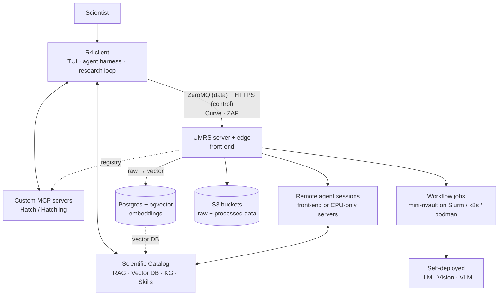
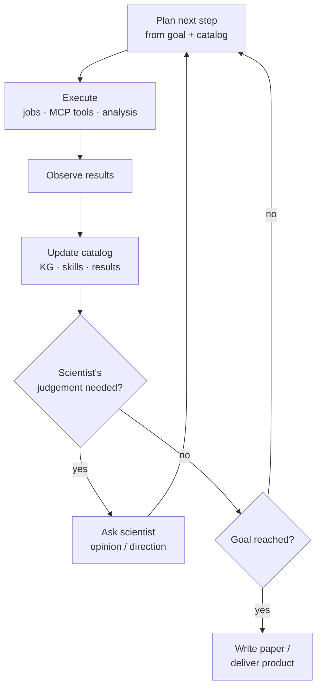
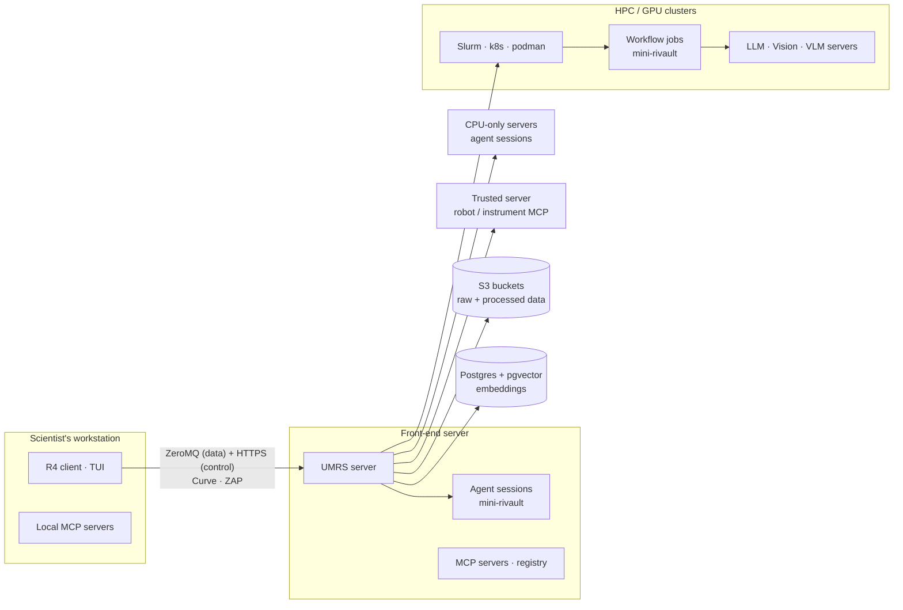
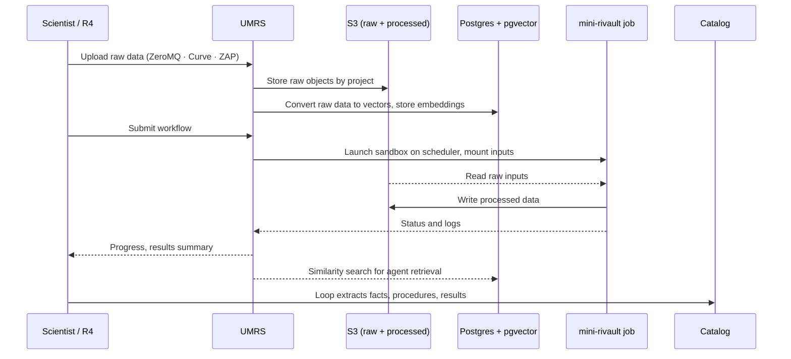

<!--
Status: CANONICAL DESIGN — the target the platform is built toward.
Adopted: 2026-09-22 (moved from the repo-root draft `updated_concepts.md` unchanged).
Companions: R4-UMRS-GAP-ANALYSIS-2026-09-22.md (design vs code), R4-UMRS-PLATFORM-OVERVIEW.md (what runs today), ../ROADMAP.md (order of closing the gaps).
Change rule: edits to this file are design decisions — record them as a dated ADR (docs/adr) and update the gap analysis in the same wave.
-->

# R4 + UMRS — Project Design Overview

2026-09-22 · RIKEN R-CCS

## Vision and purpose

R4 + UMRS is an AI platform and foundation for working scientists. It lets a research group's own knowledge, tools and compute be used directly by AI agents, so that AI augments the efficiency, accuracy and speed of everyday research work.

The target users are scientists whose daily workflow already depends on specialised infrastructure: HPC and GPU clusters, video and image recognition, robotics, instrument control and similar dedicated tooling. These users are experts in their domain but are not, and should not need to become, experts in building AI ingestion pipelines.

The platform has two halves and one shared asset:

- **R4** is the researcher-facing side: the interface, the agent harness, and the autonomous research loop that scientists actually work in.
- **UMRS** is the infrastructure backbone: accounts, secure data transfer, job and session scheduling, and self-deployed models inside sandboxed environments on HPC/GPU clusters.
- **The Scientific Catalog** is the knowledge asset both halves build and consume: a bundle of everything a domain or project knows, grown semi-automatically as scientists work, and exportable to share with the wider community.

The long-term ambition is that a domain's Scientific Catalog becomes rich enough for the LLM to proceed with research autonomously, and finally to write a scientific paper or produce a practical scientific product with the scientist in a supervising role.

## Principal objectives

The project commits to six objectives. Everything in the architecture should trace back to at least one of them.

1. **Augment the scientist.** Raise the efficiency, accuracy and speed of research activities that use HPC, vision/VLM, robotics and other dedicated tools, without forcing the scientist to change how they work.
2. **Make domain-knowledge ingestion easy.** Provide a fast, low-effort path from a group's research materials to LLM-usable knowledge: RAG, vector DB, knowledge graph, skills, custom MCP servers, and the Scientific Catalog that bundles them.
3. **Grow knowledge as a by-product of work.** The Scientific Catalog, especially its knowledge graph, is built and expanded semi-automatically from the conversations and completed tasks of the autonomous research loop, not by a separate curation effort.
4. **Reach autonomous research.** Through that loop the LLM self-educates in the domain until it can run research largely on its own, asking the scientist for opinion or direction at decision points, and finally write a paper or deliver a practical scientific product.
5. **Propagate knowledge across the community.** A Scientific Catalog can be exported as a bundle and shared, so achieved knowledge moves from one group to the wider field and accelerates science as a whole.
6. **Run securely on the scientist's own infrastructure.** Models, agents and data stay within the institution: self-deployed LLM/Vision/VLM in firewalled sandboxes (mini-rivault) on existing schedulers, with authenticated, encrypted data transfer (ZeroMQ/Curve/ZAP) and controlled storage (S3 for raw and processed data, Postgres + pgvector for the vector embeddings UMRS derives from raw data).

## Why a general LLM is not enough

A general-purpose LLM assistant knows the public literature but knows nothing about a specific group's work. Scientists carry three kinds of knowledge that a general model cannot reach:

| Kind of knowledge | Examples | What the LLM needs |
| --- | --- | --- |
| Domain materials | Papers, theses, lab notes, datasets, measurement logs, images and video | Ingestion into RAG / vector DB / knowledge graph |
| Tacit know-how | How this group runs an experiment, which parameters matter, what failures look like | Skills and a knowledge graph that capture procedures and relationships |
| Dedicated tools | Robot controllers, instrument APIs, HPC job scripts, in-house analysis codes | Custom MCP servers so the agent can call them safely |

Building this ingestion pipeline is itself a specialist engineering job: choosing chunking and embedding strategies, designing graph schemas, wrapping tools as MCP servers, deploying models near the data. Most research groups have neither the time nor the staff to do this well.

R4 + UMRS exists to remove that barrier. The platform provides the pipeline as a product: the scientist supplies materials and answers questions; the platform turns them into a Scientific Catalog the agents can use, and keeps that catalog growing as work proceeds.

## System architecture at a glance

The system has four pillars: R4 (where the scientist works), UMRS (where compute, data and models live), the Scientific Catalog (what the agents know), and custom MCP servers (what the agents can do). R4 talks to UMRS over authenticated, encrypted channels only: a ZeroMQ channel (CurveZMQ + ZAP) for the data plane and HTTPS to UMRS's edge process for the control plane (ADR-059); everything heavy runs behind UMRS.

Read top-down: the scientist drives R4; R4 draws on the catalog and MCP tools locally, and sends jobs, agent sessions and data to UMRS, which places them in sandboxes on the clusters and stores results.

| Pillar | Role | Where it runs |
| --- | --- | --- |
| R4 | User interface, agent harness, skills, context control, multi-agent teams, local/remote session control, project and workflow management, autonomous research/engineering loop | Scientist's workstation; remote sessions on the front-end or CPU-only servers |
| UMRS | Account management, secure data transfer, workflow job scheduling, remote agent session scheduling, self-deployment of LLM/Vision/VLM in mini-rivault sandboxes, data storage | Front-end server, dispatching to HPC/GPU clusters and dedicated servers |
| Scientific Catalog | Bundle of RAG index, vector DB, knowledge graph, skills, MCP server definitions and source materials for a domain or project; exportable and shareable | Built through R4 and UMRS; materials and outputs in S3, vector index in Postgres + pgvector |
| Custom MCP servers | Wrap a group's dedicated tools (robotics, instruments, HPC scripts, analysis codes) so agents can call them | Local, front-end, or a dedicated trusted server; managed by Hatch/Hatchling |

## R4: the researcher-facing agent environment

R4 is the whole user-facing layer of the platform. A scientist opens R4 in a terminal and, from there, runs agents, manages projects and workflows, and supervises the autonomous research loop, whether the agents execute locally or as remote sessions under UMRS.

| Capability | What it does |
| --- | --- |
| TUI interface | Terminal UI as the single entry point; works over SSH to the front-end as naturally as on a laptop |
| Agent harness | Runs the LLM agent: tool calling, planning, execution, error recovery, and hand-off between steps |
| Skills | Reusable, versioned procedures (how to run this analysis, how to prepare this dataset) that agents load on demand; skills are also part of the Scientific Catalog |
| Context control | Decides what enters the model's context: catalog retrieval, session history, project state, and budget management for long tasks |
| Multi-agent team-up | Composes several agents with distinct roles (e.g. planner, experimenter, analyst, reviewer) into a team for one task |
| Session control, local and remote | Starts, attaches to, pauses and resumes agent sessions on the local machine or on UMRS-managed remote hosts, with the same UI |
| Project and workflow management | Organises work by project: materials, catalog, workflows, job history and outputs; defines multi-step workflows that UMRS schedules |
| Autonomous research / engineering loop | Iterates plan → execute → observe → update knowledge, pausing to ask the scientist for opinion or direction when needed (see the dedicated section) |

R4 is deliberately thin on infrastructure: it never talks to a scheduler, a bucket or a database directly. All of that goes through UMRS, so the same R4 client works against any institution's cluster once UMRS is deployed there.

## UMRS: the infrastructure backbone

UMRS is the server-side backbone that gives R4 access to accounts, compute, models and storage without exposing any of them directly. One UMRS server runs on the front-end of an institution's cluster and acts as the single trusted gateway for all R4 clients.

| Responsibility | Design |
| --- | --- |
| Account management | Identity, authorisation and per-user/per-project quotas; maps platform users onto cluster accounts |
| Data transfer security | Dual transport, both terminated by UMRS (ADR-059): ZeroMQ data plane with CurveZMQ encryption and ZAP authentication; HTTPS control plane through UMRS's edge process (NGINX + auth sidecar); no plaintext channel |
| Workflow job scheduling | Receives workflows from R4 and submits them to the connected schedulers (Slurm, Kubernetes, Podman) as sandboxed jobs |
| Remote agent session scheduling | Places agent sessions (CPU-only) on the front-end or dedicated CPU servers; tracks lifecycle, attach/detach and resource use |
| Self-deployment of models | Launches LLM, Vision and VLM servers on demand inside mini-rivault sandboxes on GPU nodes; agents call them over the internal network |
| mini-rivault | Firewalled Podman sandbox that wraps every job and model: controlled ingress/egress, mounted data only, no access beyond its allowance |
| Raw data → vector conversion | UMRS chunks and embeds incoming raw data with the platform's models and writes the vectors to Postgres + pgvector, so the catalog's vector DB is a UMRS-managed service |
| Storage management | Raw data and all processed outputs stored as objects in S3 buckets; vector embeddings in Postgres + pgvector; both addressed by project |
| MCP registry | Lists available custom MCP servers; users pull them locally or start them on the front-end or a dedicated server |

**Process model.** The UMRS server process on the front-end is the parent of everything it launches. For a workflow it starts a mini-rivault container through the target scheduler; for an agent session it starts a mini-rivault on the front-end or a CPU-only server. Each sandbox reports back to UMRS, which relays status to the owning R4 session.

**Why self-deployed models.** Research data is often sensitive, large, or both. Running LLM/Vision/VLM inside the institution keeps data on-site, avoids per-token costs at HPC scale, and lets models sit next to the GPUs and the data they process.

## Scientific Catalog: the domain knowledge foundation

A Scientific Catalog is the complete, portable bundle of what the platform knows about one scientific domain or one project. It is the unit of knowledge in R4 + UMRS: agents load it to become domain-competent, the research loop writes back into it, and a group exports it to share with others.

| Component | Content | How it is used by agents |
| --- | --- | --- |
| Source materials | Papers, notes, protocols, datasets, images, video, code | Ground truth; re-indexed when the catalog is rebuilt |
| RAG index and vector DB | Chunked materials embedded by UMRS and stored in Postgres + pgvector | Retrieval of relevant passages into context |
| Knowledge graph | Entities, relationships, procedures, results and their provenance | Structured reasoning, navigation between concepts, tracking what has been established or tried |
| Skills | Executable procedures written for this domain | Loaded on demand to perform standard tasks correctly |
| MCP server definitions | Which custom tools belong to this domain and how to start them | Gives agents the domain's instruments and codes |
| Metadata | Domain, project, contributors, version, provenance, licence | Discovery, versioning and safe sharing |

**Two ways the catalog grows.**

1. *Explicit ingestion.* The scientist points R4 at materials; R4 hands the materials to UMRS, which lands them in S3 and runs the ingestion pipeline (chunking, embedding into Postgres + pgvector, entity and relation extraction, skill scaffolding) with minimal configuration. This is the fast on-ramp.
2. *Semi-automatic growth from work.* Every cycle of the autonomous research loop produces new facts, relationships, procedures and results. R4 extracts these from the agent's work and from its exchanges with the scientist and adds them to the knowledge graph and skills, proposing rather than silently committing where a judgement call is involved. Over time the catalog becomes a record of what the group has learned, not only what it read.

**Export and sharing.** A catalog can be exported as a self-contained bundle and imported into another R4 + UMRS installation. This is how achieved scientific knowledge propagates from one group to its community, and how a new group can start from an expert's catalog rather than from zero. The metadata layer carries provenance and licence so shared bundles remain attributable.

## Autonomous research loop and the self-educating knowledge graph

The research loop is the engine that turns everyday work into accumulated knowledge and, eventually, into autonomous research. R4 iterates the loop; UMRS executes the heavy steps; the Scientific Catalog is both the loop's input and its output.

Each cycle plans from the current catalog, executes through UMRS and MCP tools, observes, and writes what it learned back into the knowledge graph and skills before deciding whether to continue, ask, or conclude.

**How the LLM self-educates.** The base model is never fine-tuned by default. Its competence grows because the catalog grows: every cycle adds entities, relationships, tested procedures, negative results and open questions to the knowledge graph, and promotes reliable procedures into skills. Retrieval and context control then place this accumulated knowledge in front of the model on the next cycle. The scientist's answers to the loop's questions are captured the same way, so tacit know-how enters the graph through ordinary conversation.

**Human in the loop by design.** The loop pauses for the scientist when a step is costly (large cluster time, physical robot action), ambiguous (competing hypotheses), or consequential (changing the research direction). How often it pauses is a per-project setting and should fall naturally as the catalog matures.

| Maturity stage | Catalog state | Agent behaviour | Scientist's role |
| --- | --- | --- | --- |
| Bootstrapped | Explicit ingestion only | Assists with single tasks | Directs every step |
| Learning | KG growing from loop cycles | Runs multi-step tasks; asks often | Reviews results, answers questions |
| Competent | Dense KG, validated skills | Runs experiments end-to-end; asks at decision points | Supervises, sets direction |
| Autonomous | Catalog covers the domain | Proceeds independently; drafts paper or product | Validates, reviews, co-authors |

The end state of a project is a scientific paper or a practical product of science produced largely by the loop, with the scientist as reviewer and author of record, and a catalog that can be exported so others start from the same level.

## Custom MCP servers via Hatch/Hatchling

Custom MCP servers are how a group's dedicated tools become callable by agents. A robot controller, an instrument API, an in-house simulation code or a set of HPC job templates is wrapped once as an MCP server; after that any R4 agent in any project can use it through the standard Model Context Protocol.

**Hatch and Hatchling** realise this capability. Hatch is the framework for building, packaging and publishing MCP servers; Hatchling is the runtime that discovers, pulls and starts them where the user chooses. Together they give the MCP layer the same pull-and-run experience as a package manager.

| Aspect | Design |
| --- | --- |
| Registry | UMRS on the front-end lists the MCP servers available to the institution, with version, owner and required placement |
| Placement options | Pull and run locally on the scientist's machine; start on the front-end server; start on a dedicated connected trusted server (e.g. the host wired to a robot or instrument) |
| Trust boundary | Servers that touch physical hardware or sensitive systems run only on their designated trusted host; agents reach them through UMRS, never directly from the sandbox |
| Catalog link | A Scientific Catalog names the MCP servers its domain relies on, so importing a catalog also tells Hatchling what to fetch |
| Lifecycle | Hatchling starts, health-checks, restarts and stops servers; UMRS accounts for them like any other session |

The intended effect is that tool integration becomes a one-time, shareable act: one lab wraps its microscope, publishes the server to the registry and bundles its definition into the catalog, and every collaborator's agents can drive that microscope class of instrument afterwards.

## Deployment topology

One UMRS server on the institution's front-end is the hub; every other host is reached through it. GPU work goes to the clusters, CPU-only agent sessions go to the front-end or dedicated CPU servers, and hardware-bound MCP servers stay on their trusted hosts.

The client holds only R4 and any MCP servers the user pulled locally; all scheduling, model hosting and storage sit behind the front-end.

| Host | Runs | Profile | Notes |
| --- | --- | --- | --- |
| Scientist's workstation | R4 client, optional local MCP servers, local agent sessions | Laptop / desktop | Only outbound connections are the ZeroMQ data channel and HTTPS to UMRS's edge (ADR-059). *2026-10-30 (ADR-101):* the processes a local session starts (shell, Python, code tools, language servers, local MCP servers) may run in the opt-in local tool sandbox; its egress proxy binds loopback only, so this row stays true |
| Front-end server | UMRS server + edge process, MCP registry, front-end MCP servers, CPU agent sessions in mini-rivault | CPU, network-facing | Single trusted gateway (edge + server together, ADR-059); parent process of all launched sandboxes |
| HPC / GPU clusters | Workflow jobs and self-deployed LLM / Vision / VLM servers, each in mini-rivault, via Slurm, Kubernetes or Podman | GPU + high-memory nodes | Several clusters can be connected to one UMRS |
| CPU-only dedicated servers | Remote agent sessions when the front-end is saturated | CPU | Agents need no GPU; models are called over the network |
| Trusted dedicated servers | MCP servers bound to robots, instruments or restricted systems | Varies | Hardware access never leaves this host |
| Storage | S3 buckets for raw and processed data; Postgres + pgvector for vector embeddings | Object + relational/vector | Addressed by project; written only through UMRS |

## Data flow and security model

Data moves in one direction by default: from the scientist's side into UMRS-controlled storage, then into sandboxed compute, with results written back to storage and summarised into the catalog. Nothing crosses a boundary without authentication, and nothing runs outside a sandbox.

*2026-10-30 (ADR-101):* "nothing runs outside a sandbox" holds for everything UMRS launches (jobs, model servers, remote agent sessions; CONSTITUTION §2.1, gap D-12). On the scientist's workstation the process sandbox is opt-in: a local session's shell, Python, code tools, language servers and local MCP servers run in the local tool sandbox only when the user turns it on (default off, announced at every session open; gap D-65).

Raw data lands in S3 and is vectorised by UMRS into Postgres + pgvector; jobs process it only inside a mini-rivault and write their outputs back to S3; the research loop then distils those outputs into the catalog.

| Layer | Mechanism | Guarantee |
| --- | --- | --- |
| Transport | Dual: ZeroMQ data plane with CurveZMQ (Curve25519) encryption; HTTPS control plane terminated at UMRS's edge process (ADR-059) | Confidentiality and integrity of every client–server message |
| Authentication | ZAP (ZeroMQ Authentication Protocol) with per-user keys managed by UMRS accounts on the data plane; JWT verified at UMRS's edge on the control plane | Only enrolled users and hosts can connect; every message is attributable |
| Execution isolation | mini-rivault: firewalled Podman sandbox per job, session or model server | Jobs see only mounted data and permitted endpoints; no lateral movement |
| Execution isolation, workstation (*2026-10-30, ADR-101*) | Local tool sandbox, opt-in: bubblewrap (Linux) or Seatbelt (macOS) around the processes a local session starts; network only through R4's loopback proxy, which follows the session's web access (local MCP servers: their own per-server entry, default none; hatch runtimes keep the host network) | With it on, for those processes (not R4's own file tools): writes confined to the workspace, the listed credential stores and secret env names unreadable, web limited to the session's choice. Off by default and announced; not a mini-rivault |
| Storage access | S3 and Postgres reachable only from UMRS and from sandboxes it launches, scoped by project | Data never exposed directly to clients or to the wider cluster |
| Model locality | LLM / Vision / VLM self-deployed inside the institution; per-project data-class flag (ADR-062) | Research data never leaves the site for inference; public providers only for projects flagged non-sensitive |
| Tool access | MCP servers for hardware run on trusted hosts and are reached through UMRS | Agents cannot bypass the gateway to touch instruments |
| Sharing | Catalog export is an explicit, metadata-carrying bundle | Knowledge is shared deliberately, with provenance and licence attached |

The intent is that an institution's security team can reason about the platform as one gateway (UMRS: server + edge process, ADR-059), one sandbox type (mini-rivault), one authenticated transport pair (ZeroMQ/Curve/ZAP data plane + HTTPS control plane) and two stores (S3, Postgres + pgvector). *2026-10-30 (ADR-101):* one server-side sandbox type; the workstation adds the opt-in local tool sandbox, which is client-side, R4-parented and not a mini-rivault or a sixth ADR-061 profile.

## End-to-end scenario: a research project lifecycle

A materials-science group wants to automate defect analysis of microscope video and eventually publish on a new defect class. Here is how the project moves through the platform from day one to paper.

1. **Enrol and set up.** The lead scientist gets a UMRS account; the front-end already has an LLM and a VLM deployable in mini-rivault. In R4 they create a project and start a fresh Scientific Catalog.
2. **Ingest.** They point R4 at the group's papers, protocols, past analysis notebooks and a sample of labelled videos. R4 hands them to UMRS, which lands them in S3, converts them to vector embeddings in Postgres + pgvector, and builds the first knowledge graph and skill scaffolds for the group's standard analysis steps.
3. **Wire the tools.** From the UMRS registry, Hatchling pulls the group's image-processing MCP server to the front-end and starts the microscope-control MCP server on the trusted lab host.
4. **First assisted tasks.** Through the TUI the scientist asks an agent to re-run a known analysis on new footage. R4 packages it as a workflow; UMRS uploads the raw video to S3, launches a mini-rivault job on the GPU cluster with the VLM, and writes the segmented video and detection records back to S3. The scientist checks the output; corrections go into the catalog.
5. **Loop begins.** With the catalog now covering the group's methods, the scientist sets a research goal: characterise defects that current classifiers miss. A multi-agent team (planner, experimenter, analyst, reviewer) runs the autonomous loop, submitting batches of jobs, updating the knowledge graph with each result, and pausing to ask the scientist when it proposes a new defect category or a costly acquisition run.
6. **Catalog matures.** After many cycles the knowledge graph holds the defect taxonomy, the parameter sensitivities, the failed hypotheses and the validated procedures. The loop asks less often; the scientist reviews weekly summaries instead of every step.
7. **Output.** The loop drafts the paper from the catalog: methods from skills, results and figures from processed data in S3, related work from the RAG index. The scientist edits, validates and submits.
8. **Share.** The group exports the catalog as a bundle. A collaborating lab imports it, and its agents start at the competent stage rather than from scratch.

The same lifecycle applies to robotics or HPC-simulation projects; only the MCP servers, model types and data formats change.

## Glossary

| Term | Meaning in this project |
| --- | --- |
| R4 | The researcher-facing layer: TUI, agent harness, skills, context control, multi-agent teams, session control, project/workflow management, autonomous research loop |
| UMRS | The backbone: accounts, secure transfer, job and session scheduling, self-deployed models, sandboxing, storage, MCP registry |
| Scientific Catalog | Portable bundle of a domain's or project's knowledge: materials, RAG/vector index, knowledge graph, skills, MCP definitions, metadata |
| Knowledge graph (KG) | Structured store of entities, relationships, procedures, results and provenance inside a catalog; grows semi-automatically from the research loop |
| RAG / vector DB | Retrieval-augmented generation over embedded materials; supplies relevant passages to the model's context |
| Skill | Reusable, versioned procedure an agent loads to perform a standard task correctly |
| MCP / custom MCP server | Model Context Protocol; a custom server wraps a group's dedicated tool so agents can call it |
| Hatch / Hatchling | Framework for building and publishing MCP servers (Hatch) and runtime for discovering, pulling and running them (Hatchling) |
| mini-rivault | Firewalled Podman sandbox in which UMRS runs every job, agent session and model server. Canonical spellings (decided 2026-09-22, gap row D-53): **R4**, **UMRS**, **mini-RiVault**; identifier form `mini-rivault`; expansions unsettled — the names are the names. Five named profiles: gpu-job, cpu-agent, model-server, embedding-job, mcp-trusted (ADR-061). *2026-10-30 (ADR-101):* "every agent session" means every session UMRS runs; a local session's processes use the local tool sandbox below, when it is on |
| Local tool sandbox | *Added 2026-10-30 (ADR-101, gap row D-65).* R4's opt-in OS wrapper on the scientist's workstation (bubblewrap on Linux, Seatbelt on macOS) around the processes a local agent session starts: shell, Python, code and test tools, language servers, local stdio MCP servers and hatch runtimes. Off by default and announced at every session open; `/sandbox on` or `r4 --sandbox on` turns it on. Client-side and R4-parented: not a mini-rivault and not an ADR-061 profile |
| Autonomous research / engineering loop | R4's plan → execute → observe → update-catalog cycle that pauses for the scientist's judgement and ends in a paper or product |
| Multi-agent team-up | Several role-specialised agents composed by R4 to work on one task |
| Context control | R4's management of what enters the model context: retrieval, history, project state, budget |
| Remote agent session | An R4 agent session scheduled by UMRS on the front-end or a CPU-only server, attachable from the TUI |
| Workflow | A multi-step, schedulable unit of work defined in R4 and executed by UMRS on a cluster |
| ZeroMQ / Curve / ZAP | Messaging library, its Curve25519-based encryption, and its authentication protocol; the platform's client–server data plane (the control plane travels over HTTPS to UMRS's edge process — ADR-059) |
| S3 buckets / Postgres + pgvector | Object storage for raw and processed data; Postgres with the pgvector extension holds the vector embeddings UMRS produces from raw data, written only through UMRS |
| Front-end server | The cluster's login/gateway host where the UMRS server runs |
| Trusted dedicated server | A host authorised to run MCP servers bound to robots, instruments or restricted systems |

## Open design questions

The description above is consistent, but a clean-up is the moment to settle the points it leaves open. Each item below is a decision, not a feature.

- [ ] **Catalog format and versioning.** Define the bundle layout, the knowledge-graph schema (property graph vs RDF), and how an imported catalog from an older version is upgraded.
- [ ] **Governance of semi-automatic KG growth.** Decide what the loop may commit to the catalog on its own, what it must propose for review, how negative results and retracted facts are recorded, and how bad knowledge is rolled back.
- [ ] **Ask-the-scientist policy.** Specify the triggers for a pause (cluster cost, physical action, competing hypotheses, direction change) and whether thresholds are per project, per user, or per catalog maturity stage.
- [x] **Where the knowledge graph lives.** DECIDED 2026-09-22 (ADR-063): Postgres relational tables + registry + ontology CTE closure; no graph DB. Remaining: how remote agent sessions reach the graph and vectors (gap row D-42).
- [ ] **Embedding pipeline.** Which embedding models UMRS uses for text, image and video in raw → vector conversion, the chunking rules per data type, and the re-embedding policy when a model changes.
- [ ] **pgvector at scale.** Index type (HNSW vs IVFFlat), expected vector counts per project, partitioning by project or catalog, and the point at which one Postgres instance is no longer enough.
- [x] **Metadata home.** DECIDED 2026-09-22 (ADR-063): Postgres for jobs, accounts (moving from JSON), catalog metadata and provenance; S3 for blobs; rows describing S3 objects carry URI + checksum.
- [ ] **Model strategy.** Choose the serving stack, GPU allocation policy for concurrent LLM / Vision / VLM servers, and whether any fine-tuning is allowed or competence comes only from the catalog.
- [ ] **Internal inference API.** One model-serving contract for all LLM / Vision / VLM / embedding servers so agents do not depend on which backend runs, with model versions recorded in the catalog.
- [ ] **Workflow definition ownership.** Fix which side owns the workflow / DAG format (R4 authors it, UMRS executes it) and how job templates from MCP servers plug into it.
- [x] **Identity mapping.** DECIDED 2026-09-22 (ADR-063): per target — Slurm per-user account with optional SSH delegation, S3 attempt-scoped STS, k8s service account.
- [x] **Session durability.** DECIDED 2026-09-22 (ADR-063): the Postgres session journal is the authority; SQLite is a rebuildable read-model. Chat-turn authority completes under ADR-057; remote sessions checkpoint per turn.
- [ ] **Budgets for the autonomous loop.** GPU-hour and wall-clock caps per project, hard stops, and who is notified when a run reaches them.
- [ ] **Catalog quality measurement.** How to know a knowledge graph is improving: domain benchmarks, regression tests for skills, acceptance rate of the loop's proposals.
- [ ] **Observability.** Tracing of agent decisions and tool calls so a whole loop run can be replayed and audited.
- [ ] **MCP trust classes.** Define classes of MCP servers (local-safe, front-end, trusted-host-only), who may publish to the registry, and how a catalog declares the class each of its servers needs.
- [ ] **Cross-institution sharing.** Confirm that sharing is export/import of bundles only, or whether live federation between UMRS servers (accounts, catalogs, registries) is in scope.
- [ ] **Export redaction.** Which parts of a catalog must never leave the site (unpublished results, embargoed or personal data) and how export enforces that.
- [ ] **Provenance for paper and product output.** Require that every claim in a generated paper links back to job ids, S3 objects and catalog entries, and decide how that trail is stored.
- [x] **Naming.** DECIDED 2026-09-22 (gap row D-53): canonical spellings **R4**, **UMRS**, **mini-RiVault** (identifier `mini-rivault`); expansions unsettled — 'R4' and 'UMRS' are the names.

## Design suggestions

These are recommendations, not decisions. Each one is meant to close an open question above with a single mechanism rather than a new feature.

1. **Make the catalog the unit of reproducibility.** Immutable catalog versions with a changelog; every job, result and paper claim pinned to catalog version + model version + MCP server version + job id. Export, rollback and provenance then come from one mechanism.
2. **Two-tier knowledge in the KG.** Loop-generated facts enter as *proposed* with a confidence score and evidence links; they become *established* only after scientist approval or repeated independent confirmation. This answers governance structurally instead of by policy text.
3. **Postgres as the system of record for metadata.** Postgres is already deployed for pgvector; use it for job records, account data, catalog metadata and provenance too, with every row that describes an S3 object carrying its URI and checksum. Objects stay in S3; the index of what exists stays in one queryable place.
4. **Version every embedding by model.** Each vector row carries the embedding model id and version. A catalog export includes that id so an importer can either reuse the vectors or re-embed with its own model, and a model upgrade becomes a tracked re-embedding job rather than a silent break.
5. **A versioned R4–UMRS protocol.** Treat the ZeroMQ message schema as a public, versioned API. R4 and UMRS can evolve separately, and other clients (web UI, notebooks) become possible later.
6. **Sandbox profiles for mini-rivault.** A few named profiles (gpu-job, cpu-agent, model-server, embedding-job, mcp-trusted), each with a declared egress allowlist and mounts. MCP trust classes then map directly onto profiles. **ADOPTED 2026-09-22 as ADR-061.**
7. **Scheduler-agnostic, declarative workflows.** A DAG format that R4 authors and UMRS translates per scheduler, able to import existing Snakemake/Nextflow/CWL-style pipelines so groups keep their current jobs.
8. **Skills as tested code.** A skill is instructions plus optional scripts plus tests; the loop may propose skill edits but they merge only when tests pass.
9. **Asynchronous questions to the scientist.** An inbox in the TUI where loop questions queue; the loop keeps working on branches that do not depend on the answer.
10. **An independent reviewer agent.** Use a different model or held-out data for the reviewer role to reduce self-confirmation inside the loop.
11. **A catalog registry with citable identifiers.** Mirror the MCP registry for shared catalogs, with DOI-like ids so a paper can cite the exact catalog version it came from.
