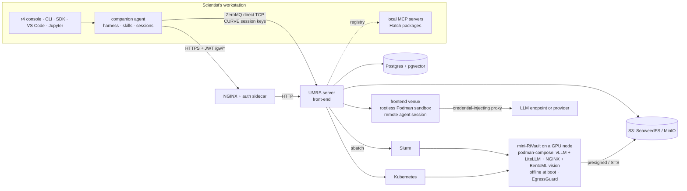

# R4 + UMRS Platform — What Runs Today

**Status as of 2026-09-22** (fact-verified against parent `91996611` / umrs `0aa92cde`, release line `0.2.0rc1`). · Scope: the implementation — what runs, where the code lives, how it is deployed and tested, and the current queue. The *target* is [R4-UMRS-DESIGN.md](R4-UMRS-DESIGN.md); the distance between the two is [R4-UMRS-GAP-ANALYSIS-2026-09-22.md](R4-UMRS-GAP-ANALYSIS-2026-09-22.md) (rows cited as `D-nn`). Every section ends with pointers to the home docs and ADRs.

---

## 1. What it is, in one paragraph

An AI platform for working scientists: **R4** is the researcher-facing agent
environment (console, agent harness, skills, sessions, projects, research
loop); **UMRS** is the backbone on the cluster front-end (accounts, secure
transfer, durable jobs and scheduling on Slurm / Kubernetes / Podman,
self-deployed models in sandboxes, S3 + Postgres/pgvector storage, MCP
registry); the **Scientific Catalog** is the knowledge bundle both build and
consume. Everything runs inside the institution. Today the catalog exists as
its parts (knowledge spine, vectors, data catalog, skills and MCP registries,
signed `.kb` bundle) rather than as one object (D-39).

## 2. The map today

Read: the console talks to the companion on the workstation; the companion
reaches UMRS over HTTPS through the edge (control plane) and over ZeroMQ
(files, jobs, models, workflows); UMRS is the parent of every job, model
server and remote session it launches.

**Transport today** (D-01): HTTPS through the edge is mandatory for chat,
MCP and every knowledge/session/catalog/project family; ZeroMQ (control
50110 + data 50111–50118 on umrs-front, direct TCP, no SSH tunnels) carries
files, jobs, models, workflows and embedding export when the client's
transport mode allows (`r4/src/r4/config.py`). CURVE session keys are minted
at `r4 auth login` from the JWT; umrs-front runs ZeroMQ auth in `session`
mode. ADR-001, ADR-003, ADR-014, ADR-018.

**The three durable planes**

| Plane | Authority | Lives in |
|---|---|---|
| Postgres (+ pgvector) | jobs, attempts, endpoints, models, projects, knowledge graph + vectors, data catalog, session journal, trust, grants, audit, A2L | `umrs/src/umrs/migrations/` (0001–0100) |
| S3 | raw uploads, attempt-scoped outputs, bundles, RAG payloads | `S3_BACKEND` abstraction (ADR-055): SeaweedFS on umrs-front since 2026-09-14, MinIO on the other profiles (D-17); since 2026-10-01 a project may bind its own object store / Postgres by locator (ADR-077; files API, workflow runs and artifacts follow it; test pair on rccs login1, `umrs/deploy/extdb/`); presigned URLs internal to compute; per-user `s3cfg` still delivered at login (D-16) |
| User records | role, Slurm accounts, projects, quota | JSON files under the server's `user_files/` (D-06) |

## 3. Elements — purpose · how it works · code · production · gaps

### 3.1 R4 console and CLI (the user plane)

- **Purpose**: the surface researchers live in. `r4 console` is the primary surface (OpenTUI v3 binary; routes `work`, `tasks`, `knowledge`, `catalog`, `sessions`, `loop`, `research`, `code`, `infrastructure`, `settings`); the CLI (`r4/src/r4/_cli/`, about 65 groups) is the scripting surface; VS Code extension, web console and Jupyter magic are secondary (D-25).
- **How it works**: `r4 console` runs the checkout's Bun source when `r4` comes from a set-up checkout (`make install`; since 2026-09-25), else the compiled binary (`r4 tui install`, sha256-checked); bridge protocol v1 over JSONL to the Python companion; editor clients attach via `r4 acp` (ADR-042).
- **Code**: `packages/r4-tui-v3/`, `r4/src/r4/_cli/`, `r4/src/r4/client.py` + sub-clients (`rag`, `data`, `mcp`, `job`, `models`, `workflows`, `vision`).
- **Production**: per-platform binaries on the GitHub release (`v0.2.0-rc1`, 8 assets).

Links: [console README](../packages/r4-tui-v3/README.md) · [Console reference](r4/TUI_REFERENCE.md) · [CLI reference](user-manual/13-cli-reference.md) · core-flows UI plan

### 3.2 Companion agent, skills, context, sessions

- **Purpose**: the agent harness of the design (D-26, D-28): tool calling, planning, execution, error recovery, sub-agents, permission ladder, environment probe, feed-forward guides, quality sensors, steering.
- **Skills**: Agent Skills `SKILL.md` format everywhere — 27 builtin groups in `r4/src/r4/companion/builtin/` (research, research_loop, teamup, hpc, umrs, workflow_ops, model_management, vision, paper-writing skills, …), user skills under `~/.config/r4/…/skills/`, project skills under `.r4/skills/`; UMRS skill registry (`/umrs/skills`). Not yet part of the catalog bundle; no per-skill tests (D-27).
- **Context**: token budget derived from the active model, compaction at 80 %, catalog retrieval with graph selection (`knowledge_selection.py`), acquisition write gate (`open` / `pinned` / `disabled`).
- **Sessions**: SQLite store on the workstation mirrored to Postgres (`companion_session_snapshots`, migration 0080); archive cascades trust revocation (0079); chat-turn identity and `fork(from_turn)` are ADR-057 (Proposed) — two authorities remain (review F2, D-30).
- **Authorization ladder** (2026-11-09, ADR-104 amendment 3): modes derive as `chat|plan → auto_safe` and `autopilot → trust`. Chat/plan auto-run read-only tools and ask for other calls; autopilot auto-answers every local non-deletion permission prompt with an audit note, including taint and optional organisation-policy prompts, but asks before recognised user-file deletion/worktree removal. Explicit denies and backend/sandbox authorization remain; `knowledge_graph_decide` never manufactures a human approval and UMRS's actor/proposal rules still decide whether a mutation is legal.
- **Code**: `r4/src/r4/companion/` (`agent.py`, `tools.py`, `permissions.py`, `context.py`, `context_budget.py`, `skills.py`, `session*.py`, `harness/`, `knowledge_tools.py`, `knowledge_graph_tools.py`, `knowledge_write_gate.py`), `umrs/src/umrs/companion_trust/`.

Links: [companion rules](../.github/instructions/companion.instructions.md) · ADR-028 · ADR-035 · ADR-037 · ADR-039 · ADR-050 · ADR-057

### 3.3 Remote agent sessions (frontend venue) and the inference proxy

- **Purpose**: the design's remote agent session (D-09): a CPU-only sandbox on the front-end running the same companion, attachable from the console, never holding a user JWT or a provider key.
- **How it works** (ADR-046 Amendment 2, landed repo-side 2026-09-21): `POST /umrs/companion/sessions/{sid}/venue/start` submits a durable `frontend_session` job; the worker (`r4 venue worker`) runs in a rootless Podman sandbox on `egress-net`, passes a D-7 isolation self-test, pulls the owner's mirrored snapshot through a lease-token rail, runs queued turns, heartbeats partial text, raises tool approvals as durable T4 intents the owner answers from any client; the rail re-dispatches only the `workflows` and `jobs` families with minted identity (`RAIL_GW_FAMILIES`, D-42); provider calls exit through the credential-injecting inference proxy (`umrs/src/umrs/infer_proxy/`) that unseals the sealed source per request.
- **Code**: `umrs/src/umrs/venues/`, `umrs/src/umrs/api/companion_venue.py`, `umrs/src/umrs/jobs/frontend_session_backend.py`, `r4/src/r4/venue_worker.py`, `venue_rail.py`, `venue.py`; TUI picker/watcher; Ansible `frontend-venue*.yaml` (keypair, `egress-net`, pinned images, `umrs-infer`).
- **Production**: live legs (converge with tag `frontend_venue`, first session-start receipt) are owner-side; the nftables egress guard is privileged and opt-in (rootless has no host filter). Venues are `frontend` and `cluster:<name>`; no pause/resume; no CPU-only or trusted-host venue (D-48, D-49).

Links: remote-session TUI wave · credential/egress plan · ADR-046 · ADR-051

### 3.4 Research loop, teams, projects, workflows

- **Loop (D-32)**: the server-hosted engine `umrs/src/umrs/knowledge/loop.py` (goal → plan → retrieve → hypothesis → experiment → analyse → findings → memory) is hosted by the `research_loop_job` kind (ADR-036; one job per loop, attempt = one hosted run, LOST → requeue resumes at the stored iteration); findings are minted as knowledge artifacts with provenance; the cluster-venue leg (`cluster:<site>` → Slurm → `cluster_loop_entry.py`, state back through the `/gw/loopjob/*` HMAC lane) was verified live 2026-09-10. Client-side trackers remain (`companion/science_loop.py`, `research_loop/orchestrator.py`, `agent/research_director.py`). Output is a Markdown report from loop state, not a catalog-grounded paper (D-45). Ask policy and loop budgets do not exist (D-33, D-36).
- **Teams (D-29)**: Team Engine SPI (`packages/r4-teamengine-spi/`, ADR-020 Proposed) with a native engine and a LangGraph adapter (`engines/r4-engine-langgraph/`); older `r4/src/r4/teamup/` (VibeCodeHPC PM/SE/PG/CD) and `research_loop/team.py` (RL/DA/ED/PR prompts, unspawned) still ship; companion sub-agents are a fourth path.
- **Projects (D-31)**: `r4 project create / switch / import / init / verify / readiness / plan / status / loop / export` (`ingest` / `understand` remain as deprecated aliases); durable, self-service projects with owner attribution (ADR-051, `umrs/src/umrs/api/projects.py`).
- **Workflows (D-08)**: R4 authors (`r4 workflow`, `workflow_lint.py`, `workflow_graph.py`), UMRS registers and executes (`umrs/src/umrs/workflow/`, `pipeline_sdk/`, job kind `WORKFLOW_RUN`; schema 2.0.0 with seven step kinds incl. `manual_gate`; ADR-021). Three spines never to be confused: UMRS workflows, the research loop, and the console's local "Research DAG" demo route.

Links: ADR-009 (Proposed) · ADR-016 · ADR-020 · ADR-021 · ADR-036 · [user manual ch. 26](user-manual/26-autonomous-research.md)

### 3.5 UMRS server, durable jobs, orchestration (the backbone)

- **Purpose**: UMRS is the parent of everything it launches and the authority for durable state (D-12 process model).
- **How it works**: `server_umrs.py` boots from `site.yaml` + `.env`, starts the ZeroMQ `MessageQueue` (control + per-user data sockets, CURVE/ZAP when enabled) and the FastAPI HTTP sidecar whose explicit router registry mounts the 26 lane-classified API families (`umrs/src/umrs/server/http_sidecar.py`; ADR-053; `/umrs/context` is the one named dormant family, ADR-056). Jobs follow Job/Attempt semantics with commit pointers, one active attempt per job, LOST-on-restart + requeue, per-attempt execution manifests and executor-backed reproduce (ADR-002 + amendment). Job kinds: index build, embedding batch, pipeline run, workflow run, endpoint provision/upgrade, model download, data ingestion, knowledge ingest/understand/embed/verify/export/reindex, companion worker, frontend session, research loop, vision infer, batch infer, model eval, fine-tune (dispatch gated; ADR-044, ADR-047).
- **Orchestration**: one `execution_authority` per job (ADR-004); Slurm path = `slurm_podman_backend.py` submitting the site's `serve-model.slurm` wrapper which runs podman-compose profiles (`harness`, `vllm`, `vision-bentoml`) on the node; `slurm_backend.py` (Singularity) is legacy but present (D-12); `kubernetes_backend.py`; `compose_backend.py` (single-host dev); hybrid composer; site profiles under `orchestrator/site_profiles/` (ADR-045 venue portability: job-private podman config, private network pool, dead-job GC, shared-filesystem image staging).
- **Accounts and policy**: user JSON records + `umrs-server admin` (enroll, tokens, Slurm account binding); per-user Slurm accounting (`--account=`), optional per-user SSH delegation; agent CPU-process cap per user, disk cap (ADR-051); asset and source grants (ADR-041); companion trust (ADR-035). Per-project GPU-hour budgets do not exist (D-36).
- **Code**: `umrs/src/server_umrs.py`, `umrs/src/umrs/{core,server,api,jobs,orchestrator,admin,shared,grants,companion_trust,scheduler,slurm}`.
- **Production**: containers via podman compose per profile; umrs-front runs an **independent server per cluster** (D-47).

Links: ADR-002 · ADR-004 · ADR-007 · ADR-008 · ADR-043 · ADR-044 · ADR-045 · ADR-047 · ADR-048 · ADR-053 · ADR-056 · [runtime spec](architecture/runtime/UMRS_CORE_RUNTIME_SPEC.md)

### 3.6 mini-RiVault — models on GPU nodes

- **Purpose**: the design's self-deployed LLM / Vision / VLM servers (D-10): one sandbox per endpoint with its own RAG + MCP + EgressGuard, never a shared always-on daemon.
- **How it works**: a `ENDPOINT_PROVISION` job allocates (Slurm/K8s/Compose), the wrapper launches the compose stack (vLLM + LiteLLM + NGINX + CoreDNS; BentoML vision service for SAM3 / MAE / HMAE), readiness is an explicit probe on `/v1/models`, models are pre-staged and the container asserts offline at boot; tiers `system` (warm, no egress) / `project` / `user` (on-demand, EgressGuard allowlists); UMRS proxies `/umrs/llm/v1/*` to the endpoint's LiteLLM with alias rewriting and usage accounting (`umrs/src/umrs/api/llm.py`). Vision-capable LLM architectures are detected by the model registry and served by vLLM; there is no documented VLM endpoint class yet (D-10) and no single inference contract across LLM / vision / embedding (D-11).
- **Models**: registry with scopes (system/project/user), versions, conversion, certification and capability detection (`umrs/src/umrs/model_registry/`); staging only through `MODEL_DOWNLOAD` durable jobs with allowlisted egress; `r4 model stage / list`, `r4 endpoint up / down / list`.
- **Code**: `umrs/src/umrs/mini-rivault-llm/`, `umrs/src/umrs/orchestrator/`, `umrs/src/umrs/vision_service/`, `umrs/src/umrs/model_registry/`, `umrs/src/umrs/api/{llm,endpoints,models,vision}.py`.
- **Production**: Slurm + podman-compose on RCCS and AI4S nodes; bdrt (dgx-spark) uses netavark, one mini-RiVault per node (static host ports), vendored podman-compose; dedicated builds for hot models.

Links: ADR-006 · ADR-015 · ADR-045 · [mini-RiVault runtime README](../umrs/src/umrs/mini-rivault-llm/README.md) · HPC deployment rules

### 3.7 Knowledge spine, vectors, data catalog, bundles (the catalog's parts)

- **Ingestion (D-38)**: `r4 project import` → `POST /umrs/knowledge/upload` stages bytes at `knowledge-uploads/<project>/…` in S3 and submits `KNOWLEDGE_INGEST` → `KNOWLEDGE_UNDERSTAND` (parse to IR: documents, code, notebooks, OCR) → `KNOWLEDGE_EMBED` (chunks → `knowledge_node_embeddings`) → `KNOWLEDGE_VERIFY` (verifier registry → confidence report, readiness gate). Remote sources (`http_url`, `git_repo`) are fetched only inside egress-controlled ingest jobs (ADR-015). Entity/relation extraction in `umrs/src/umrs/knowledge_graph/`; ontology as a typed contract with a registry table and closure inference (ADR-049; migration 0091).
- **Graph**: `knowledge_nodes` / `knowledge_edges` scoped by `graph_id`, `knowledge_graphs` registry with ownership, lifecycle (archive, never drop) and ontology binding, proposals table (migration 0069); agent mutations pass a server-side guard that requires a recorded user decision; `knowledge_build_from_context` builds knowledge from session history under the acquisition gate (ADR-050); visibility tiers `project | system | ambient` gate reads on the rag / graph / embeddings / catalog lanes (migrations 0092/0093). Two-tier proposed/established, retraction and skill promotion are absent (D-35).
- **Vectors (D-14, D-15)**: Postgres + pgvector — `memory_vectors` (HNSW, cosine) and `knowledge_node_embeddings`; batch embedding in `umrs/src/umrs/inference/embeddings.py` (sentence-transformers; MAE/HMAE/ResNet for tomography and vision); query-time embedder in `api/rag_service.py` (default `all-MiniLM-L6-v2`); `vector_version_store` tracks the producing model and re-embed jobs; hybrid retrieval (vector + BM25, RRF), cross-encoder rerank. Video: modality detection only.
- **Data catalog**: `catalog_objects` (Postgres, migration 0054) with summaries, tags, modality, extracted-text refs, full-text search; `/umrs/catalog/{search,read,stats}`; `asset_index/` read-model for the console `/catalog`; A2L lineage (`umrs/src/umrs/a2l/`, ADR-034). This is the *data* catalog, not the Scientific Catalog (D-39).
- **Bundles (D-40)**: `KNOWLEDGE_EXPORT` job → `r4-kb` v1.2 (artifacts, IR documents, nodes, edges, embeddings, catalog rows, A2L links; SHA-256 manifest hash + HMAC signature); import with integrity verification and project retarget; accepted versions 1.0–1.2. Missing: raw materials, skills, MCP definitions, contributors, licence.
- **Code**: `umrs/src/umrs/knowledge/`, `knowledge_graph/`, `knowledge_model/`, `scientific_memory/`, `embeddings_api/`, `search_api/`, `evidence/`, `experiment_registry/`, `data_catalog/`, `asset_index/`, `a2l/`, `api/knowledge*.py`, `api/catalog*.py`, `api/rag*.py`, `api/bundle_restore.py`; client `r4/src/r4/knowledge*.py`, `knowledge_bundle.py`, `knowledge_explorer/`.

Links: ADR-011 · ADR-013 · ADR-017 · ADR-024 · ADR-026 · ADR-027 · ADR-031 · ADR-032 · ADR-041 · ADR-049 · ADR-050 · [user manual ch. 27–28](user-manual/27-knowledge-management.md)

### 3.8 MCP servers, Hatch registry, EgressGuard

- **Registry (D-19)**: `umrs/src/umrs/mcp/` store + `/umrs/mcp/*` (register, list, tools, lookup, call, health; SSRF guard on server URLs); twin registration converged on `hatch-*` names (ADR-029); companion-only tools stay companion-scoped (ADR-030). No placement or trust-class field (D-21, D-24).
- **Hatch / Hatchling (D-20)**: `r4 mcp hatch search / install / connect / create / share`; packages are a directory with `hatch.json` + `server.py` exposing `create_server()`; the R4 hatch runtime bridge spawns, respawns, times out and audits each package; default registry `mcp-servers/hatch-registry/` with six packages — `platform-tools`, `rag-search`, `knowledge-tools` (loopback HTTP to the platform), `rikyu-hpc`, `rikyu-docs`, `fugaku` (stdio adapters around vendor servers; privileged tools filtered at registration; ADR-022, ADR-023 hardening contract C1–C10). Default runtimes on umrs-front live under `/opt/umrs/mcp-runtimes` (privileged Ansible cadence).
- **Platform MCP servers**: `mcp-servers/src/r4_mcp/servers/` — filesystem, database, webfetch, code, platform, rag-proxy, vision; stdio and SSE transports; capability flags per tool.
- **EgressGuard**: deny-by-default outbound proxy with domain allowlists, content scanning and audit for the only egress-capable classes (`MODEL_DOWNLOAD`, `KNOWLEDGE_INGEST`, project/user-tier endpoints, MCP egress); site-level TCP blocking on Slurm nodes is operator-dependent (PLATFORM_CONTRACT 3.4); convergence of enforcement points is ADR-040 (Proposed).
- **Code**: `umrs/src/umrs/mcp/`, `umrs/src/umrs/api/mcp*.py`, `mcp-servers/`, `r4/src/r4/integrations/hatchling.py`, `r4/src/r4/mcp.py`, `umrs/src/umrs/security/`.

Links: ADR-015 · ADR-022 · ADR-023 · ADR-029 · ADR-030 · ADR-040 · [mcp-servers README](../mcp-servers/README.md) · [hatch-registry README](../mcp-servers/hatch-registry/README.md)

### 3.9 The edge (NGINX + auth sidecar)

- **Purpose today**: the single external entry for HTTP traffic — validates JWTs (admin-issued HS256 or OIDC RS256) via `auth_request`, rate-limits per route class, proxies `/gw/*` to UMRS families, serves validated downloads via X-Accel, mints ZeroMQ session credentials on login, audits to Postgres. Stateless by rule.
- **Design position**: not a design component — the design has UMRS as the single trusted gateway over ZeroMQ. Its future is decision D-02 (fold into UMRS, or declare it UMRS's edge process). Until then it stays and is never bypassed.
- **Code**: `gateway/nginx/` (route table `conf.d/server.conf`), `gateway/sidecar/main.py`; Apache HTTPS reverse proxy on umrs-front port 443 (privileged cadence).

Links: ADR-003 · ADR-014 · [gateway README](../gateway/README.md) · [edge ↔ sidecar boundary](architecture/boundaries/GATEWAY_SIDECAR_BOUNDARY.md)

## 4. Deployments

Rule: Ansible for every managed host, never ad-hoc SSH; host checkouts are read-only deploy inputs (ADR-019 amendment; nightly converge check files an issue on drift). Command canon: deployment-operations.instructions.md. Profiles from `deploy/ansible/bootstrap.sh`: `generic`, `rccs-cloud`, `bdrt`, `octopus`, `atom-k8s`, `umrs-front` (+ per-cluster `umrs-front-{rccs,ai4s,bdrt,octopus}`); deploy roots with site configs under `umrs/deploy/`. *(2026-11-07: the Ansible profiles and the converge workflow belong to the development repository. The public repository ships the stand-alone stack in `deploy/standalone/`; see [chapter 29](user-manual/29-standalone-deployment.md).)*

| Profile | What it is | Notes |
|---|---|---|
| `umrs-front` (data0) | multi-cluster front-end: independent UMRS stack per cluster (RCCS + AI4S live; bdrt + octopus defined), each with its own edge ports, Postgres, object store | two-cadence converge — main (no sudo, must end `rescued=0`) asserts privileged artifacts; a separate privileged run owns Apache TLS and default MCP runtimes; SeaweedFS since 2026-09-14; frontend venue tag `frontend_venue`; rollback var, daily userland backups, `.deployed.json` record; clients use direct-TCP ZeroMQ 50110–50118, never SSH tunnels |
| `rccs-cloud` | login-direct single cluster: UMRS on the login node, Slurm local | recovery runbooks in `docs/admin/operations/` |
| `bdrt` | dgx-spark cluster behind a reverse SSH tunnel from its login node to data0 (ADR-018) | netavark, vendored podman-compose, one mini-RiVault per node |
| `octopus`, `hpbd-atom` | satellite profiles | same component set |
| `atom-k8s` | Kubernetes profile (Kind/K3s) | `k8s` execution authority |
| `n8n/` | optional workflow-automation bridge calling the edge routes | not in the core deploy graph |

Environment principle: every deployment is `site.yaml` + `.env`; changing scale is config, not code.

## 5. Testing and governance

- **Validators**: 24 registered in `tools/enforcement_maturity_scorer.py`, scorecard `A:24 B:0 C:0 D:0`, 390 tests (run 2026-09-22); includes import boundaries, contracts fence, DTO equivalence, schema version tracker, stale names, config drift, exemption governance, traceability, ADR linkage, doc sanity gate, complexity and lint baselines (ratchets, ADR-052), import hygiene (ADR-053), surface characterization.
- **Local gate**: `bash scripts/ci-lint-local.sh` — secret scan → ruff lint + format → complexity (max 9, xenon, lizard, shellcheck) → boundary validators → component-scoped pytest; `--umrs-changed` runs the submodule diff between pointers. Must print `ALL CHECKS PASSED` ([developer.md §3](onboarding/developer.md#3-first-green-gate)).
- **GitHub CI**: `ci.yaml` on a self-hosted runner; nightly E2E, compose E2E, demo CI, container builds, TUI binaries; `converge-umrs-front.yaml` (`workflow_dispatch` check/apply + nightly no-op check). *(2026-11-07: this describes the development repository's CI. The public repository runs only `.github/workflows/ci.yaml`, on GitHub-hosted runners.)*
- **Suite sizes (last recorded runs)**: r4 3,332 (2026-09-21), umrs 5,142 with one pre-existing env-red (`test_connection_profiles` when a host `s3_url` is present in `~/.config/umrs/connections/`) (2026-09-21), bun console 1,044 (2026-09-21), repo-root belt 1,299 pass / 207 skipped (2026-09-15; E2E lanes opt in with `R4_RUN_E2E=1`, ADR-054), gateway sidecar 30, r4-contracts 179, mcp-servers 202 (2026-09-13). Route inventory 362.
- **Codacy**: analysis on every edited file.
- **Docs**: living-documentation policy; the doc sanity gate is strict under `docs/adr/` and ratcheted elsewhere.

## 6. Recent changes

(2026-11-07: this section used to hold the 2026-09-22 work queue; it now lists dated changes only. Open work is tracked as gap rows in the [gap analysis](R4-UMRS-GAP-ANALYSIS-2026-09-22.md).)

- 2026-10-02: **the rccs GB10 step lane is open, and researchers serve themselves** (ADR-074 R3–R5; ADR-079). A project's own CNN video pipeline runs on the lane with an allow-listed project image. A researcher runs `r4 bucket create` → `r4 files upload --bucket` → `r4 workflow upload|trigger` → `r4 workflow results` / `r4 files download --recursive` with no admin step.
- 2026-10-01: **per-project external storage** (ADR-077): a project binds its own S3 / Postgres by locator (`r4 project storage`); example deploy root in `umrs/deploy/extdb/`.
- 2026-09-22: **design reset**: [R4-UMRS-DESIGN.md](R4-UMRS-DESIGN.md) adopted, with the [gap analysis](R4-UMRS-GAP-ANALYSIS-2026-09-22.md) as the distance to it; ADR-059…063 and a naming decision closed phase 0 (transport and edge, topology, sandbox profiles, model locality, naming).
- 2026-09-21: **remote (frontend-venue) sessions from the console** (ADR-046 Amendment 2).
- 2026-09-15: `v0.2.0-rc1` tagged; structure hardening (ADR-052/053/054/056).
- 2026-09-14: SeaweedFS replaces MinIO on umrs-front (ADR-055).

## 7. Glossary

See [architecture/design/glossary.md](architecture/design/glossary.md) (rewritten 2026-09-22; design terms with their implementation counterparts).

---

*Update rule*: regenerated at every architectural wave; facts re-verified against the tree and by running the counted commands at edit time. Problems → fix the doc in the same wave.
