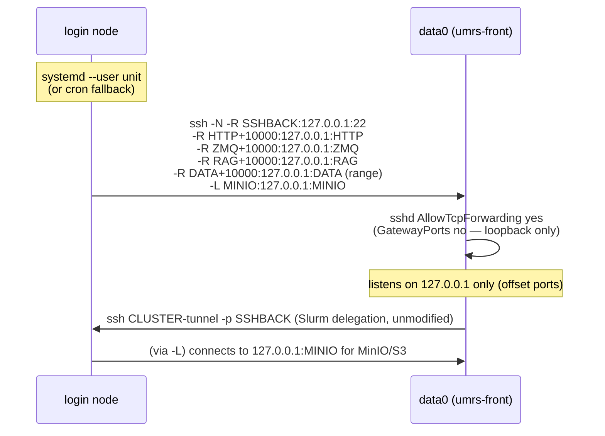

# ADR-018: Reverse SSH Tunnel for HPC Login Nodes Behind VPN Boundaries

**Status:** Accepted
**Date:** 2026-07-17
**Relates to:** ADR-013 (knowledge portability and compute separation), development.instructions.md
(HPC-first architecture), umrs-branch-separation.instructions.md, mutation-safety.instructions.md
(deployment invariants)

## Context

`umrs-front` (data0) is the shared front-end VM that runs UMRS
servers for four clusters: `rccs-cloud`, `ai4s`, `bdrt`, and `octopus`. For
`bdrt` (RIKEN DGX-Spark, login node `<login-node>`) and `octopus`,
Slurm delegation, MinIO reachability for compute jobs, and general SSH access
require a working network path between data0 and the login node.

### The network topology problem

Live investigation confirmed:

- data0 uses the site's public DNS resolver.
- The login node uses an internal DNS server (`<internal-zone>`, the
  institute's internal HPC VPN subnet).
- **data0 cannot route to that DNS server or resolve `<login-node>`
  at all.** Any `ssh <login-node>` issued FROM data0 fails before the TCP layer.
- **The login node CAN resolve and route to data0's public address** —
  confirmed live via a raw TCP/22 connect test from the login node.

This is a **one-directional** network boundary: data0 → login node is blocked;
login node → data0 works. Any tunnel implementation that has data0 dial the
login node (the previous `-L` forward-tunnel design) can never work regardless
of DNS fixes, retries, or SSH config — the underlying route does not exist.

The previous implementation ([e8eb0379], since superseded) tried exactly this:
data0 as the SSH client, opening `-L` forwards to the login node. It failed at the
DNS-resolution step, and even with a `/etc/hosts` workaround would still fail
at the routing layer.

### Additional discovery: port collisions on data0

While rebuilding the tunnel, live testing on data0 (`ss -tlnp`) showed that
data0 **already binds the bare Gateway, RAG and ZMQ ports locally** — these are the
umrs-front bdrt UMRS server's own Gateway HTTP, RAG, and ZMQ control ports,
which run directly on data0 regardless of any tunnel (per
`umrs_front_tunnel_mode: false`, the "no-tunnel production" default). A
same-numbered `-R` forward for these ports collides (`EADDRINUSE`), and
because the tunnel uses `ExitOnForwardFailure=yes`, a single colliding forward
tears down the **entire** SSH session — including forwards that would
otherwise have worked fine (reproduced live: a fourth forward's failure killed
the SSH-back forward too). See "Port offset" below for the fix.

## Decision

**Flip the SSH connection direction.** The HPC login node becomes the SSH
client and dials OUT to data0. This matches the only direction that actually
has a network path.

```
Before (broken):              After (ADR-018):

   data0                          data0
     |                              ^
     | ssh -L                      | ssh -R / -L
     v                              |
  login node                     login node
  (unreachable from data0)      (reaches data0 fine)
```

### Forwarded services

| Service | Direction | Listen side | Listen port | Target port | Rationale |
|---|---|---|---|---|---|
| SSH-back (Slurm delegation) | `-R` | data0 | `sshback_port` (one per cluster) | 22 (login node) | Lets data0 keep `ssh <cluster>` working unmodified |
| Gateway HTTP | `-R` | data0 | `http_port + 10000` | `http_port` | **Offset** — data0 already binds the bare port locally |
| ZMQ control | `-R` | data0 | `zmq_port + 10000` | `zmq_port` | **Offset** — same collision |
| ZMQ data range | `-R` | data0 | `(data_base..data_last) + 10000` | `data_base..data_last` | **Offset**, for consistency with the other UMRS ports |
| RAG | `-R` | data0 | `rag_port + 10000` | `rag_port` | **Offset** — same collision |
| MinIO | `-L` | login node | `minio_port` | `minio_port` (on data0) | **Not offset** — no collision; this is the *opposite* direction (login node/compute jobs reach data0's MinIO), matching the pre-existing (currently disabled) `start.sh`-managed MinIO reverse-tunnel pattern for rccs/ai4s |

The `+10000` listen-port offset on data0's side is **only relevant if some
future consumer needs to reach the login node's Gateway/ZMQ/RAG endpoints
from data0's own `localhost`.** Today, nothing on data0 consumes those
offset ports — the requirement to forward them was carried over from the
original (pre-ADR-018) design for service parity. They are provided,
verified live, and documented, but the honest status is: **most of the
demonstrated value of this tunnel is the SSH-back forward (Slurm delegation)
and the MinIO `-L` forward (S3 reachability for compute jobs)**, both of which
have a clear, real consumer today.

### Architecture



### Persistence: systemd --user, cron fallback

Per-login-node, in order of preference:

1. **systemd --user service** (`umrs-reverse-tunnel-<cluster>.service`):
   `Restart=always`, `RestartSec=5`. Reconnects automatically after network
   blips, VPN reconnects, or the tunnel process being killed. Requires
   `loginctl enable-linger <user>` to survive logout/reboot without an active
   session — the playbook attempts this and warns (not fails) if it cannot
   (e.g., insufficient polkit permission; an admin may need to run it once).
2. **Cron fallback** (only used if `systemctl --user status` fails, e.g. no
   systemd user session support on that login node): a `@reboot` cron entry
   plus a `*/2 * * * *` watchdog entry, both calling the same wrapper script's
   idempotent `start` verb (a no-op if already running, verified via pidfile).

Either way, the actual SSH invocation prefers `autossh -M 0` (disabling
autossh's own monitor port since `ServerAliveInterval`/`ServerAliveCountMax`
plus the supervisor's `Restart=always`/cron watchdog already provide
reconnection) and falls back to plain `ssh` if `autossh` is not installed.

### Idempotency

- Keypair generation uses `creates:` — a second run is a no-op.
- `authorized_key` and `blockinfile` (SSH config stanzas) are naturally
  idempotent Ansible modules.
- systemd unit deployment + `enable --now` is idempotent.
- Cron entries are named and idempotent via the `cron` module.
- The wrapper script's own `start` verb checks a pidfile before spawning.

### Security considerations

1. **Dedicated, restricted keypair.** Each cluster's reverse tunnel uses its
   own ED25519 keypair (`umrs_reverse_tunnel_<cluster>_ed25519`), generated on
   the login node and never reused for interactive login or Slurm delegation.
   The corresponding entry in data0's `~/.ssh/authorized_keys` carries
   `restrict,port-forwarding` — `restrict` disables PTY allocation, agent
   forwarding, X11 forwarding, and arbitrary command execution;
   `port-forwarding` is re-enabled explicitly since that is the only
   capability this key needs.
2. **GatewayPorts stays at its secure default (`no`).** All `-R` listen
   sockets on data0 bind to `127.0.0.1` only — never `0.0.0.0`. This is the
   default OpenSSH behavior when `GatewayPorts no` (the default) and an
   explicit loopback bind address is requested, which the wrapper script
   always does (`-R 127.0.0.1:<port>:127.0.0.1:<port>`). No sshd_config change
   is needed for this; the playbook only *verifies* `AllowTcpForwarding yes`
   (required for `-R`/`-L` to work at all) and warns (does not silently
   rewrite `/etc/ssh/sshd_config`) if it is disabled.
3. **SSH-back port is not a general shell.** The `-R <sshback_port>:127.0.0.1:22`
   forward only proxies TCP to the login node's own sshd — authentication for
   whatever connects through it (Slurm delegation) is unchanged, using
   whatever credentials delegation already used (`<delegation-key>` in the
   current deployment). The dedicated tunnel key never authenticates
   delegation traffic; it only authenticates the outer tunnel session.
4. **Failure recovery does not require credential re-entry.** Because the
   private key lives only on the login node's filesystem (mode `0700`
   directory) and the tunnel reconnects automatically, no human needs to
   re-authenticate after a network blip, VPN reconnect, or login node reboot
   (once lingering is enabled).
5. **Blast radius if the dedicated key is compromised.** An attacker with the
   dedicated tunnel private key can open TCP forwards through data0's sshd as
   the configured tunnel user — but cannot get a shell, run commands, or
   forward agent/X11 sessions on data0 (enforced by `restrict`). They would
   still need separate credentials to do anything with an opened forward
   (e.g., the SSH-back port still requires valid login-node credentials to
   authenticate through).
6. **Audit trail.** Every reverse-tunnel key is uniquely commented in
   `authorized_keys` (`umrs-reverse-tunnel-<cluster>`), making it easy to
   identify and revoke per cluster without affecting others.

## Migration Plan

1. **Fix the pre-existing login-node SSH client config bug.** Both `bdrt`
   and (likely) `octopus` login nodes had a `~/.ssh/config` with a
   macOS-only `UseKeychain` directive, which fatally breaks **every** outbound `ssh`
   invocation from that host, unrelated to this tunnel. This was fixed live
   for bdrt by removing the two offending lines (backed up first as
   `~/.ssh/config.bak.<timestamp>`). **Action required:** verify/fix the same
   issue on the octopus login node before enabling
   `umrs_front_octopus_tunnel_enabled`.
2. **Deploy the new `remote-tunnel.yaml`** (same file name, same
   `bootstrap.sh --remote-tunnel*` CLI surface — no user-facing command
   changes). Internally: 3 plays instead of the old 2 BDRT/OCTOPUS
   copy-pasted blocks; login nodes are registered as ad-hoc Ansible hosts via
   `add_host`, so no new inventory file is needed and there is no risk of
   `all:` group-vars leakage from the bdrt/octopus profiles' own inventories.
3. **`umrs_front_<cluster>_tunnel_enabled` keeps its old meaning** (enable/
   disable the tunnel for that cluster) — only the underlying mechanism
   changed. `umrs_front_bdrt_ssh_target` now points at a new
   `<cluster>-tunnel` alias (e.g. `<login-node>-tunnel`) instead of the real
   hostname alias; a new `umrs_front_<cluster>_login_node_alias` variable
   holds the real alias, used only by the Ansible controller to reach the
   login node directly for tunnel management.
4. **Slurm delegation requires zero code changes.** It already reads
   `ssh_target` from a variable and shells out to `ssh <ssh_target> ...`; the
   value simply now resolves (via a `~/.ssh/config` block the playbook
   manages) to `127.0.0.1:<sshback_port>` instead of the real hostname.
5. **The old `umrs_front_<cluster>_minio_tunnel_enabled` (start.sh-managed,
   currently `false` for bdrt/octopus) becomes redundant** once this playbook's
   MinIO `-L` forward is enabled — it solves the same problem via the same
   working connection direction. No immediate action needed since it is
   already disabled for bdrt/octopus; do not enable both mechanisms
   simultaneously for the same cluster (the MinIO port would be claimed twice on
   the login-node side).
6. **Rollback:** the old (broken) forward-tunnel implementation is preserved
   in git history (commits `e8eb0379`, `1465e68a`, `1e322566`); reverting to
   it is possible but does not fix the underlying network problem, so it is
   not a meaningful rollback target. The real rollback is
   `umrs_front_<cluster>_tunnel_enabled: false` plus
   `systemctl --user disable --now umrs-reverse-tunnel-<cluster>.service` on
   the login node (or `./bootstrap.sh --profile umrs-front --remote-tunnel-stop`).

## Verification Procedure

The change was verified live against the `bdrt` cluster: the tunnel came up
through the `--remote-tunnel` play, the systemd user unit restarted itself
after its process was killed (and the cron watchdog did the same on the
fallback path), `--remote-tunnel-status` reported the SSH-back, Gateway and
ZMQ control forwards reachable from data0, Slurm delegation through the
`<cluster>-tunnel` alias worked with no code change, and `--remote-tunnel-stop`
tore the tunnel down cleanly. The step-by-step operator runbook is kept with
the site deployment tooling, which is not part of the public tree.

## Consequences

### Positive

- Slurm delegation, HPC code sync, and MinIO reachability for bdrt/octopus
  now have a real, working network path, unblocking `umrs_front_bdrt_slurm_delegation_enabled`.
- Self-healing: reconnects automatically after network blips, VPN
  reconnects, and login node reboots (given lingering is enabled).
- No changes to Slurm delegation code — only a group_vars value change
  (`ssh_target`) and an Ansible-managed `~/.ssh/config` stanza.
- Adding a new cluster is a group_vars + one `_rt_clusters` list entry change.

### Negative / Follow-ups

- Requires `loginctl enable-linger` on each login node for full survive-reboot
  behavior; this may need one-time admin assistance if self-service linger is
  blocked by polkit policy on a given HPC login node.
- The Gateway HTTP/ZMQ control/RAG/ZMQ-data-range `-R` forwards are offset by
  `+10000` and, as of this writing, have no known live consumer on data0 —
  they exist for service parity with the original design's stated intent.
  Future work should confirm whether any UMRS component actually needs to
  reach the login-node side via these ports, or whether they can be dropped
  to reduce surface area.
- octopus login node needs the same `~/.ssh/config` `UseKeychain` fix (not yet
  verified) before `umrs_front_octopus_tunnel_enabled: true` will work.

*(2026-11-06: internal addresses, paths and group ids replaced with placeholders for the public export (repo-rename plan P5b-2); the values live in r4-ops.)*

*(2026-11-07: site details generalized for the public tree: the login-node name, DNS zone and resolver, live port numbers and key filename are placeholders, and the operator verification runbook is reduced to a summary.)*
