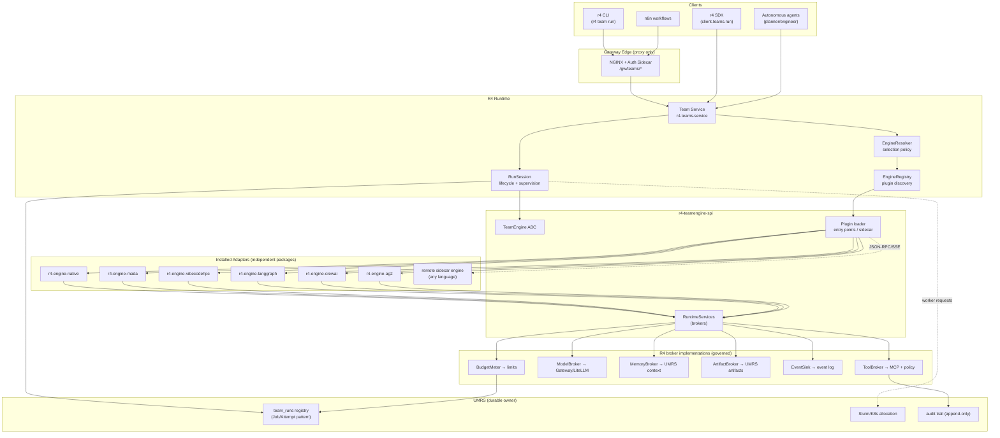
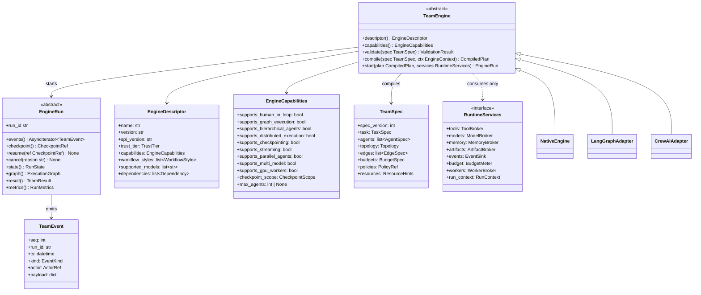
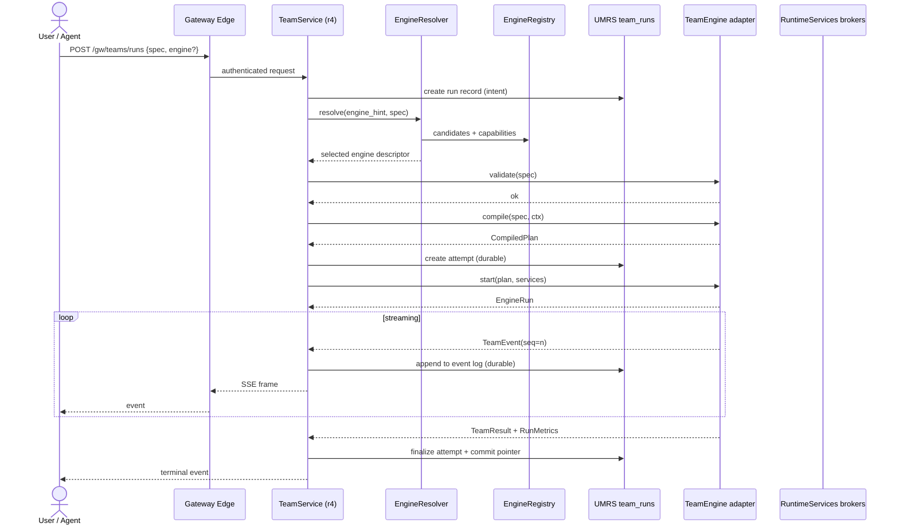
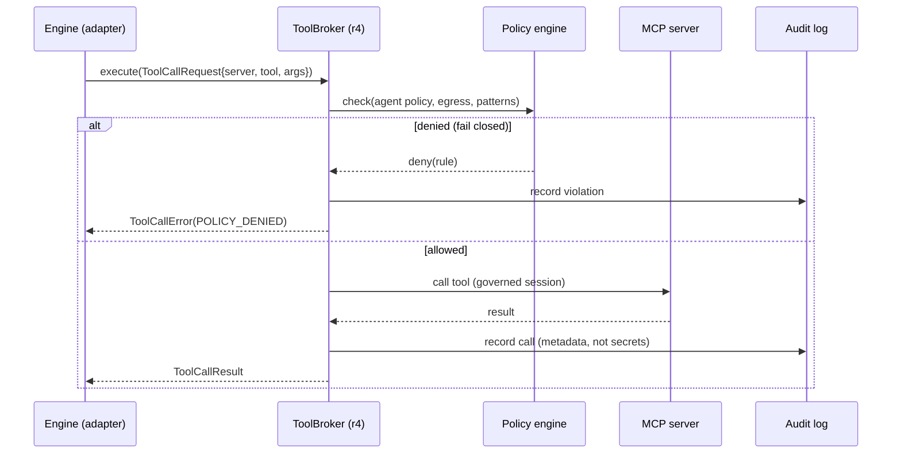
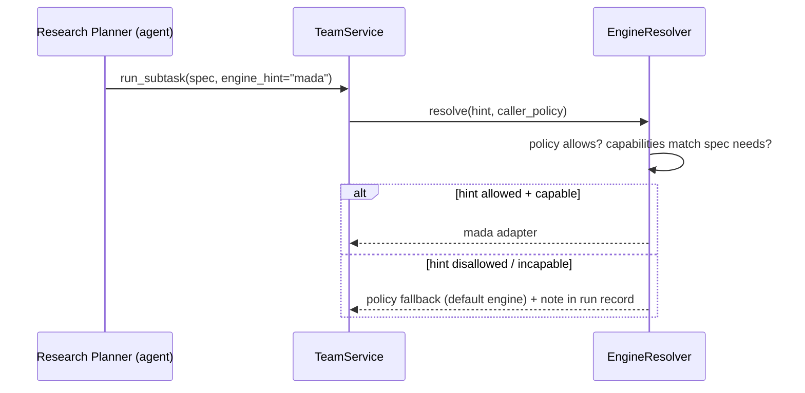

# ADR-020: Team Engine SPI — Pluggable Multi-Agent Orchestration

**Status:** Accepted (2026-09-24, via [ADR-072](072-one-team-seam-research-roles.md): the one team seam; native engine over teamup = default, other engines = external plugins)
**Date:** 2026-07-31
**Relates to:** ADR-005 (r4-contracts stdlib-only), ADR-002 (Job/Attempt
separation), ADR-004 (execution-authority invariant), ADR-009 (research-loop
architecture), ADR-015 (knowledge-ingest egress), agent-safety instructions,
mutation-safety instructions

## Context

R4's multi-agent execution logic is coupled to the runtime. The `r4/teamup/`
module implements a VibeCodeHPC-style collaboration pattern (file-based comms,
PM/SE/PG roles, budget tracking, evolutionary optimization) directly against
R4 internals. There is no seam where an alternative orchestration engine —
LLNL MADA, upstream VibeCodeHPC, LangGraph, CrewAI, AG2, or a future engine —
could be substituted without forking R4.

We want the same relationship that Kubernetes has with CRI/CSI/CNI, or VSCode
with LSP: **the runtime defines the interface; implementations are external,
independently installable, and independently versioned.**

This ADR defines the Team Engine SPI: contracts, interfaces, plugin
discovery, selection, durability, security, evaluation, and the migration
path away from today's coupled `teamup` module.

### Design principles (binding)

- Runtime independent of orchestration engine (Open/Closed)
- Strong typing everywhere on the SPI surface
- Async-first, streaming-first
- MCP-native tool surface
- Engine-agnostic APIs; engines never see engine-foreign concepts
- HPC-aware; distributed execution is a capability, not an assumption
- Reproducibility is a first-class contract item
- Governance (policy, audit, egress, budgets) stays in R4 — engines are
  *untrusted orchestration logic* that R4 supervises

---

## 1. Architecture

### The core move: compile, don't wrap

Adapters do **not** wrap one framework's API behind another framework's API.
The SPI center is an engine-neutral intermediate representation — `TeamSpec`
— that each adapter **compiles** into its native execution form:

```
TeamSpec (IR)  ──compile──▶  LangGraph StateGraph
                 ──compile──▶  CrewAI Crew + Process
                 ──compile──▶  AG2 GroupChat + speaker policy
                 ──compile──▶  MADA team definition
                 ──compile──▶  VibeCodeHPC session tree
                 ──compile──▶  Native R4 plan graph
```

This mirrors LLVM: one IR, many backends. R4 never accumulates per-engine
conditionals; each adapter owns exactly one translation.

### The second core move: reverse control (RuntimeServices)

Engines do not reach outward for models, tools, memory, or storage. R4 hands
the engine a single `RuntimeServices` bootstrap object containing **broker**
handles. Every outward call flows back into R4, where policy, audit,
EgressGuard, budgets, and Slurm delegation already live:

```
Engine ──tool_call──▶ ToolBroker ──policy/audit──▶ MCP server
Engine ──llm_call───▶ ModelBroker ──routing──────▶ Gateway / LiteLLM
Engine ──read/mem───▶ MemoryBroker ──────────────▶ UMRS context storage
Engine ──put_art────▶ ArtifactBroker ────────────▶ UMRS artifact store + versioned refs
Engine ──emit───────▶ EventSink ─────────────────▶ canonical event log
Engine ──spend──────▶ BudgetMeter ───────────────▶ token/cost/wallclock limits
```

An engine receives **zero credentials**. It cannot open network connections,
talk to Slurm, touch S3, or invoke MCP directly. Untrusted engines run
out-of-process (§7) where this is enforceable at the OS boundary.

### Three-layer package separation

| Layer | Package | Contents | Dependencies |
|-------|---------|----------|--------------|
| Contracts | `r4-contracts` (extend) | Wire DTOs: `TeamSpec`, events, results, capabilities, metrics — stdlib-only dataclasses per ADR-005 | none |
| SPI | `r4-teamengine-spi` (new) | `TeamEngine` ABC, `RuntimeServices`, `EngineHandle`, errors, loader, sidecar protocol client | `r4-contracts` only |
| Runtime | `r4/teams/` | registry, resolver, session orchestration, service facade | SPI + contracts |
| Adapters | `r4-engine-<name>` (one package each) | IR compiler + engine driver | SPI + engine SDK |

UMRS remains the owner of durable run records (registry, attempt tracking)
and of Slurm/K8s allocation. The Python Gateway and production
NGINX+Sidecar edge stay proxy-only: no durable state, no orchestration logic
(mutation-safety: Gateway boundary).

---

## 2. Component diagram



---

## 3. Class diagram



---

## 4. Sequence diagrams

### 4a. Run flow (submit → stream → complete)



### 4b. Tool call under reverse control



### 4c. Checkpoint / resume

```mermaid
sequenceDiagram
    participant E as EngineRun
    participant S as RunSession (r4)
    participant UM as UMRS team_runs
    participant B as Artifact store

    S->>E: checkpoint()
    E->>E: serialize engine-native state (opaque blob)
    E->>B: put blob → CheckpointRef{blob, event_offset}
    S->>UM: persist ref on attempt
    Note over S,UM: ... crash / restart ...
    S->>UM: load run + latest CheckpointRef
    S->>E2: compile(spec) → plan; start(plan)
    S->>E2: resume(ref)
    E2->>B: fetch blob; restore native state
    E2->>S: replay from event_offset onward
```

Resume by a **different** engine uses the event log instead: the new engine
receives the conversation/artifact transcript up to the offset and starts
fresh (best-effort migration, §11).

### 4d. Agent-driven engine selection



---

## 5. Python interfaces

### 5a. Contracts — `r4-contracts/src/r4_contracts/team_engine/`

Stdlib-only dataclasses (ADR-005). All payloads JSON-serializable. Every
versioned DTO carries an explicit `spec_version` field registered with
`schema_version_tracker`.

```python
# r4_contracts/team_engine/spec.py
from __future__ import annotations

from dataclasses import dataclass, field
from enum import Enum
from typing import Any, Literal


TEAM_SPEC_VERSION = 1


class WorkflowStyle(str, Enum):
    SEQUENTIAL = "sequential"
    DAG = "dag"
    GRAPH = "graph"                 # cyclic, conditional routing
    HIERARCHICAL = "hierarchical"   # manager/worker delegation
    DEBATE = "debate"
    SWARM = "swarm"
    FILEBASED = "file_based"        # VibeCodeHPC-style shared workspace


@dataclass(frozen=True)
class AgentSpec:
    """Engine-neutral agent definition.

    An agent is a role + instructions + allowed tools + model preference.
    Nothing here references any specific engine SDK.
    """

    name: str
    role: str                                 # e.g. "planner", "software_engineer"
    instructions: str                         # system-level prompt
    tool_refs: tuple[str, ...] = ()           # "mcp://<server>/<tool>" ids
    model_ref: str | None = None              # registry name or None = default
    max_iterations: int | None = None
    engine_hint: str | None = None            # sub-delegation preference (§8)
    metadata: dict[str, Any] = field(default_factory=dict)


@dataclass(frozen=True)
class EdgeSpec:
    source: str                               # agent name or "$start"
    target: str                               # agent name or "$end"
    condition: str | None = None              # expression language v1 (simple)
    carry: tuple[str, ...] = ()               # artifact/state keys to pass


@dataclass(frozen=True)
class Topology:
    style: WorkflowStyle
    entry_agent: str | None = None
    max_parallel: int = 1


@dataclass(frozen=True)
class BudgetSpec:
    max_tokens: int | None = None
    max_cost_usd: float | None = None
    max_wallclock_sec: int | None = None
    max_tool_calls: int | None = None


@dataclass(frozen=True)
class ResourceHints:
    """HPC-aware hints. Engines MAY ignore them; r4 enforces feasibility."""

    gpu_workers: int = 0
    cpu_workers: int = 0
    slurm_partition: str | None = None        # validated against site.yaml
    distributed_ok: bool = False


@dataclass(frozen=True)
class TaskSpec:
    objective: str
    inputs: tuple[str, ...] = ()              # artifact ids / memory queries
    expected_outputs: tuple[str, ...] = ()    # named artifacts to produce
    human_checkpoints: tuple[str, ...] = ()   # points requiring approval


@dataclass(frozen=True)
class TeamSpec:
    """The engine-neutral IR. schema_version_tracker-tracked."""

    spec_version: int
    run_name: str
    project: str
    task: TaskSpec
    agents: tuple[AgentSpec, ...]
    topology: Topology
    edges: tuple[EdgeSpec, ...] = ()
    budgets: BudgetSpec = BudgetSpec()
    policy_ref: str = "default"               # name of r4 policy document
    resources: ResourceHints = ResourceHints()
    context: dict[str, Any] = field(default_factory=dict)  # memory queries etc.
```

```python
# r4_contracts/team_engine/events.py
from __future__ import annotations

from dataclasses import dataclass
from enum import Enum
from typing import Any


class EventKind(str, Enum):
    RUN_STARTED = "run_started"
    AGENT_STARTED = "agent_started"
    AGENT_MESSAGE = "agent_message"
    TOOL_CALL_REQUESTED = "tool_call_requested"
    TOOL_CALL_COMPLETED = "tool_call_completed"
    ARTIFACT_PRODUCED = "artifact_produced"
    HUMAN_INPUT_REQUESTED = "human_input_requested"
    CHECKPOINT_CREATED = "checkpoint_created"
    BUDGET_WARNING = "budget_warning"
    AGENT_COMPLETED = "agent_completed"
    RUN_COMPLETED = "run_completed"
    RUN_FAILED = "run_failed"
    RUN_CANCELLED = "run_cancelled"


@dataclass(frozen=True)
class ActorRef:
    kind: str            # "engine" | "agent" | "runtime" | "human"
    name: str


@dataclass(frozen=True)
class TeamEvent:
    """Canonical event. Engines translate native callbacks into these.

    seq is assigned by the EventSink (single writer responsibility), never
    by the engine. payload schemas per kind live in payload_schemas.py.
    """

    seq: int
    run_id: str
    ts: str                       # ISO-8601 UTC
    kind: EventKind
    actor: ActorRef
    payload: dict[str, Any]
```

```python
# r4_contracts/team_engine/results.py
from __future__ import annotations

from dataclasses import dataclass, field
from typing import Any


@dataclass(frozen=True)
class ArtifactRef:
    artifact_id: str              # UMRS artifact id
    name: str
    media_type: str
    producer: str                 # agent name
    content_hash: str             # sha256 — reproducibility anchor


@dataclass(frozen=True)
class RunMetrics:
    """Comparable across engines — this is what the benchmark harness reads."""

    wallclock_sec: float
    total_tokens: int
    input_tokens: int
    output_tokens: int
    tool_calls: int
    llm_calls: int
    cost_usd: float | None
    agent_steps: int
    checkpoint_count: int
    human_interventions: int


@dataclass(frozen=True)
class TeamResult:
    status: str                   # "success" | "partial" | "failed" | "cancelled"
    summary: str                  # engine-produced, human-readable
    artifacts: tuple[ArtifactRef, ...] = ()
    metrics: RunMetrics | None = None
    error: str | None = None
    reproducibility: dict[str, Any] = field(default_factory=dict)
    # reproducibility keys: seed, engine_version, model_versions,
    # spec_hash, event_log_hash — enough to attest a rerun.


@dataclass(frozen=True)
class CheckpointRef:
    run_id: str
    attempt_id: str
    engine_name: str              # resumable only by same engine + version
    engine_version: str
    state_blob_id: str            # opaque blob in artifact store
    event_offset: int             # stream position at checkpoint time
    created_at: str


@dataclass(frozen=True)
class NodeState:
    node_id: str
    agent: str | None
    status: str                   # pending | running | done | failed | skipped
    detail: str | None = None


@dataclass(frozen=True)
class ExecutionGraph:
    """Best-effort projection of the engine's internal execution graph.

    Engines without introspectable graphs emit a linear chain of nodes.
    """

    nodes: tuple[NodeState, ...]
    edges: tuple[tuple[str, str], ...] = ()
```

```python
# r4_contracts/team_engine/capabilities.py
from __future__ import annotations

from dataclasses import dataclass
from enum import Enum

from .spec import WorkflowStyle


class TrustTier(str, Enum):
    CORE = "core"                 # shipped with r4, CI-gated (native)
    VERIFIED = "verified"         # signed + reviewed, optional install
    COMMUNITY = "community"       # unsigned, in-proc allowed with warning
    UNTRUSTED = "untrusted"       # sidecar-only, sandboxed brokers


class CheckpointScope(str, Enum):
    NONE = "none"
    ENGINE_INTERNAL = "engine_internal"   # opaque blob, same-engine resume
    PORTABLE = "portable"                 # event-log replay transferable


@dataclass(frozen=True)
class Dependency:
    package: str
    constraint: str               # PEP 440 specifier
    optional: bool = False


@dataclass(frozen=True)
class EngineCapabilities:
    # the nine required flags, plus operational metadata
    supports_human_in_loop: bool = False
    supports_graph_execution: bool = False
    supports_hierarchical_agents: bool = False
    supports_distributed_execution: bool = False
    supports_checkpointing: bool = False
    supports_streaming: bool = False
    supports_parallel_agents: bool = False
    supports_multi_model: bool = False
    supports_gpu_workers: bool = False
    checkpoint_scope: CheckpointScope = CheckpointScope.NONE
    max_agents: int | None = None
    workflow_styles: tuple[WorkflowStyle, ...] = ()
    supported_models: tuple[str, ...] = ("any",)   # registry names or "any"


@dataclass(frozen=True)
class EngineDescriptor:
    """Self-declared manifest returned by TeamEngine.descriptor()."""

    name: str                     # "native" | "langgraph" | ...
    version: str                  # adapter package version
    spi_version: str              # SPI semver it was built against
    trust_tier: TrustTier
    capabilities: EngineCapabilities
    dependencies: tuple[Dependency, ...] = ()
```

```python
# r4_contracts/team_engine/services.py — broker REQUEST/RESPONSE DTOs
from __future__ import annotations

from dataclasses import dataclass, field
from typing import Any


@dataclass(frozen=True)
class ToolDescriptor:
    """MCP tool manifest as surfaced to engines (output schema included)."""

    server: str
    name: str
    description: str
    input_schema: dict[str, Any]
    required_capabilities: tuple[str, ...] = ()   # r4_mcp ToolCapability flags


@dataclass(frozen=True)
class ToolCallRequest:
    server: str
    tool: str
    arguments: dict[str, Any]
    agent: str                    # requesting agent — policy evaluated per-agent
    call_id: str


@dataclass(frozen=True)
class ToolCallResult:
    call_id: str
    ok: bool
    content: Any = None
    error: str | None = None


@dataclass(frozen=True)
class ModelRequest:
    messages: tuple[dict[str, Any], ...]      # OpenAI-compatible
    model: str | None = None                  # None = broker routes
    tools: tuple[ToolDescriptor, ...] = ()
    temperature: float | None = None
    max_tokens: int | None = None
    seed: int | None = None                   # reproducibility


@dataclass(frozen=True)
class ModelChunk:
    text: str
    finish_reason: str | None = None
    tool_calls: tuple[dict[str, Any], ...] = ()
```

### 5b. SPI — `r4-teamengine-spi/src/r4_teamengine_spi/`

The SPI package depends **only** on `r4-contracts`. Engines import this and
nothing else from R4. R4 internals never appear on the SPI surface.

```python
# r4_teamengine_spi/engine.py
from __future__ import annotations

from abc import ABC, abstractmethod
from collections.abc import AsyncIterator
from typing import Any

from r4_contracts.team_engine.capabilities import EngineDescriptor
from r4_contracts.team_engine.events import TeamEvent
from r4_contracts.team_engine.results import (
    CheckpointRef,
    ExecutionGraph,
    RunMetrics,
    TeamResult,
)
from r4_contracts.team_engine.spec import TeamSpec

from .context import EngineContext, RuntimeServices
from .errors import ValidationIssue


class TeamEngine(ABC):
    """One adapter per engine. Instances are stateless factories of runs —
    all mutable state lives on EngineRun, never on the engine object."""

    @abstractmethod
    def descriptor(self) -> EngineDescriptor: ...

    def capabilities(self):                     # convenience accessor
        return self.descriptor().capabilities

    @abstractmethod
    def validate(self, spec: TeamSpec) -> list[ValidationIssue]:
        """Static check: can this engine express this spec? Fail fast."""
        ...

    @abstractmethod
    def compile(self, spec: TeamSpec, ctx: EngineContext) -> "CompiledPlan":
        """IR → native graph. THE adapter core. Pure-ish: no side effects,
        no network. Deterministic given (spec, ctx)."""
        ...

    @abstractmethod
    async def start(
        self, plan: "CompiledPlan", services: RuntimeServices,
    ) -> "EngineRun":
        """Allocate the run. Work begins on first events() iteration
        (lazy start keeps submission cheap and cancellable-before-launch)."""
        ...


class CompiledPlan(ABC):
    """Opaque to r4. Holds the engine-native compiled artifact."""

    @property
    @abstractmethod
    def plan_hash(self) -> str:
        """Content hash — reproducibility + cache key."""
        ...


class EngineRun(ABC):
    """One execution attempt. Mirrors UMRS Job/Attempt: a run is an attempt
    of the durable team_run record."""

    @property
    @abstractmethod
    def run_id(self) -> str: ...

    @abstractmethod
    def events(self) -> AsyncIterator[TeamEvent]:
        """Canonical event stream. MUST yield until terminal event.
        Re-iterable after resume: replays from last acked offset."""
        ...

    @abstractmethod
    async def checkpoint(self) -> CheckpointRef: ...

    @abstractmethod
    async def resume(self, ref: CheckpointRef) -> None:
        """Restore from same-engine checkpoint. Raises
        IncompatibleCheckpoint if engine/version mismatch."""
        ...

    @abstractmethod
    async def cancel(self, reason: str) -> None:
        """MUST be safe to call from any task; idempotent."""
        ...

    @abstractmethod
    def state(self) -> str:
        """pending|running|awaiting_human|checkpointing|done|failed|cancelled"""
        ...

    @abstractmethod
    def graph(self) -> ExecutionGraph: ...

    @abstractmethod
    async def result(self) -> TeamResult: ...

    @abstractmethod
    async def metrics(self) -> RunMetrics: ...
```

```python
# r4_teamengine_spi/context.py
from __future__ import annotations

from abc import ABC, abstractmethod
from collections.abc import AsyncIterator
from dataclasses import dataclass
from typing import Any, Protocol

from r4_contracts.team_engine.events import TeamEvent
from r4_contracts.team_engine.results import ArtifactRef
from r4_contracts.team_engine.services import (
    ModelChunk,
    ModelRequest,
    ToolCallRequest,
    ToolCallResult,
    ToolDescriptor,
)


class ToolBroker(ABC):
    """Governed MCP access. Engines NEVER open MCP sessions themselves."""

    @abstractmethod
    def list_tools(self) -> list[ToolDescriptor]: ...

    @abstractmethod
    async def execute(self, request: ToolCallRequest) -> ToolCallResult:
        """Policy-checked, budgeted, audited. Denial returns
        ToolCallResult(ok=False, error="POLICY_DENIED: ...")."""
        ...


class ModelBroker(ABC):
    """Streaming-first model access through the platform route."""

    @abstractmethod
    def stream(self, request: ModelRequest) -> AsyncIterator[ModelChunk]: ...

    @abstractmethod
    def available_models(self) -> list[str]: ...


class MemoryBroker(ABC):
    @abstractmethod
    async def recall(self, query: str, *, scope: str = "project",
                     limit: int = 8) -> list[dict[str, Any]]: ...

    @abstractmethod
    async def store(self, kind: str, content: dict[str, Any]) -> str: ...


class ArtifactBroker(ABC):
    @abstractmethod
    async def put(self, name: str, data: bytes,
                  media_type: str, *, producer: str) -> ArtifactRef: ...

    @abstractmethod
    async def get(self, artifact_id: str) -> bytes: ...

    @abstractmethod
    async def publish(self, ref: ArtifactRef) -> ArtifactRef:
        """Promote attempt-local artifact to run-visible (commit pointer)."""
        ...


class EventSink(Protocol):
    """Engines push pre-sequenced event drafts; sink assigns seq,
    persists, and fans out to subscribers."""

    def emit(self, kind: str, actor: tuple[str, str],
             payload: dict) -> None: ...


class BudgetMeter(ABC):
    @abstractmethod
    def spend_tokens(self, n: int) -> None: ...   # raises BudgetExhausted

    @abstractmethod
    def remaining(self) -> dict[str, Any]: ...


class WorkerBroker(ABC):
    """The ONLY path to distributed workers. Engines never see Slurm.
    Backed by UMRS durable jobs; execution_authority invariant applies."""

    @abstractmethod
    async def request_worker(self, profile: dict) -> str: ...  # worker handle

    @abstractmethod
    async def release_worker(self, handle: str) -> None: ...


@dataclass(frozen=True)
class RunContext:
    run_id: str
    attempt_id: str
    project: str
    caller: str                   # authenticated user id
    working_dir: str              # attempt-local scratch
    seed: int


@dataclass(frozen=True)
class EngineContext:
    """Everything compile() may consult — static, snapshot-at-submit."""

    project: str
    available_tools: tuple[ToolDescriptor, ...]
    available_models: tuple[str, ...]
    mcp_servers: tuple[str, ...]
    policy_name: str
    user: str
    env_fingerprint: str          # site + dependency digest


@dataclass
class RuntimeServices:
    tools: ToolBroker
    models: ModelBroker
    memory: MemoryBroker
    artifacts: ArtifactBroker
    events: EventSink
    budget: BudgetMeter
    workers: WorkerBroker
    run: RunContext
```

```python
# r4_teamengine_spi/errors.py
from dataclasses import dataclass


@dataclass(frozen=True)
class ValidationIssue:
    field: str
    message: str
    severity: str = "error"       # error | warning


class TeamEngineError(Exception): ...
class SpecNotExpressible(TeamEngineError): ...
class IncompatibleCheckpoint(TeamEngineError): ...
class BudgetExhausted(TeamEngineError): ...
class EngineCrashed(TeamEngineError): ...
class PluginTrustError(TeamEngineError): ...
```

---

## 6. Directory layout

New tree only; existing packages untouched until migration (§9).

```
r4-contracts/src/r4_contracts/team_engine/
    __init__.py          # re-exports
    spec.py              # TeamSpec IR              [schema_version_tracker]
    events.py            # TeamEvent, EventKind
    services.py          # broker request/response DTOs
    results.py           # TeamResult, RunMetrics, CheckpointRef, ExecutionGraph
    capabilities.py      # EngineCapabilities, EngineDescriptor, TrustTier

packages/r4-teamengine-spi/
    pyproject.toml       # deps: ["r4-contracts"]  — nothing else
    src/r4_teamengine_spi/
        __init__.py
        engine.py        # TeamEngine, EngineRun, CompiledPlan
        context.py       # RuntimeServices + brokers + EngineContext
        errors.py
        loader.py        # entry-point + manifest discovery (§7)
        version.py       # SPI_VERSION, compatibility window
        sidecar/
            protocol.md  # wire spec (JSON-RPC 2.0 + SSE)
            client.py    # engines living out-of-process appear as TeamEngine

r4/src/r4/teams/
    registry.py          # discovered engines → descriptors, trust filter
    resolver.py          # selection chain (§8)
    services_impl.py     # broker implementations over r4/UMRS internals
    session.py           # RunSession: supervision, event persistence, sse fanout
    service.py           # TeamService facade used by API + SDK + CLI
    policy.py            # engine allowlists per user/project (YAML-driven)

r4/src/r4/api/routes/teams.py      # REST surface (§8)
r4/src/r4/_cli/team.py             # extended (§8); teamup facade kept

engines/                           # one installable package per adapter
    r4-engine-native/              #   extraction target of r4/teamup (§9)
        pyproject.toml             #   entry_points: r4.team_engines
        src/r4_engine_native/ ...
        tests/
    r4-engine-langgraph/ ...
    r4-engine-crewai/ ...
    r4-engine-mada/ ...
    r4-engine-vibecodehpc/ ...
    r4-engine-ag2/ ...

umrs/src/umrs/team_runs/
    registry.py          # durable run records (Job/Attempt pattern, ADR-002)
    schema.py            # Postgres tables [schema_version_tracker]

benchmarks/team_engines/
    suites/              # declarative task suites (YAML)
    graders/             # quality graders
    runner.py            # cross-engine harness (§13)

tests/
    test_team_spi_conformance.py          # reusable conformance suite (§11)
    test_team_engine_registry.py
    test_team_engine_resolver.py
engines/*/tests/                          # per-adapter unit tests
```

---

## 7. Plugin discovery

### Options compared

| Mechanism | Strengths | Weaknesses | Verdict |
|-----------|-----------|------------|---------|
| **entry_points** (`importlib.metadata`) | Native Python packaging; versioned via pip; zero new infra; per-venv isolation | In-proc only; Python only; trust = package trust | **Primary mechanism** |
| Dynamic module loading (path scanning) | Simple | Unversioned, no metadata, security nightmare | Rejected |
| Configuration-only registration (`site.yaml`) | Good *complement* for enable/disable + trust policy | Cannot deliver code | Accept as policy overlay, not discovery |
| OCI packages (image per engine) | Matches container-first platform; strong isolation; any language | Heavier lifecycle; needs registry plumbing | **Phase 2** for sidecar engines (leverage existing mini-RiVault image flow) |
| MCP-advertised engines | Engines-as-tools; remote by nature; fits MCP-native principle | MCP is request/reply tools, not streaming supervision; would re-couple governance | Accept **generic bridge** (any MCP server advertising a `team_engine` capability is wrapped by `r4-engine-mcp-bridge`) — not a first-class discovery path |

### Decision: layered discovery

```
Layer 1 (trusted, in-proc):  entry_points group "r4.team_engines"
Layer 2 (policy overlay):    site.yaml engines.{enable,disable,trust_tier}
Layer 3 (untrusted/polyglot): sidecar engines over SPI wire protocol,
                             declared in site.yaml engines.sidecars[]
Layer 4 (interop):           MCP bridge adapter (optional package)
```

Any adapter package registers via standard packaging:

```toml
# engines/r4-engine-langgraph/pyproject.toml
[project]
name = "r4-engine-langgraph"
version = "0.1.0"
dependencies = ["r4-teamengine-spi", "langgraph>=0.2"]

[project.entry-points."r4.team_engines"]
langgraph = "r4_engine_langgraph:LangGraphEngine"
```

```python
# r4_teamengine_spi/loader.py (essentials)
import importlib.metadata

GROUP = "r4.team_engines"

def discover() -> dict[str, EngineDescriptor]:
    found = {}
    for ep in importlib.metadata.entry_points(group=GROUP):
        engine_cls = ep.load()
        desc = engine_cls().descriptor()
        _check_spi_compat(desc.spi_version)          # semver window
        found[desc.name] = desc
    return found

def load(name: str, *, site_policy: dict) -> TeamEngine:
    desc = discover()[name]
    tier = site_policy.get("trust_overrides", {}).get(name, desc.trust_tier)
    if not site_policy.get("enabled", {}).get(name, tier != "untrusted"):
        raise PluginTrustError(f"engine {name} disabled by site policy")
    if tier == "untrusted":
        raise PluginTrustError(f"{name}: untrusted engines must run as sidecar")
    return _by_name(name)()
```

The **sidecar wire protocol** (protocol.md) is the LSP-analog for remote
engines: JSON-RPC 2.0 control messages + SSE for the event stream, payloads
exactly the §5 contract dataclasses serialized. A sidecar engine is
addressed `sidecar://<endpoint>`; `loader` wraps it in a `RemoteEngine`
implementing `TeamEngine`, so the runtime cannot tell the difference.
This is how MADA (which may not be pip-installable into the r4 venv) or a
Go/Rust engine plugs in, and how Untrusted-tier engines get OS-level
isolation (separate container, egress via EgressGuard only).

Engines are **never imported by r4 statically** — r4's dependency set stays
clean; a broken adapter cannot break the runtime (failures surface as
`engine unavailable`, fail closed).

---

## 8. Selection mechanism + API changes

### Resolution chain (first match wins)

1. **Explicit request** — `engine:` field in API/CLI/SDK call
2. **Agent hint** — `AgentSpec.engine_hint` (sub-delegation, validated
   against caller policy; disallowed hint → fallback + audit note)
3. **Spec-driven match** — required capabilities derived from topology
   (e.g. `GRAPH` style + `supports_parallel_agents`) filter candidates;
   first policy-ranked candidate selected
4. **Project default** — project config
5. **Site default** — `native`

Every selection records `{requested, hint, resolved, reason}` on the run
record — agent autonomy is auditable, never silent.

### REST (`/gw/teams/*`, edge-proxied, gateway stays stateless)

```
GET  /gw/teams/engines                     list + capabilities + trust tier
POST /gw/teams/runs         {spec, engine?, policy?}        → 202 {run_id}
GET  /gw/teams/runs/{id}/events           SSE stream (replay from offset)
GET  /gw/teams/runs/{id}                  state + graph + metrics
POST /gw/teams/runs/{id}/cancel
POST /gw/teams/runs/{id}/checkpoint
POST /gw/teams/runs/{id}/resume
POST /gw/teams/runs/{id}/human-input      HITL response
```

### CLI

```bash
r4 team engines                              # table: name, version, caps
r4 team run --spec team.yaml --engine mada
r4 team events <run_id> [--follow]
r4 team graph <run_id>
r4 team checkpoint <run_id> / resume <run_id>
r4 team cancel <run_id>
r4 team bench --suite hpc-opt --engines native,langgraph   # §13
```

`r4 teamup` stays as a **facade**: it builds the legacy VibeCodeHPC-shaped
`TeamSpec` and submits through `TeamService` with `engine_hint=native`.
Zero user-facing breakage (mutation-safety: additive first).

### Python SDK

```python
async with r4.Client(profile="rccs") as c:
    handle = await c.teams.run(spec, engine="langgraph")
    async for ev in handle.events():
        ...
    result = await handle.result()
```

---

## 9. Migration plan

Additive-first, flagship-validated, no flag days (mutation-safety §safe-patterns).

**Phase 0 — contracts + SPI skeleton (no behavior change)**
- Add `r4_contracts/team_engine/` + register in schema_version_tracker.
- Create `packages/r4-teamengine-spi`. Wire into CI lint scope + ci-lint-local.sh.
- Deliverable: packages install, conformance suite runs against a stub engine.

**Phase 1 — native extraction**
- Create `r4-engine-native`; move `teamup/{session,roles,comms,budget,evolution,goals,sota,hardware,hpc_conn,reports}.py` behind an internal IR compiler — file-based comms become a `FileWorkspace` tool surface; `budget.py` folds into `BudgetMeter`.
- `r4/teamup/` becomes thin re-exporting facade delegating to `engine=native`. Existing tests must pass unmodified.
- Deliverable: `r4 teamup` and `r4 team run --engine native` produce equivalent sessions.

**Phase 2 — runtime integration**
- `r4/teams/` (registry/resolver/session/service), REST routes, SDK `teams` namespace, UMRS `team_runs` tables (SCHEMA_VERSION bump).
- Event persistence: append-only log per attempt; SSE fanout.
- Feature flag `teams.spi.enabled` gates new REST routes; CLI `team` group already exists.

**Phase 3 — second engine proves the seam**
- `r4-engine-langgraph` (§10). If the SPI can host a foreign graph engine without changes, abstraction holds.
- Conformance suite + cross-engine benchmark on one suite.

**Phase 4 — hardening**
- Sidecar protocol + one remote engine; TrustTier enforcement; engine allowlist policy docs; benchmark CI job; docs/runbook.

**Phase 5 — further adapters (parallelizable, per appetite)**
- crewai, ag2, mada (likely sidecar), vibecodehpc-as-engine (absorbing today's facade pattern properly).

Exit criteria per phase: existing suite green + `bash scripts/ci-lint-local.sh` + validators (import_boundary, contracts_fence, stale_name) + new conformance tests green.

---

## 10. Example adapter — `r4-engine-langgraph`

Shows the full pattern: descriptor → validate → compile (IR → StateGraph)
→ run/driver (native callbacks → canonical events; brokers for all outward
calls). ~230 lines. Structure only; prod version adds HITL interrupts,
tools per-node, and checkpoint blob encoding.

```python
# engines/r4-engine-langgraph/src/r4_engine_langgraph/engine.py
from __future__ import annotations

import hashlib
import json
from collections.abc import AsyncIterator
from typing import Any

from r4_contracts.team_engine.capabilities import (
    CheckpointScope,
    EngineCapabilities,
    EngineDescriptor,
    TrustTier,
)
from r4_contracts.team_engine.events import TeamEvent
from r4_contracts.team_engine.results import (
    CheckpointRef,
    ExecutionGraph,
    RunMetrics,
    TeamResult,
)
from r4_contracts.team_engine.services import ModelRequest
from r4_contracts.team_engine.spec import TeamSpec, WorkflowStyle
from r4_teamengine_spi.context import EngineContext, RuntimeServices
from r4_teamengine_spi.engine import CompiledPlan, EngineRun, TeamEngine
from r4_teamengine_spi.errors import IncompatibleCheckpoint, SpecNotExpressible, ValidationIssue

SPI_VERSION = "0.1"

# ---- compile: IR -> LangGraph StateGraph --------------------------------

class LGPlan(CompiledPlan):
    def __init__(self, spec: TeamSpec) -> None:
        self.spec = spec
        self._hash = hashlib.sha256(
            json.dumps({"v": spec.spec_version, "agents": [a.name for a in spec.agents],
                        "edges": [(e.source, e.target) for e in spec.edges]},
                       sort_keys=True).encode()
        ).hexdigest()

    @property
    def plan_hash(self) -> str:
        return self._hash


class LangGraphEngine(TeamEngine):
    def descriptor(self) -> EngineDescriptor:
        return EngineDescriptor(
            name="langgraph",
            version="0.1.0",
            spi_version=SPI_VERSION,
            trust_tier=TrustTier.VERIFIED,
            capabilities=EngineCapabilities(
                supports_human_in_loop=True,
                supports_graph_execution=True,
                supports_hierarchical_agents=True,
                supports_distributed_execution=False,
                supports_checkpointing=True,
                supports_streaming=True,
                supports_parallel_agents=True,
                supports_multi_model=True,
                supports_gpu_workers=False,
                checkpoint_scope=CheckpointScope.ENGINE_INTERNAL,
                workflow_styles=(WorkflowStyle.GRAPH, WorkflowStyle.DAG,
                                 WorkflowStyle.HIERARCHICAL),
            ),
        )

    def validate(self, spec: TeamSpec) -> list[ValidationIssue]:
        issues: list[ValidationIssue] = []
        if spec.resources.gpu_workers:
            issues.append(ValidationIssue("resources.gpu_workers",
                                          "langgraph adapter does not schedule GPU workers"))
        if spec.topology.style not in self.capabilities().workflow_styles:
            issues.append(ValidationIssue("topology.style",
                                          f"{spec.topology.style} not expressible"))
        names = {a.name for a in spec.agents}
        for e in spec.edges:
            for ep in (e.source, e.target):
                if ep not in names | {"$start", "$end"}:
                    issues.append(ValidationIssue("edges", f"unknown endpoint {ep}"))
        return issues

    def compile(self, spec: TeamSpec, ctx: EngineContext) -> LGPlan:
        issues = self.validate(spec)
        if any(i.severity == "error" for i in issues):
            raise SpecNotExpressible(str(issues))
        # Real impl: build langgraph.graph.StateGraph here — one node per
        # AgentSpec, add_conditional_edges from EdgeSpec.condition,
        # entry from topology.entry_agent. Deterministic => pure fn of spec.
        return LGPlan(spec)

    async def start(self, plan: LGPlan, services: RuntimeServices) -> "LGRun":
        return LGRun(plan, services)


# ---- run: drive native execution, emit canonical events -----------------

class LGRun(EngineRun):
    def __init__(self, plan: LGPlan, services: RuntimeServices) -> None:
        self._plan = plan
        self._svc = services
        self._run_id = services.run.run_id
        self._cancelled = False
        self._status = "pending"
        self._metrics = RunMetrics(wallclock_sec=0.0, total_tokens=0,
                                   input_tokens=0, output_tokens=0, tool_calls=0,
                                   llm_calls=0, cost_usd=None, agent_steps=0,
                                   checkpoint_count=0, human_interventions=0)

    @property
    def run_id(self) -> str:
        return self._run_id

    async def _run_agent(self, agent_name: str, state: dict) -> AsyncIterator[None]:
        spec_agent = next(a for a in self._plan.spec.agents if a.name == agent_name)
        self._svc.events.emit("agent_started", ("agent", agent_name), {})
        # LLM call MUST go through ModelBroker — never langchain chat models
        # wired to provider keys. Broker applies routing + budgets.
        req = ModelRequest(
            messages=(
                {"role": "system", "content": spec_agent.instructions},
                {"role": "user", "content": json.dumps(state)},
            ),
            model=spec_agent.model_ref,
            seed=self._svc.run.seed,
        )
        text = ""
        async for chunk in self._svc.models.stream(req):
            text += chunk.text
            self._svc.events.emit("agent_message", ("agent", agent_name),
                                  {"delta": chunk.text})
        state[agent_name] = text
        self._svc.events.emit("agent_completed", ("agent", agent_name), {})
        yield

    async def events(self) -> AsyncIterator[TeamEvent]:
        # Skeleton driver: sequential topo order. Real impl streams
        # compiled.astream_events(...) and translates each native event
        # into TeamEvent drafts pushed to svc.events; subscribers (incl.
        # this generator) read from the sink's per-run queue.
        self._status = "running"
        self._svc.events.emit("run_started", ("engine", "langgraph"),
                              {"plan_hash": self._plan.plan_hash})
        queue = self._svc.events  # sink owns seq + persistence + fanout
        ...
        yield  # pragma: no cover — illustrative

    async def checkpoint(self) -> CheckpointRef:
        # Real impl: graph.checkpointer payload -> ArtifactBroker → ref.
        raise NotImplementedError("phase-3")

    async def resume(self, ref: CheckpointRef) -> None:
        if ref.engine_name != "langgraph" or ref.engine_version != "0.1.0":
            raise IncompatibleCheckpoint(ref.engine_name)

    async def cancel(self, reason: str) -> None:
        self._cancelled = True
        self._status = "cancelled"

    def state(self) -> str:
        return self._status

    def graph(self) -> ExecutionGraph:
        return ExecutionGraph(
            nodes=tuple(),  # phase-3: project StateGraph node statuses
        )

    async def result(self) -> TeamResult:
        return TeamResult(status="success", summary="", metrics=self._metrics)

    async def metrics(self) -> RunMetrics:
        return self._metrics
```

Key adapter rules demonstrated:

1. `compile()` is deterministic and side-effect-free — the pure IR→native step.
2. All outward effects (LLM, tools, artifacts) go through brokers — the
   adapter contains **no provider SDK calls, no credentials, no network**.
3. Native events are **translated**, not proxied — R4 sees only `TeamEvent`.
4. Checkpoints are engine-internal blobs; honest about same-engine scope.

---

## 11. Unit testing strategy

| Subject | Technique |
|---------|-----------|
| Contract DTOs | serde round-trip property tests (hypothesis); schema_version_tracker registration test |
| `r4-teamengine-spi` | pure unit tests of loader, version window, errors |
| Each adapter | unit tests against **mock brokers** (in-memory implementations in `r4_teamengine_spi.testing` — thin stubs, not behavior re-models, per harness rules) |
| Compiler correctness | golden-file tests: `TeamSpec` fixture → expected native graph structure (adapter-local) |
| Registry/resolver | fixture engines via entry-point injection; policy matrix tests (hint allowed/denied/incapable) |
| **Conformance suite** | `tests/test_team_spi_conformance.py` — engine-agnostic pytest suite (validate→compile→start→stream→terminal-event ordering; cancel mid-run; checkpoint/resume round-trip if supported) *parameterized over installed engines*. Every adapter runs it in its own CI. Conformance = the "CRI validation" of this SPI. |
| Determinism | same spec + seed ⇒ same `plan_hash` across runs (all adapters) |

---

## 12. Integration testing strategy

Reuses existing harness topology — nothing new is invented:

1. **Docker Compose E2E** (`docker-compose.e2e.yaml` extension): r4 + UMRS + native + langgraph adapters; submit run via REST, assert SSE ordering,
   assert artifacts land in UMRS store, assert event log durability across r4 restart (kill r4 mid-run → resume from checkpoint/event offset).
2. **Tool governance E2E**: engine requests a blocked-pattern tool call → expect `POLICY_DENIED` + audit row.
3. **Budget E2E**: tiny `max_tokens`; expect `BUDGET_WARNING` then hard stop with `run_failed`.
4. **HPC E2E** (`tests/run_hpc_tests.sh`-adjacent): engine with `supports_distributed_execution` requests a worker via `WorkerBroker`; assert Slurm job submitted through UMRS durable tracking with correct `execution_authority`, per-user account rules unchanged.
5. **Cross-engine equivalence**: same research scenario run on native + langgraph; assert both produce required artifacts and sane metrics (content may differ; structure must not).
6. **Benchmark smoke** in CI: one cheap suite case per installed engine, nightly (not per-PR).
7. Validators continue to gate every phase (import_boundary — engines may not import `umrs.*` or `gateway.*`; contracts_fence — SPI crosses packages only via r4-contracts types).

---

## 13. Benchmarking framework

`benchmarks/team_engines/` — declarative, engine-blind:

```yaml
# suites/hpc_opt_baseline.yaml
name: hpc_opt_baseline
cases:
  - id: kernel_port_01
    spec: specs/kernel_port_team.yaml      # a TeamSpec file
    seed: 7
    repeat: 3
    graders: [artifact_compiles, speedup_reported]
    budget: {max_tokens: 200000, max_wallclock_sec: 3600}
  - id: literature_triage_01
    spec: specs/lit_triage_team.yaml
    graders: [citation_precision]
```

`runner.py` submits each case through the **public API** (never internals)
to every selected engine, sequentially or with `--parallel`, and writes
JSONL results + a markdown comparison table. Metrics come from `RunMetrics`
plus graders:

- **latency / wall time** — wallclock_sec, per-agent breakdown from events
- **token usage** — from ModelBroker metering (authoritative, not engine self-report)
- **tool calls** — from audit log
- **success rate** — grader pass/fail over repeats; flaky-rate reported
- **artifact quality** — pluggable graders (compile-check, rubric LLM-judge
  behind ModelBroker, numeric checks)
- **reproducibility** — rerun with same seed; compare `plan_hash`, artifact
  hashes, metric deltas → reproducibility score
- **cost** — ModelBroker cost accounting per model route

Results store: `benchmarks/results/<date>/<suite>/<engine>/<case>.json` —
append-only, committable for trend tracking. CI gate option: fail if a
merged change regresses native-engine baseline > threshold.

---

## 14. Security considerations

Built on agent-safety instructions (fail closed, policy-as-config, least
privilege, append-only audit):

1. **Engines are untrusted orchestration logic.** Trust tiers gate install
   location: in-proc for CORE/VERIFIED; sidecar-container for COMMUNITY at
   site discretion and mandatory for UNTRUSTED. Sidecars get no network
   except the SPI socket; egress only via EgressGuard policy.
2. **No ambient authority.** Engines receive brokers, not credentials. Every
   tool call is evaluated against per-agent policy (mcp ToolCapability
   flags), blocked-pattern lists, and rate limits — centrally, so engine
   bugs cannot bypass governance. Arguments scanned, not just tool names.
3. **Plugin supply chain.** VERIFIED tier requires signed artifacts (phase 4:
   sigstore verification at load); loader refuses downgrades of
   `spi_version` trust; site.yaml can pin exact `name==version`.
4. **Audit.** Run record stores spec hash, engine descriptor, selection
   reason, and policy decisions; tool-call audit records metadata + hashes,
   never secrets. Event log is append-only in UMRS.
5. **Isolation of blast radius.** Engine crash ⇒ `run_failed`, other runs
   unaffected; in-proc engines run in a supervised task with cancel-scoped
   asyncio; sidecar engines additionally sandboxed by container policy
   (mini-RiVault mount model: read-only everything except attempt scratch).
6. **Budgets as security control.** Token/cost/wallclock ceilings enforced
   by BudgetMeter inside brokers — an engine loop cannot burn unbounded
   resources (rate-limit / runaway protection).
7. **HPC delegation preserved** — WorkerBroker is the only path to Slurm;
   per-user account rules and SSH delegation from deployment instructions
   apply unchanged; engines never see SSH material.

---

## 15. Future extension points

1. **Cross-engine portability**: PORTABLE checkpoint scope — event-log
   replay + transcript reconstruction as an engine-neutral resume format
   ("export run, continue elsewhere"). Deliberately marked best-effort in v1.
2. **Engine marketplaces**: OCI-published sidecar engines with signed
   manifests (`r4 team engines install oci://...`), reusing mini-RiVault
   image distribution.
3. **Heterogeneous subgraphs**: an agent inside a run delegating a sub-team
   to a *different* engine via `engine_hint` — the IR already supports it;
   runtime support after phase 4 (recursive RunSession).
4. **Negotiated compilation**: capability-aware partial lowering (engine
   declares which `EdgeSpec.condition` constructs it supports; validator
   rejects or rewrites at compile time).
5. **Federated runs**: TeamSpec spanning sites (RCCS + AI4S cluster peers)
   via WorkerBroker remote workers; needs site-to-site auth work first.
6. **Cost-aware resolver**: resolver picks engine by predicted cost/latency
   from benchmark history, not only capability match.
7. **Observability bridges**: OTel spans from canonical events (one
   translation point in EventSink, zero engine changes).
8. **IDE surfaces**: vscode-extension run-graph view from `ExecutionGraph` +
   SSE; notebook magics for `%%team_run`.

## Consequences

**Positive.** Orchestration engine becomes a swappable dependency; research
workflows can A/B engines on the same benchmark; governance surface shrinks
to the brokers; new engines (incl. non-Python, via sidecar) require zero r4
core changes; `teamup` gains a proper home instead of ad-hoc coupling.

**Costs / honest limits.** The IR is a least-common-denominator — exotic
engine features surface only via `metadata` escape hatches until
standardized. Cross-engine checkpoints are best-effort, not opaque-state
portable. Every adapter buys a maintenance burden (conformance suite keeps
it bounded). Two more packages join the import-boundary graph.

**Invariants preserved.** ADR-005 stdlib-only contracts; ADR-002 Job/Attempt
durability (team runs adopt it); ADR-004 execution authority (workers via
UMRS only); gateway proxy-only; no new egress paths; mutation-safety
additive-first migration.
```

⚠️ Response token limit hit — file write got cut. Splitting into staged writes: create file with part 1, then append remaining parts. Re-creating cleanly.