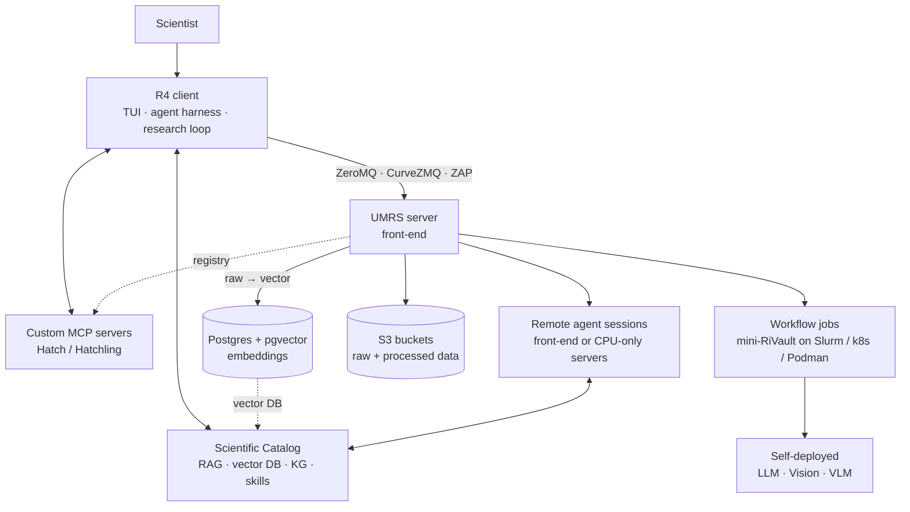
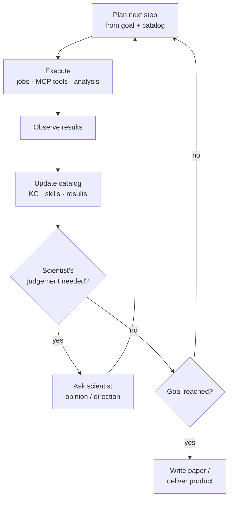
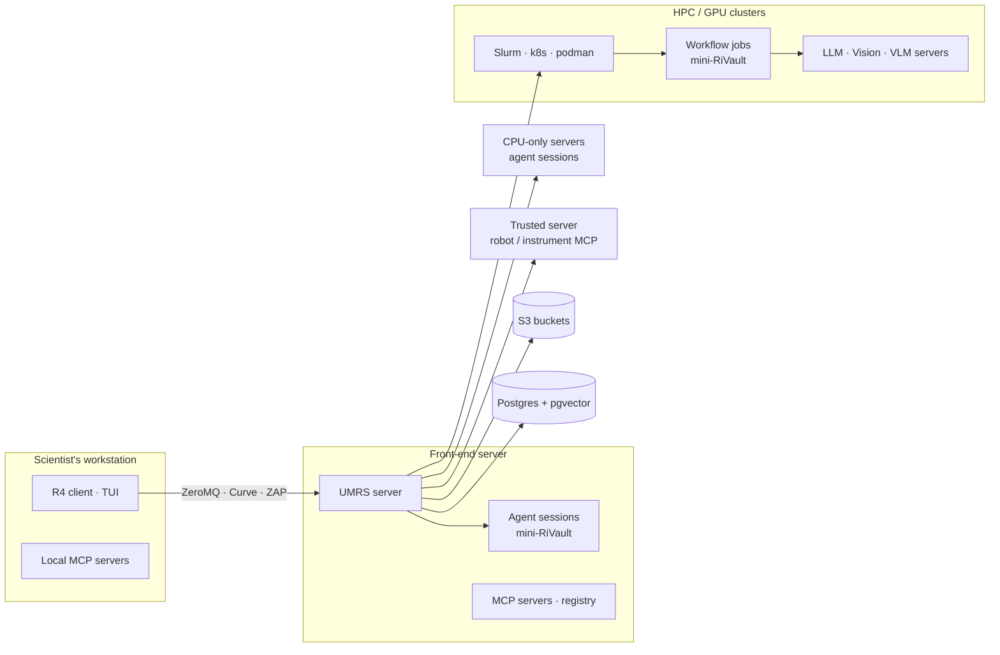
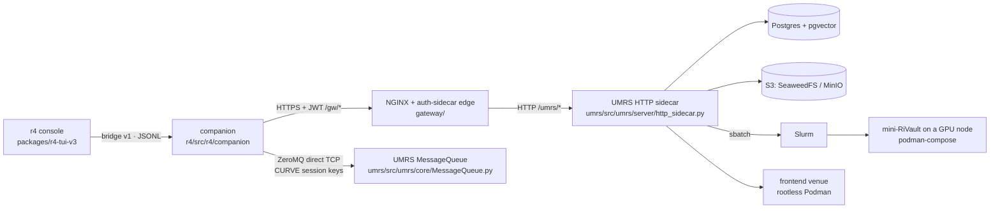

# Design: Architecture

> **Updated 2026-09-22 (design reset)**
> **Audience:** Developers, architects, contributors
> **Status:** CANONICAL design-level architecture reference — §1 is the
> target from [R4-UMRS-DESIGN.md](../../R4-UMRS-DESIGN.md); §2 is what the
> tree does today, verified against the code on the date above; every
> difference is a numbered row (`D-nn`) in
> [R4-UMRS-GAP-ANALYSIS-2026-09-22.md](../../R4-UMRS-GAP-ANALYSIS-2026-09-22.md).
> The repo-root [ARCHITECTURE.md](../../../ARCHITECTURE.md) is the short
> form of the same two layers; this file carries the per-pillar detail.

---

## 1. Target architecture (the design)

Four pillars: **R4** (where the scientist works), **UMRS** (where compute,
data and models live), the **Scientific Catalog** (what the agents know)
and **custom MCP servers** (what the agents can do). R4 talks to UMRS over
one authenticated, encrypted channel; everything heavy runs behind UMRS.

| Pillar | Responsibilities in the design | Where it runs |
|---|---|---|
| R4 | TUI as the single entry point; agent harness; skills; context control; multi-agent team-up; local and remote session control; project and workflow management; the plan → execute → observe → update-catalog loop. R4 never talks to a scheduler, bucket or database directly. | Scientist's workstation; remote sessions on the front-end or CPU-only servers |
| UMRS | Accounts and quotas; ZeroMQ/CurveZMQ/ZAP transport; workflow-job scheduling on Slurm / Kubernetes / Podman; remote agent-session scheduling; self-deployment of LLM / Vision / VLM in mini-RiVault sandboxes; raw → vector conversion into Postgres + pgvector; S3 storage by project; MCP registry. UMRS is the parent process of everything it launches. | Front-end server, dispatching to clusters and dedicated servers |
| Scientific Catalog | One portable, versioned bundle per domain or project: source materials, RAG index + vectors, knowledge graph, skills, MCP server definitions, metadata (domain, contributors, version, provenance, licence). Grows by explicit ingestion and semi-automatically from loop cycles; exportable between installations. | Built through R4 and UMRS; materials in S3, vectors in Postgres + pgvector |
| Custom MCP servers | Built and published with Hatch, discovered and run with Hatchling; registered in UMRS with version, owner and required placement; hardware-bound servers only on trusted hosts, reached through UMRS. | Local, front-end, or a dedicated trusted server |

**Security statement.** An institution's security team should be able to
reason about the platform as **one gateway** (UMRS), **one sandbox type**
(mini-RiVault: a firewalled Podman container around every job, agent
session and model server), **one transport** (ZeroMQ / CurveZMQ / ZAP) and
**two stores** (S3, Postgres + pgvector). The per-layer table is in
[security.md](security.md).

**The research loop.** R4 iterates; UMRS executes the heavy steps; the
catalog is both input and output.

**Deployment topology.** One UMRS server on the institution's front-end is
the hub; every other host is reached through it.

---

## 2. Implementation today (2026-09-22), per pillar

### 2.1 The request path today

| | Design | Today | Gap |
|---|---|---|---|
| Control plane | ZeroMQ + CurveZMQ + ZAP | HTTPS to the NGINX + auth-sidecar edge (`gateway/nginx/conf.d/server.conf`, `/gw/<family>/*`), rewritten to the UMRS HTTP sidecar (`/umrs/<family>/*`); JWT validated by `gateway/sidecar/main.py` on every route via `auth_request`; mandatory for `chat`, `chat_completion`, `mcp_*` (`OPERATION_GATEWAY_ONLY`, `r4/src/r4/config.py`) and the only path for knowledge, sessions, catalog, projects and venue families | D-01, D-02 |
| Data plane | same channel | ZeroMQ string commands (`CMD:client:payload`, `umrs/doc/zmq_api_contract.md`) over direct TCP for `status`, models, jobs, workflows, `file_upload` / `file_download`, `export_embeddings` (`OPERATION_ZMQ_ELIGIBLE`; routed by `r4/src/r4/_transport_router.py` with HTTP fallback). On umrs-front each cluster stack has its own control port and data range (`deploy/ansible/inventory/umrs-front/group_vars/umrs_front.yaml`: rccs 50090 / 50091–50098, ai4s 50100 / 50101–50108, bdrt 50110 / 50111–50118, octopus 50120 / 50121–50128) | D-01, D-50 |
| Identity | ZAP keys managed by UMRS accounts | JWT (admin-issued HS256 or OIDC RS256; SAML SP routes in the sidecar) → session-CURVE keypair registered at `POST /umrs/zmq/session` (`umrs/src/umrs/api/zmq_sessions.py`, `umrs/src/umrs/core/session_curve_provider.py`); ZAP authenticator in `umrs/src/umrs/core/zmq_security.py`; umrs-front runs `umrs_front_zmq_auth_type: session` | D-03 |
| Encryption | every message | External HTTPS terminated by Apache on umrs-front port 443 (`deploy/ansible/roles/front_end/tasks/apache-gateway-proxy.yaml`); edge → UMRS is plain HTTP; ZeroMQ is CURVE-encrypted when session mode is on | D-05 |
| Versioning | versioned public protocol | Unversioned HTTP families in three lanes; ZeroMQ protocol strings; bridge protocol v1 (`BRIDGE_PROTOCOL_VERSION = 1`) | D-04 |

The edge is UMRS's edge process (ADR-059, Accepted 2026-09-22): it stays,
is deployed on every profile and is never bypassed (CONSTITUTION §1.5).
(2026-10-18: said "Until decision D-01/D-02 is taken"; the identity and
versioning cells above are as of 2026-09-22 — D-03 and D-04 are Implemented
since, see their gap rows.)

### 2.2 R4 today

| Capability (design) | Code today | Status |
|---|---|---|
| TUI single entry point | `r4 console` → OpenTUI v3 binary or Bun source (`packages/r4-tui-v3/`, ten routes under `src/routes/`); Python CLI `r4/src/r4/_cli/` (69 modules); secondary surfaces: `packages/r4-web/`, `vscode-extension/`, `r4/src/r4/jupyter/`, `mcp-apps/` | Partial (D-25) |
| Agent harness | `r4/src/r4/companion/` — `agent.py`, `tools.py`, `permissions.py` (`ASK_ALWAYS` / `AUTO_SAFE` / `TRUST`), `harness/` (probe, guides, sensors, progress, steering), `acp_session.py` + `r4/src/r4/acp.py` | Implemented (D-26) |
| Skills | 27 builtin groups in `r4/src/r4/companion/builtin/` (Agent Skills `SKILL.md`), `companion/skills.py`; UMRS registry `umrs/src/umrs/skills/` at `/umrs/skills` | Implemented; not in the catalog bundle, no per-skill tests (D-27) |
| Context control | `companion/context.py`, `context_budget.py`, `r4/src/r4/knowledge_selection.py` | Implemented (D-28) |
| Multi-agent team-up | `packages/r4-teamengine-spi/` + `r4/src/r4/teams/` + `engines/r4-engine-langgraph/` (ADR-020); older `r4/src/r4/teamup/` and `r4/src/r4/research_loop/team.py`; companion sub-agents | Fragmented (D-29) |
| Session control | SQLite store (`companion/session_store.py`) mirrored to Postgres (`companion_session_snapshots`, migration 0080); remote sessions via the frontend venue (`r4/src/r4/venue.py`, `venue_rail.py`, `venue_worker.py`) | Partial (D-09, D-30) |
| Projects and workflows | `r4/src/r4/project.py`, `_cli/project.py`; `r4/src/r4/workflows.py`, `workflow_lint.py`, `workflow_graph.py` | Implemented (D-31, D-08) |
| Research loop | Client trackers `companion/science_loop.py`, `research_loop/orchestrator.py`, `agent/research_director.py`, report `research_loop/publish.py`; the engine is server-side (§2.3) | Fragmented; no catalog-grounded paper (D-32, D-45) |
| "Only UMRS" rule | No scheduler or DB access from `r4/`; exceptions: per-user `s3cfg` written by `r4/src/r4/_cli/login.py`, and `r4/src/r4/providers/` (OpenAI-compatible, Bedrock, Ollama, LiteLLM) reaching public LLM APIs directly | Partial (D-16, D-37, D-51) |

### 2.3 UMRS today

**Server process.** `umrs/src/server_umrs.py` boots the ZeroMQ
`MessageQueue` (control socket + per-user data sockets; CURVE/ZAP when
`UMRS_ZMQ_AUTH_TYPE` is `curve` or `session`) and the FastAPI HTTP sidecar
(`umrs/src/umrs/server/http_sidecar.py`, default port 8082), whose explicit
`include_router` list mounts every API family. `umrs/src/umrs/shared/lanes.py`
classifies the 42 mounted families into `v1-stable` (6), `v1beta` (31) and
`internal` (5) (counts corrected 2026-10-18: `pipelines` and `verification`
deleted in hardening H-10.1, `buckets` and `scientific-catalogs` added
earlier); `/umrs/context` is the single named dormant family (ADR-056). The sidecar's lifespan also starts the janitor, the scheduler
service and the durable-job runtime.

**Durable jobs.** `umrs/src/umrs/jobs/` implements Job / Attempt / commit
pointer with Postgres advisory locks (one active attempt), LOST-on-restart +
requeue (`reconciler.py`, `session_recovery.py`), per-attempt manifests and
attempt-scoped S3 credentials (`attempt_credentials.py`, `sts_federation.py`).
`JobType` (`jobs/models.py`): `index_build`, `embedding_batch`,
`pipeline_run`, `workflow_run`, `endpoint_provision`, `model_download`,
`cleanup`, `data_ingestion`, `knowledge_ingest`, `knowledge_understand`,
`knowledge_embed`, `knowledge_verify`, `knowledge_export`,
`endpoint_upgrade`, `companion_worker`, `frontend_session`,
`research_loop_job`, `knowledge_reindex`, `vision_infer`, `batch_infer`,
`fine_tune`, `model_eval`, `session_gc`. `embedding_batch`, `pipeline_run`
and `fine_tune` are registered but dispatch-blocked
(`_UNDISPATCHABLE_JOB_TYPES`, `umrs/src/umrs/api/jobs.py`).

**Orchestration and the sandbox.**

| Workload | Sandbox today | Design target | Gap |
|---|---|---|---|
| LLM / vision endpoint on a GPU node | `orchestrator/slurm_podman_backend.py` submits the site's `mini-rivault-llm/serve-model.slurm`, which runs `podman-compose` profiles from `serve-model.yaml` (`harness` = NGINX + LiteLLM, `vllm`, `vision-bentoml`, `vision`, `rag`, `egress`, `custom-mcp`, `sts-renewal`, `litellm-db`); `assert-offline.sh` at boot; `kubernetes_backend.py` and `compose_backend.py` are the other execution authorities (ADR-004) | mini-RiVault `model-server` profile | D-13 |
| Workflow job | same stack under the endpoint's attempt (`jobs/workflow_run.py`, `umrs/src/umrs/workflow/`, `pipeline_sdk/`) | mini-RiVault `gpu-job` | D-13 |
| Remote agent session | rootless Podman on the front-end (`umrs/src/umrs/venues/frontend_podman.py`), dual-homed egress pod, nftables guard rendered by `venues/egress_nft.py` (privileged, opt-in), credential-injecting `umrs/src/umrs/infer_proxy/` | mini-RiVault `cpu-agent` | D-12, D-13 |
| Embedding / ingest compute | in the UMRS server process (`umrs/src/umrs/inference/embeddings.py`, `jobs/knowledge_adapters.py`) | `embedding-job` sandbox | D-12 |
| Default MCP runtimes | host venv installed by the privileged Ansible cadence (`deploy/ansible/roles/front_end/tasks/frontend-default-mcp-deps.yaml`) | `mcp-trusted` profile | D-12, D-21 |
| Singularity path | `orchestrator/slurm_backend.py` + `launcher_stack.py` still in the tree (legacy) | none | D-12 |

**Models.** `umrs/src/umrs/model_registry/` (scopes, versions, conversion,
certification, capability detection in `detect.py`); OpenAI-compatible
proxy `/umrs/llm/v1/*` → LiteLLM (`umrs/src/umrs/api/llm.py`); BentoML
vision service (`umrs/src/umrs/vision_service/`, SAM3 / MAE / HMAE
adapters); in-process sentence-transformers embeddings. No documented VLM
endpoint class (D-10); three inference contracts instead of one (D-11);
`fine_tune` dispatch gated (D-54).

**Accounts.** JSON records under `user_files/` (`umrs/src/umrs/admin/user_store.py`);
durable projects in Postgres (`api/projects.py`, migration 0095, ADR-051);
circles (0119, project-scoped — ADR-086); per-user CPU-process and disk caps (`api/agent_quota.py`,
0096); companion trust allowlist (`umrs/src/umrs/companion_trust/`, scope
grammar `system | project: | circle: | user: | session:` (legacy `group:` inert, ADR-086) in
`shared/scope_grammar.py`); asset and source grants (`umrs/src/umrs/grants/`).
`umrs/src/umrs/tenants/` is experimental and unwired. Gap D-06.

**Stores.**

| Plane | Today | Gap |
|---|---|---|
| Postgres + pgvector | `umrs/src/umrs/migrations/` (`0001` … `0100`, 69 files): jobs, endpoints, models, projects, knowledge tables (`knowledge_graphs` 0069, `knowledge_node_embeddings` 0075, ontologies 0091, visibility 0092/0093), `memory_vectors` (0010), catalog objects (0054), session snapshots (0080), trust, grants, sealed sources (0086), audit, A2L | D-18 (accounts still JSON) |
| S3 | `S3_BACKEND` abstraction (`umrs/src/umrs/shared/storage/s3.py`, ADR-055): SeaweedFS on umrs-front, MinIO elsewhere; presigned URLs internal; attempt-scoped STS (ADR-043) | D-16 (`s3cfg` to clients), D-17 (fleet cutover) |
| Vectors | text via `knowledge_ingest → knowledge_understand → knowledge_embed`; image via MAE/HMAE/ResNet; video modality detection only (`data_catalog/modality.py`); `jobs/vector_version_store.py` tracks the producing model | D-14, D-15 |

### 2.4 Scientific Catalog today

No catalog object exists (D-39); the parts do:

| Design component | Today |
|---|---|
| Source materials | staged at `knowledge-uploads/<project>/…` in S3 by `POST /umrs/knowledge/upload`; indexed as `catalog_objects` (the *data* catalog, `umrs/src/umrs/data_catalog/`, `/umrs/catalog`) |
| RAG index + vector DB | `knowledge_node_embeddings`, `memory_vectors`; retrieval facade `umrs/src/umrs/api/rag_service.py`; hybrid search in `umrs/src/umrs/knowledge/` |
| Knowledge graph | `knowledge_nodes` / `knowledge_edges` with `graph_id`; registry + proposals (0069); ontology registry (0091, ADR-049); server-side mutation guard `umrs/src/umrs/api/_knowledge_mutation_guard.py` |
| Skills | builtin / user / project `SKILL.md` dirs + UMRS registry — not in the bundle (D-27) |
| MCP server definitions | `umrs/src/umrs/mcp/` registry — not in the bundle (D-23) |
| Metadata, versioning, export | `r4-kb` v1.2 bundle (`umrs/src/umrs/knowledge/bundle_export.py`, HMAC-signed; import accepts 1.0–1.2); no contributors / licence / redaction (D-40, D-41, D-46) |

The research-loop engine that grows the catalog is server-hosted:
`umrs/src/umrs/knowledge/loop.py` under the `research_loop_job` kind
(`jobs/research_loop_backend.py`, `knowledge/loop_hosting.py`, ADR-036),
findings minted with provenance (`knowledge/finding_ingest.py`); proposals
are decided by the user, never auto-approved (D-35).

### 2.5 Custom MCP servers today

`umrs/src/umrs/mcp/` + `/umrs/mcp/*` (register, list, tools, lookup, call,
health; SSRF guard on server URLs in `api/mcp.py`); `r4 mcp hatch
create / install / connect / search / share` (`r4/src/r4/_cli/mcp.py`,
`r4/src/r4/integrations/hatchling.py`, `hatch_runtime.py`); default registry
`mcp-servers/hatch-registry/` with six packages; platform servers in
`mcp-servers/src/r4_mcp/servers/`; EgressGuard `mcp-servers/src/r4_mcp/egress_guard.py`.
No placement or trust-class field, no trusted-host venue (D-19, D-21, D-24).

### 2.6 Deployment today

Every managed host is deployed by `deploy/ansible/bootstrap.sh --profile
<name>` (inventories `umrs-front`, `rccs-cloud`, `bdrt`, `octopus`,
`atom-k8s`). umrs-front (`data0`) runs an **independent UMRS stack per
cluster** with its own edge ports, Postgres, object store and ZeroMQ range
(D-47); satellites reach it through reverse SSH tunnels (ADR-018); there is
no CPU-only or trusted-host venue (D-48, D-49). Configuration is
`site.yaml` + `.env` (ADR-008).

---

## 3. Key decisions

| Decision | ADR |
|---|---|
| ZeroMQ data plane + HTTP control plane coexist | [ADR-001](../../adr/001-zmq-http-dual-transport.md) |
| Job / Attempt separation; per-attempt manifests and reproduce | [ADR-002](../../adr/002-durable-job-attempt-separation.md) |
| NGINX + auth-sidecar edge; Python gateway removed 2026-09-11 | [ADR-003](../../adr/003-three-component-gateway.md), [ADR-014](../../adr/014-python-gateway-retirement.md) |
| One `execution_authority` per job, never changed | [ADR-004](../../adr/004-execution-authority-invariant.md) |
| `r4-contracts` is stdlib-only | [ADR-005](../../adr/005-r4-contracts-stdlib-only.md) |
| Offline inference and the egress model | [ADR-006](../../adr/006-mini-rivault-container-security.md), [ADR-015](../../adr/015-knowledge-ingest-egress.md), [ADR-040](../../adr/040-egress-enforcement-convergence.md) |
| `site.yaml` + `.env`, no overwrite of operator env | [ADR-008](../../adr/008-site-config-env-overlay.md) |
| Data catalog + ingestion; knowledge portability (`.kb`) | [ADR-011](../../adr/011-data-catalog-and-ingestion.md), [ADR-013](../../adr/013-knowledge-portability-and-compute-separation.md), [ADR-032](../../adr/032-knowledge-package-portability-contract.md) |
| Team Engine SPI; workflow model unification | [ADR-020](../../adr/020-team-engine-spi.md), [ADR-021](../../adr/021-workflow-model-unification.md) |
| Default MCP set and hardening contract | [ADR-022](../../adr/022-default-mcp-stdio-adapters.md), [ADR-023](../../adr/023-default-mcp-hardening-contract.md) |
| A2L as a bounded domain inside UMRS | [ADR-034](../../adr/034-a2l-conservation-domain-merge.md) |
| Enforcement points: edge authn, UMRS authz, client gate | [ADR-035](../../adr/035-enforcement-point-matrix.md) |
| Loop hosting as a durable job kind | [ADR-036](../../adr/036-loop-hosting-companion-job-kind.md) |
| Taint: untrusted content never auto-approves | [ADR-039](../../adr/039-untrusted-content-provenance-taint.md) |
| Attempt-scoped S3 credentials and STS | [ADR-043](../../adr/043-attempt-scoped-s3-credentials.md) |
| HPC venue portability | [ADR-045](../../adr/045-hpc-venue-portability-contract.md) |
| Remote sessions: sealed credentials, inference proxy, venue | [ADR-046](../../adr/046-remote-session-credential-egress.md) |
| Ontology as typed contract; visibility tiers | [ADR-049](../../adr/049-ontology-typed-contract.md), [ADR-050](../../adr/050-visibility-and-session-history-build.md) |
| Self-service projects and agent resource caps | [ADR-051](../../adr/051-self-service-projects-agent-resource-poles.md) |
| Import discipline; dormant `/umrs/context` | [ADR-053](../../adr/053-umrs-import-discipline.md), [ADR-056](../../adr/056-dormant-context-surface.md) |
| Object-store backend abstraction (SeaweedFS) | [ADR-055](../../adr/055-object-store-backend-seaweedfs.md) |

Structural decisions as of 2026-09-22 (need an ADR, not code): transport and
edge (D-01/D-02/D-50), topology (D-47), sandbox universality and profiles
(D-12/D-13), the catalog object (D-39), naming (D-53). (2026-10-18: since
taken — transport and edge ADR-059, topology ADR-060 (D-47 converging),
sandbox profiles ADR-061 (D-12/D-13 Partial), the catalog object landed
(D-39 Partial); naming D-53 is still open.)

---

## Related documents

| Document | Purpose |
|---|---|
| [R4-UMRS-DESIGN.md](../../R4-UMRS-DESIGN.md) | The target design |
| [R4-UMRS-GAP-ANALYSIS-2026-09-22.md](../../R4-UMRS-GAP-ANALYSIS-2026-09-22.md) | Design vs code, rows D-01 … D-56 |
| [R4-UMRS-PLATFORM-OVERVIEW.md](../../R4-UMRS-PLATFORM-OVERVIEW.md) | What runs today, deployments, queue |
| [ARCHITECTURE.md](../../../ARCHITECTURE.md) | Short two-layer reference and enforced invariants |
| [CONSTITUTION.md](../../../CONSTITUTION.md) | Non-negotiable rules |
| [components.md](components.md) | Component catalog by pillar |
| [security.md](security.md) | Security model, per layer |
| [dataflow.md](dataflow.md) | Target and current data flows |
| [apis.md](apis.md) | API surfaces and protocols |
| [glossary.md](glossary.md) | Canonical terms |
| [UMRS_CORE_RUNTIME_SPEC.md](../runtime/UMRS_CORE_RUNTIME_SPEC.md) | UMRS runtime boundaries (pre-reset, 2026-05) |
