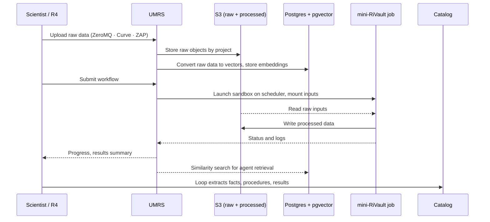
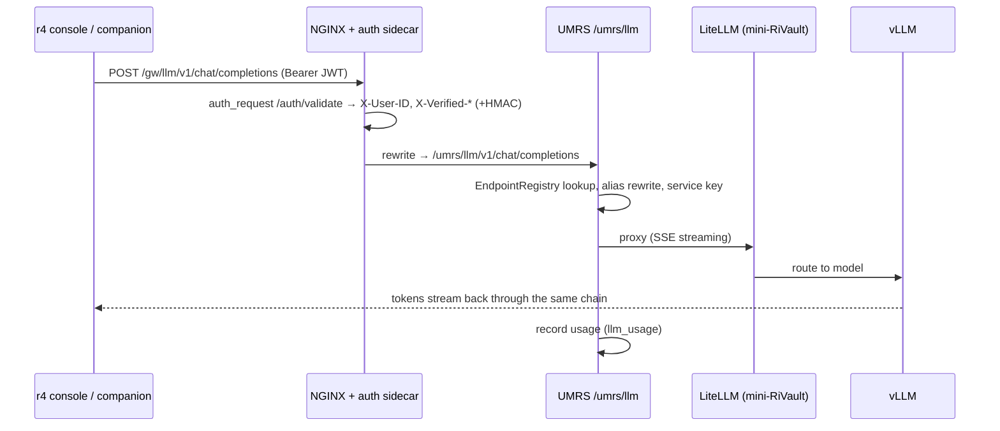
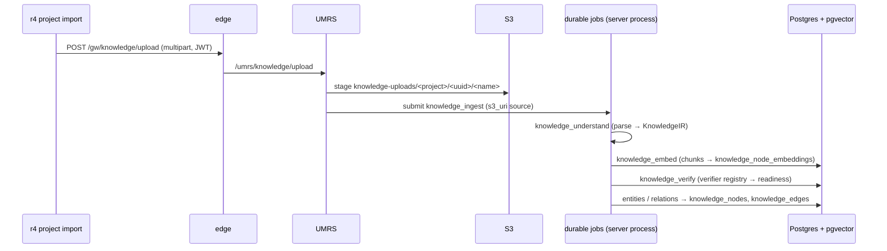
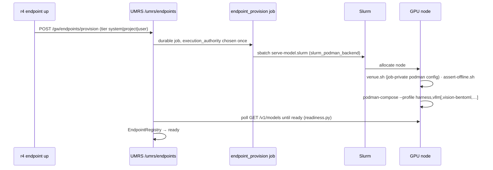
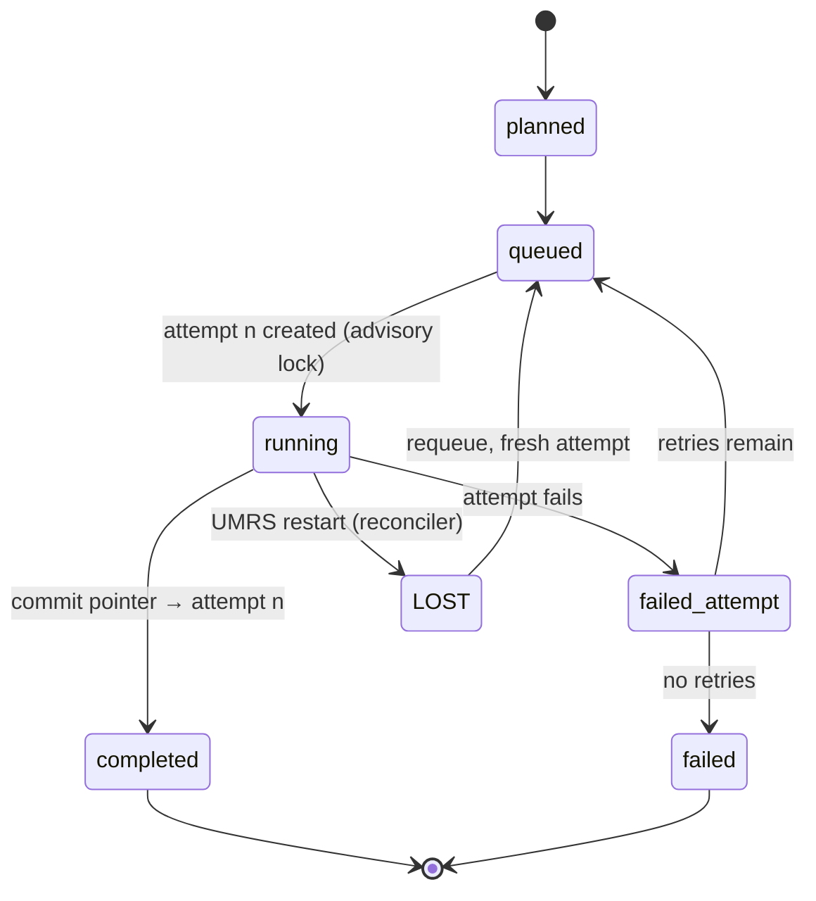
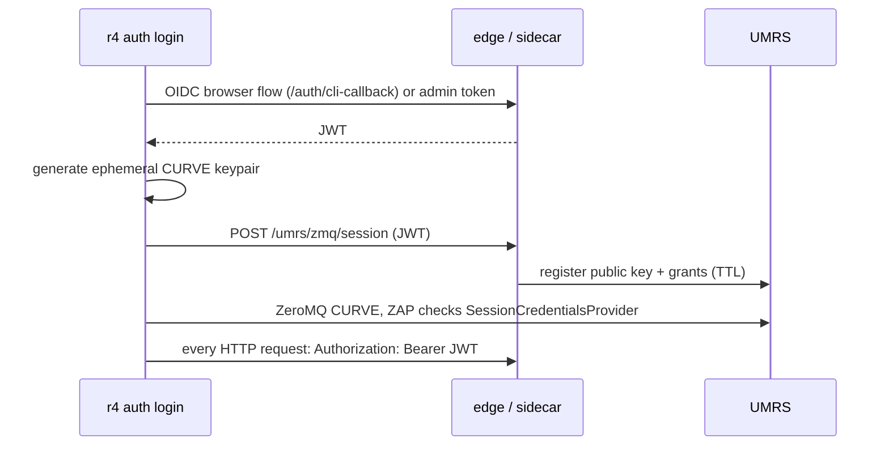

# Design: Data Flow

> **Updated 2026-09-22 (design reset)**
> **Audience:** Developers, architects, contributors
> **Status:** CANONICAL data-flow reference — §1 is the target flow from
> [R4-UMRS-DESIGN.md](../../R4-UMRS-DESIGN.md); §2 lists where today's flow
> differs; §3 draws today's flows, each checked against the code paths it
> names on the date above. Gap rows (`D-nn`) are in
> [R4-UMRS-GAP-ANALYSIS-2026-09-22.md](../../R4-UMRS-GAP-ANALYSIS-2026-09-22.md).

---

## 1. Target flow (the design)



Raw data lands in S3 and is vectorised by UMRS into Postgres + pgvector;
jobs process it only inside a mini-RiVault and write outputs back to S3;
the research loop distils those outputs into the catalog.

## 2. Where today's flow differs

| Step in the design | Today | Gap |
|---|---|---|
| One channel, R4 → UMRS | Two: HTTPS through the NGINX + auth-sidecar edge for control-plane families; ZeroMQ direct TCP for files, jobs, models, workflows | D-01, D-02 |
| Storage written only through UMRS | Clients also receive a per-user `s3cfg` at login (`r4/src/r4/_cli/login.py`) | D-16 |
| Raw → vector conversion by UMRS | Runs, but inside the UMRS server process (`umrs/src/umrs/inference/embeddings.py`, `jobs/knowledge_adapters.py`), not in a sandbox | D-12 |
| Every job in a mini-RiVault | Compute jobs yes; embedding/ingest and default MCP runtimes no | D-12 |
| Loop writes into the catalog | Findings are minted with provenance; graph changes are *proposed* and need a user decision; no catalog object to version | D-35, D-39, D-45 |
| Remote agent sessions read the catalog | The worker rail forwards only the `workflows` and `jobs` families | D-42 |

---

## 3. Flows today

### 3.1 Chat and inference



Code: `gateway/nginx/conf.d/server.conf` (`/gw/llm/`),
`gateway/sidecar/main.py`, `umrs/src/umrs/api/llm.py`,
`umrs/src/umrs/orchestrator/endpoint_registry.py`. `/gw/chat/*` is the
project-aware Assistant Service surface (`umrs/src/umrs/api/chat.py`,
ADR-012); on umrs-front the service is deployed as a CPU-only front-end
service (`deploy/ansible/roles/front_end/tasks/frontend-assistant-service.yaml`).
`/umrs/rag/*` proxies to the RAG service of the active mini-RiVault
(`api/rag.py`, compose profile `rag`), while knowledge retrieval
(`/umrs/knowledge/query`, `api/rag_service.py`) runs in the server process.

### 3.2 Knowledge ingestion (explicit catalog growth, D-38)



Code: `umrs/src/umrs/api/knowledge_upload.py` (`_BUCKET_PREFIX =
"knowledge-uploads"`, disk-ledger charge, `JobType.KNOWLEDGE_INGEST`),
`umrs/src/umrs/jobs/knowledge_adapters.py` (ingest → understand → embed
chain), `umrs/src/umrs/knowledge/verify.py` + `verifiers/`,
`umrs/src/umrs/knowledge_graph/`. Remote sources (`http_url`, `git_repo`)
are fetched only inside the ingest job through the allowlisted
`knowledge/egress_fetch.py` (ADR-015). Skill scaffolding is absent (D-38).

### 3.3 File movement

```mermaid
flowchart LR
    subgraph HTTP[HTTPS through the edge]
        UP[POST /gw/files/upload<br/>upload_limit · body unlimited] --> UF[/umrs/files/upload]
        DL[GET /gw/files/download/*<br/>validated] --> DF[/umrs/files/download/*]
        DF -. X-Accel-Redirect .-> INT[/internal/files/ · /internal/s3/]
    end
    subgraph ZMQ[ZeroMQ direct TCP]
        CQ[CREATE_DATA_QUEUE:user] --> DQ[per-user PUSH→PULL socket]
        DQ --> FILE[FILE:user:count · OBJECT:user:count]
    end
    subgraph NODE[Compute node]
        PRE[presigned URL · attempt-scoped STS<br/>jobs/&lt;job&gt;/attempt_&lt;n&gt;/]
    end
    UF --> S3[(S3)]
    FILE --> S3
    PRE --> S3
```

Code: `gateway/nginx/conf.d/server.conf`, `umrs/src/umrs/api/files.py`
(`/upload`, `/presign`, `/download/{path}`, `/download-status`),
`umrs/src/umrs/api/intake_uploads.py` (manifest + parts + complete),
`umrs/doc/zmq_api_contract.md`, `r4/src/r4/umrs_transport.py`,
`umrs/src/umrs/jobs/attempt_credentials.py`, `jobs/sts_federation.py`.
The per-user `s3cfg` path (D-16) bypasses this picture and is being
removed.

### 3.4 Endpoint provisioning



Code: `umrs/src/umrs/api/endpoints.py`, `orchestrator/slurm_podman_backend.py`,
`mini-rivault-llm/serve-model.slurm`, `serve-model.yaml`, `venue.sh`,
`assert-offline.sh`, `orchestrator/readiness.py`, `orchestrator/janitor.py`
(ghost endpoints). The Singularity path (`orchestrator/slurm_backend.py`)
is legacy (D-12).

### 3.5 Remote agent session (frontend venue)

```mermaid
sequenceDiagram
    participant C as r4 console
    participant U as UMRS
    participant J as frontend_session job
    participant W as worker sandbox (rootless Podman)
    participant IP as inference proxy
    C->>U: POST /umrs/companion/sessions/{sid}/venue/start
    U->>J: durable job (attempt = sandbox life)
    J->>W: network → lease → secret → sidecar pod → egress ip → worker
    W->>W: isolation self-test (direct egress must fail)
    W->>U: rail: GET snapshot · POST queue/pop · heartbeat (lease token)
    W->>IP: LLM calls (session token; key unsealed in the proxy)
    W->>U: rail: approvals → durable intents; owner decides from any client
    C->>U: POST …/venue/stop
```

Code: `umrs/src/umrs/api/companion_venue.py`,
`umrs/src/umrs/jobs/frontend_session_backend.py`,
`umrs/src/umrs/venues/frontend_podman.py`, `r4/src/r4/venue_worker.py`,
`umrs/src/umrs/infer_proxy/app.py` (ADR-046). The rail re-dispatches only
`workflows` and `jobs` (`RAIL_GW_FAMILIES`, D-42).

### 3.6 MCP tool call

```mermaid
flowchart LR
    A[companion / agent] -- /gw/mcp/* --> E[edge] --> U[/umrs/mcp/call]
    U -- SSRF guard on server.url --> M[registered MCP server<br/>front-end runtime or user host]
    M -. network .-> EG[EgressGuard allowlist]
    A -- local --> H[Hatch package via<br/>r4 hatch_runtime bridge]
```

Code: `umrs/src/umrs/api/mcp.py` (`/servers`, `/tools`, `/tools/lookup`,
`/call`, `/health`), `umrs/src/umrs/mcp/store.py`,
`r4/src/r4/integrations/hatch_runtime.py`, `mcp-servers/src/r4_mcp/`.
Placement and trust classes are not modelled (D-21, D-24).

### 3.7 Durable job lifecycle



Code: `umrs/src/umrs/jobs/models.py`, `store.py`, `scheduler.py`,
`reconciler.py`, `session_recovery.py` (ADR-002). Outputs are
attempt-scoped (`jobs/<job_id>/attempt_<n>/`); the commit pointer is the
read authority; per-attempt manifests support `POST /umrs/jobs/{id}/reproduce`.

### 3.8 Authentication



Code: `r4/src/r4/_cli/login.py`, `r4/src/r4/curve_session.py`,
`gateway/sidecar/main.py`, `umrs/src/umrs/api/zmq_sessions.py`,
`umrs/src/umrs/core/session_curve_provider.py`. Login also writes the
`s3cfg` (D-16).

### 3.9 Research loop (semi-automatic catalog growth)

```mermaid
flowchart LR
    R[r4 project loop /<br/>console loop route] --> API[/umrs/loops]
    API --> J[research_loop_job]
    J --> L[knowledge/loop.py<br/>goal → plan → retrieve → hypothesis → experiment → analyse]
    L --> W[workflow / job execution ports]
    L --> F[finding_ingest: knowledge artifacts + provenance]
    L --> A[approval inbox (durable)]
    A --> U[scientist decides from any client]
    F --> P[proposals → user decision → knowledge graph]
    L --> O[publish.py Markdown report]
```

Code: `umrs/src/umrs/api/loop.py`, `jobs/research_loop_backend.py`,
`knowledge/loop_hosting.py`, `knowledge/loop.py`, `knowledge/finding_ingest.py`,
`knowledge/tool_approvals.py`, `companion_trust/approval_inbox.py`,
`r4/src/r4/research_loop/publish.py` (ADR-036). Cluster-hosted runs
(`cluster:<site>`) report back through the `/gw/loopjob/*` HMAC lane.
No ask-the-scientist policy, budgets or claim-level provenance yet (D-33,
D-36, D-45).

---

## Related documents

| Document | Purpose |
|---|---|
| [architecture.md](architecture.md) | Target architecture and implementation map |
| [components.md](components.md) | Component catalog |
| [security.md](security.md) | Security model per layer |
| [apis.md](apis.md) | Route tables and protocols |
| [COMMUNICATION_ARCHITECTURE.md](../runtime/COMMUNICATION_ARCHITECTURE.md) | Transport paths (pre-reset) |
| [RUNTIME_TOPOLOGY_REFERENCE.md](../runtime/RUNTIME_TOPOLOGY_REFERENCE.md) | Boot sequence, thread map (pre-reset, 2026-05) |
