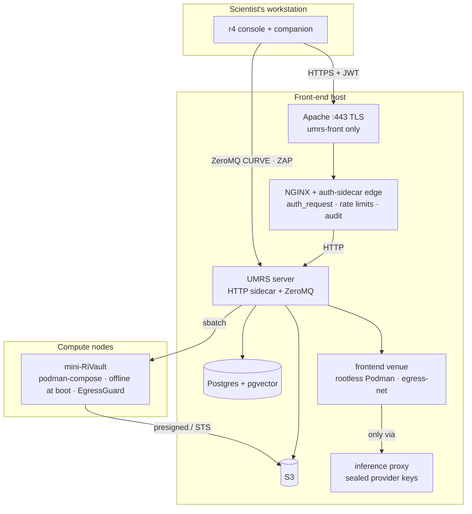

# Design: Security

> **Updated 2026-09-22 (design reset)**
> **Audience:** Developers, architects, security reviewers
> **Status:** CANONICAL security model — §1 is the design's model
> ([R4-UMRS-DESIGN.md](../../R4-UMRS-DESIGN.md), "Data flow and security
> model"); §3 says, layer by layer, what enforces it today (file paths
> verified on the date above) and which gap row it falls short on
> ([R4-UMRS-GAP-ANALYSIS-2026-09-22.md](../../R4-UMRS-GAP-ANALYSIS-2026-09-22.md)).
> Operator-facing invariants: [PLATFORM_CONTRACT.md](../../../PLATFORM_CONTRACT.md).
> Binding rules: [CONSTITUTION.md §2](../../../CONSTITUTION.md).

---

## 1. The design's security model

Data moves in one direction by default: from the scientist's side into
UMRS-controlled storage, then into sandboxed compute, with results written
back to storage and summarised into the catalog. Nothing crosses a boundary
without authentication, and nothing runs outside a sandbox.

| Layer | Mechanism | Guarantee |
|---|---|---|
| Transport | ZeroMQ with CurveZMQ (Curve25519) encryption | Confidentiality and integrity of every client–server message |
| Authentication | ZAP with per-user keys managed by UMRS accounts | Only enrolled users and hosts can connect; every message is attributable |
| Execution isolation | mini-RiVault: firewalled Podman sandbox per job, session or model server | Jobs see only mounted data and permitted endpoints; no lateral movement |
| Storage access | S3 and Postgres reachable only from UMRS and from sandboxes it launches, scoped by project | Data never exposed directly to clients or to the wider cluster |
| Model locality | LLM / Vision / VLM self-deployed inside the institution | Research data never leaves the site for inference |
| Tool access | MCP servers for hardware run on trusted hosts and are reached through UMRS | Agents cannot bypass the gateway to touch instruments |
| Sharing | Catalog export is an explicit, metadata-carrying bundle | Knowledge is shared deliberately, with provenance and licence attached |

The intent: one gateway (UMRS), one sandbox type (mini-RiVault), one
transport (ZeroMQ / Curve / ZAP), two stores (S3, Postgres + pgvector).

---

## 2. Boundaries today

Trust zones today: the workstation (untrusted client), the edge (JWT
boundary), the UMRS process (authorisation and durable state), the sandboxes
(mini-RiVault on compute nodes; frontend venue on the front-end), the
stores. The design collapses the first two zones into UMRS (D-02).

---

## 3. Layer by layer: what enforces it today

### 3.1 Transport

| Today | Where | Gap |
|---|---|---|
| External HTTPS terminated by Apache on umrs-front port 443, proxied to NGINX | `deploy/ansible/roles/front_end/tasks/apache-gateway-proxy.yaml` | D-05 (other profiles: NGINX directly) |
| Edge → UMRS and UMRS → mini-RiVault are plain HTTP on the internal network | `gateway/nginx/conf.d/server.conf` (`proxy_pass http://umrs`), `umrs/src/umrs/api/llm.py` | D-05 |
| ZeroMQ direct TCP, CURVE-encrypted when `UMRS_ZMQ_AUTH_TYPE` is `curve` or `session`; server sockets refuse to bind without key material | `umrs/src/umrs/core/MessageQueue.py`, `core/zmq_security.py` | D-01 (two transports), D-50 |
| Bridge (console ↔ companion) is local JSONL, no network | `packages/r4-tui-v3/src/bridge/jsonl-client.ts` | — |

### 3.2 Authentication and identity

| Today | Where | Gap |
|---|---|---|
| JWT (admin-issued HS256, or OIDC RS256 via JWKS; SAML SP flow) validated by the sidecar on every `/gw/*` route through NGINX `auth_request`; dev secret refused unless `GATEWAY_ALLOW_INSECURE_DEV_AUTH` on loopback | `gateway/sidecar/main.py` (`validate_jwt`, `validate_auth_config`), `gateway/sidecar/saml_sp.py`, `gateway/nginx/conf.d/server.conf` | D-02 |
| Sidecar forwards `X-User-ID`, `X-Project-ID`, `X-Verified-Project-ID`, `X-Verified-Is-Admin`, `X-Verified-Workflow-Author`, `X-Verified-Project-Memberships`, signed as `X-Verified-HMAC`; UMRS strict mode honours `X-Verified-*` only with a valid signature (`UMRS_HANDSHAKE_HMAC_SECRET`) | `gateway/sidecar/main.py`, `umrs/src/umrs/api/_verified_headers.py`, `r4-contracts/src/r4_contracts/handshake_hmac.py` | — |
| Session-CURVE: `r4 auth login` generates an ephemeral keypair, registers it at `POST /umrs/zmq/session` with grants copied from the JWT; the ZAP authenticator consults the shared `SessionCredentialsProvider`; umrs-front runs `session` mode | `r4/src/r4/curve_session.py`, `umrs/src/umrs/api/zmq_sessions.py`, `umrs/src/umrs/core/session_curve_provider.py`, `deploy/ansible/inventory/umrs-front/group_vars/umrs_front.yaml` | D-03 (identity from JWT, not a UMRS key authority) |
| ZeroMQ commands also carry the JWT; the server builds a per-client auth context | `umrs/src/umrs/shared/auth.py`, `core/MessageQueue.py` | — |
| Cluster-hosted loops reach UMRS through `/gw/loopjob/*` with a pre-signed `X-Verified-HMAC` instead of a JWT | `gateway/nginx/conf.d/server.conf` (`/gw/loopjob/`) | — |
| Remote-session workers authenticate to the rail with a lease token, never a JWT | `umrs/src/umrs/api/_rail_identity.py`, `api/companion_venue.py` | — |
| Accounts: JSON records (role, Slurm accounts, projects, quota); durable projects and circles in Postgres | `umrs/src/umrs/admin/user_store.py`, `api/projects.py`, `api/circles.py` | D-06 |
| Agent authority: autopilot consults the server-side trust allowlist (scopes `system | project: | circle: | user: | session:`; `group:` inert per ADR-086); tainted tool arguments never auto-approve; never-auto tools | `umrs/src/umrs/companion_trust/`, `shared/scope_grammar.py`, `r4/src/r4/companion/permissions.py`, `companion/taint.py`, `r4-contracts/src/r4_contracts/taint.py` (ADR-035, ADR-039) | — |
| Agent-originated knowledge mutation requires an approved proposal for the target graph (`x-r4-actor: agent`); `knowledge_graph_decide` never auto-approves | `umrs/src/umrs/api/_knowledge_mutation_guard.py`, migration 0069, `r4/src/r4/companion/knowledge_graph_tools.py` | — |

### 3.3 Execution isolation

| Today | Where | Gap |
|---|---|---|
| Compute mini-RiVault: podman-compose stack under Slurm; `TRANSFORMERS_OFFLINE=1`, `HF_HUB_OFFLINE=1`, no proxy variables, optional live probe — checked before launch | `umrs/src/umrs/mini-rivault-llm/assert-offline.sh`, `serve-model.slurm`, `serve-model.yaml` (ADR-006) | D-12 (Singularity path still in `orchestrator/slurm_backend.py`) |
| Job-private podman configuration, private network pool, dead-job GC | `umrs/src/umrs/mini-rivault-llm/venue.sh` (ADR-045) | — |
| EgressGuard: deny-by-default forward proxy with exact-host allowlist, private ranges always denied, one audit line per decision; only `model_download` and `knowledge_ingest` jobs and project/user-tier endpoints may talk out | `mcp-servers/src/r4_mcp/egress_guard.py`, `umrs/src/umrs/knowledge/egress_fetch.py`, `orchestrator/site_config.py` (`egress_proxy_*`), `orchestrator/deployment_spec.py` (tier), `api/endpoints.py` (system tier admin-only) (ADR-015, ADR-040) | D-13 (no named profile contract) |
| Direct TCP egress from Slurm compute nodes is site-dependent | [PLATFORM_CONTRACT.md](../../../PLATFORM_CONTRACT.md) 3.4, EGRESS_INFRASTRUCTURE.md | — |
| Frontend venue: rootless Podman worker on `egress-net`, dual-homed egress pod, isolation self-test at start (direct egress and external DNS must fail); host nftables guard is privileged and opt-in | `umrs/src/umrs/venues/frontend_podman.py`, `venues/egress_nft.py`, `r4/src/r4/venue_worker.py`, `deploy/ansible/roles/front_end/tasks/frontend-venue-privileged.yaml` (ADR-046) | D-12 (rootless has no host filter) |
| Custom MCP servers: manifest must declare `sandbox.network = egress_guard`, `filesystem = read_only`, positive memory and runtime limits; hard-fail at load | `mcp-servers/src/r4_mcp/runners/custom_mcp.py` (ADR-023) | D-24 |
| Not sandboxed: embedding and ingest compute (UMRS server process), default MCP runtimes (host venv), the UMRS server itself | `umrs/src/umrs/inference/embeddings.py`, `jobs/knowledge_adapters.py`, `deploy/ansible/roles/front_end/tasks/frontend-default-mcp-deps.yaml` | D-12 |

### 3.4 Storage access

| Today | Where | Gap |
|---|---|---|
| Presigned S3 URLs are minted by UMRS for compute and served to clients only through the edge's internal X-Accel locations; audit never logs the query string | `umrs/src/umrs/api/files.py`, `gateway/nginx/conf.d/server.conf` (`/internal/files/`, `/internal/s3/`, `/gw/files/download/`), `gateway/tests/test_nginx_audit_runtime.py` | — |
| Attempt-scoped credential records (`jobs/<job_id>/attempt_<n>/` prefix, short TTL) and per-attempt STS `AssumeRole` with a prefix-true inline policy, fail-closed | `umrs/src/umrs/jobs/attempt_credentials.py`, `jobs/sts_federation.py`, `api/jobs.py` (`…/attempts/{attempt_id}/credentials[/sts]`) (ADR-043, ADR-055) | — |
| Per-user `s3cfg` is still delivered to the client at login | `r4/src/r4/_cli/login.py` (`_write_s3cfg_from_connect_info`), `umrs/src/umrs/shared/storage/user_s3cfg.py` | D-16 (being removed, never extended) |
| Postgres is reached only by UMRS; `EXPORT_EMBEDDINGS` returns rows through the server, the client never connects | `umrs/doc/zmq_api_contract.md`, `umrs/src/umrs/shared/pg.py` | — |
| Knowledge reads gated by visibility tier (`project | system | ambient`) and asset/source grants | `umrs/src/umrs/knowledge/access_scope.py`, migrations 0092/0093, `umrs/src/umrs/grants/` (ADR-041, ADR-050) | — |
| Object store backend: SeaweedFS on umrs-front, MinIO elsewhere | `umrs/src/umrs/shared/storage/s3.py` (`S3_BACKEND`) | D-17 |

### 3.5 Model locality

| Today | Where | Gap |
|---|---|---|
| Inference containers are offline at boot; model weights are pre-staged or fetched only by `model_download` jobs | `assert-offline.sh`, `umrs/src/umrs/jobs/model_download.py` (ADR-006) | — |
| Remote sessions may route to a public provider through the credential-injecting inference proxy: per-request lease check, path policy per provider kind, unseal of the sealed key, credential-stripping, no redirect following; worker never sees the key | `umrs/src/umrs/infer_proxy/app.py`, `security/seal.py`, `security/sealed_sources.py` (migration 0086), `api/user_sources.py` (ADR-046) | D-51 (no per-project data-class rule) |
| The local companion can call public providers directly with the user's own key | `r4/src/r4/providers/` | D-37, D-51 |

### 3.6 Tool access

| Today | Where | Gap |
|---|---|---|
| MCP server URLs are SSRF-checked at registration and call time (loopback, RFC 1918, link-local, cloud metadata blocked; `MCP_URL_ALLOWLIST` override) | `umrs/src/umrs/api/mcp.py` | — |
| Per-tool capability flags; dangerous tools filtered at registration; hardening contract C1–C10 | `mcp-servers/hatch-registry/packages/*/hatch.json` (`capabilities.tool_capabilities`), `mcp-servers/src/r4_mcp/security.py` (ADR-022, ADR-023) | D-24 (no trust-class vocabulary) |
| Hatch packages run locally through the R4 bridge; default runtimes on the front-end are a host venv | `r4/src/r4/integrations/hatch_runtime.py`, `deploy/ansible/roles/front_end/tasks/frontend-default-mcp-deps.yaml` | D-21 (no trusted-host venue, D-49) |

### 3.7 Sharing

| Today | Where | Gap |
|---|---|---|
| `r4-kb` v1.2 bundle: SHA-256 manifest hash, HMAC signature, embedding-model pin; import verifies integrity and retargets the project | `umrs/src/umrs/knowledge/bundle_export.py`, `bundle_import.py` (ADR-013, ADR-032) | D-40 (no contributors / licence), D-46 (no redaction, no registry) |

---

## 4. Audit and secrets

| Event | Written by | Where |
|---|---|---|
| Every edge request, JWT validation result, download validation | auth sidecar | Postgres `gateway_audit_log` (`gateway/sidecar/main.py`) |
| Egress decisions | EgressGuard; `/umrs/egress/audit` sink | `egress-audit.jsonl` in the sandbox; `egress_requests` (migration 0005) |
| Inference-proxy requests (no bodies, headers or tokens) | `umrs/src/umrs/infer_proxy/app.py` | broker audit table |
| Job and attempt transitions, manifests, credential mints | UMRS jobs | Postgres (`umrs/src/umrs/jobs/`) |
| Knowledge proposals and decisions; A2L lineage | UMRS knowledge / A2L | migration 0069 tables; `umrs/src/umrs/a2l/` |
| Companion tool calls and hatch invocations | `r4/src/r4/companion/event_log.py`, hatch runtime bridge | workstation session store |

Secrets, all environment-driven (`site.yaml` + `.env`, never in git; ADR-008):
the edge JWT secret or JWKS URL and `UMRS_HANDSHAKE_HMAC_SECRET` (sidecar ↔
UMRS), the ZeroMQ server CURVE key (`GET /umrs/zmq/server-key` publishes
the public half), S3 credentials held by UMRS (attempts get STS
credentials instead), the Postgres password, the LiteLLM service key
injected by `umrs/src/umrs/api/llm.py`, and sealed provider keys whose
private half lives only in the inference proxy. Lifecycle and rotation:
SECRET_LIFECYCLE.md.

---

## 5. Invariants enforced by tests and validators

| Invariant | Enforcement |
|---|---|
| Inference containers boot offline; only `model_download` and `knowledge_ingest` have (allowlisted) egress | `assert-offline.sh`, EgressGuard tests, `tools/contracts_fence.py` |
| Presigned URLs never reach external clients or audit logs | `gateway/tests/test_nginx_audit_runtime.py`, `gateway/tests/test_nginx_config.py` |
| Every `/gw/*` route authenticates except documented probes | `tests/test_gateway_route_characterization.py` |
| The edge is stateless; sidecar refuses the dev secret outside dev/test | `gateway/sidecar/main.py` (`validate_auth_config`), CONSTITUTION §2 |
| `X-Verified-*` trusted only with a valid HMAC in strict mode | `umrs/src/umrs/api/_verified_headers.py` |
| ZeroMQ `session` / `curve` sockets fail closed without key material | `umrs/src/umrs/core/zmq_security.py` |
| Agent knowledge mutation requires a recorded user decision | `umrs/src/umrs/api/_knowledge_mutation_guard.py` |
| Remote-session workers never hold a JWT or provider key | `r4/src/r4/venue_worker.py`, `umrs/src/umrs/infer_proxy/` |
| No new path hands storage credentials to a client | CONSTITUTION §2 (D-16 shrinks, never grows) |
| Package boundaries (`r4` ∤ `umrs`, edge imports neither, contracts stdlib-only) | `tools/import_boundary_validator.py`, `tools/contracts_fence.py` |

---

## Related documents

| Document | Purpose |
|---|---|
| SYSTEM_AUTHORITY_TRUST_MODEL.md | Authority model |
| UNTRUSTED_INPUT_SECURITY.md | Input validation and sanitisation |
| EGRESS_INFRASTRUCTURE.md | Site-level egress containment |
| SECRET_LIFECYCLE.md | Credential management |
| AUDIT_AND_INCIDENT_RECONSTRUCTION.md | Audit and forensics |
| [GATEWAY_SIDECAR_BOUNDARY.md](../boundaries/GATEWAY_SIDECAR_BOUNDARY.md) | Edge ↔ UMRS sidecar contract (pre-reset) |
| [PLATFORM_CONTRACT.md](../../../PLATFORM_CONTRACT.md) | Operator-facing invariants |
| [architecture.md](architecture.md) | Target architecture and implementation map |
| [dataflow.md](dataflow.md) | Where data crosses these boundaries |
