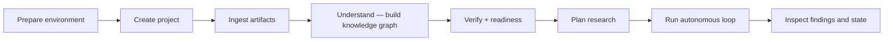

# End-to-End Demo: Project Creation to Autonomous Research Loop

> **2026-09-22:** command names updated to the current CLI (`r4 project import` /
> `r4 project init`; `ingest` / `understand` remain as deprecated aliases). The
> plan itself predates the design reset — read it as a 2026-06 validation plan,
> and see [../R4-UMRS-DESIGN.md](../R4-UMRS-DESIGN.md) for the current target.

This guide is the official walkthrough for running the full autonomous-science
path on a live R4 deployment, from an empty project to a running research loop.

It is the practical companion to [../user-manual/26-autonomous-research.md](../user-manual/26-autonomous-research.md),
which covers the same journey in tutorial form.
The architecture background lives in [PLAN.md](./PLAN.md) and
[DEVELOPMENT_PLAN.md](./DEVELOPMENT_PLAN.md).

## What This Demo Proves

A single, unbroken operator path through every stage of the autonomous-science
surface:



All steps use only `r4` CLI commands and the existing demo scripts — no
debugging, internal harnesses, or test helpers.

---

## Prerequisites

- `r4` CLI installed and authenticated. See [03-authentication.md](../user-manual/03-authentication.md).
- At least one model endpoint reachable. Check: `r4 model list`.
- Source material on disk: a directory with papers (PDF), code (`.py`), notebooks (`.ipynb`),
  and any data or README files. Using your actual project material is strongly
  preferred over synthetic fixtures.

---

## Step 0 — Prepare the environment

```bash
r4 config show
r4 auth status
r4 model list
r4 endpoint list
```

If no endpoint is available yet, provision one:

```bash
r4 endpoint up --model GLM-5.2-NVFP4 --tier system --ttl-sec 0 --wait --timeout 600
```

Or run the onboarding demo:

```bash
bash demos/00_onboarding/run_demo.sh --auto
```

Expected outcome: gateway is reachable, auth works, a model and endpoint are visible.

---

## Step 1 — Create a project

```bash
r4 project create my-research --name "My Research Project"
r4 project switch my-research
r4 project current
```

All subsequent commands use `my-research` as the project identifier.
Replace it with your own project id throughout.

Expected outcome: `r4 project current` prints `my-research`.

---

## Step 2 — Ingest artifacts

Point `ingest` at one or more directories. Every supported file type under
those directories is loaded into the project knowledge store and a manifest
is written to the local project workspace.

```bash
r4 project import my-research ./papers ./code ./notebooks ./data
```

Expected output:

```
✓ Ingested 42 artifact(s) into project my-research
  Workspace: ~/.r4/projects/my-research
```

You can run `ingest` multiple times to add more material. The manifest is
updated incrementally.

Alternatively, use the scientific-data-management demo for a pre-seeded
artifact mix:

```bash
bash demos/08_scientific_data_management/run_demo.sh --auto
```

---

## Step 3 — Build understanding (extract + knowledge graph)

`understand` extracts structured knowledge from every ingested artifact,
persists an immutable `KnowledgeIR` record per artifact, and writes a
derived `knowledge_graph.json` index. All records land under
`~/.r4/projects/my-research/`.

```bash
r4 project init my-research
```

Expected output:

```
✓ Understood 42 artifact(s) for my-research
  Graph: 318 nodes, 512 edges, coverage 0.71
```

**What gets written to disk:**

```
~/.r4/projects/my-research/
  knowledge_ir/         ← one <ir_id>.json per artifact (write-once)
  knowledge_graph.json  ← derived index, regenerable from IR records
```

Running `understand` again on the same artifact content is idempotent —
`knowledge_ir/` records are never overwritten.

### OCR for scanned PDFs (optional)

If your PDFs have no embedded text layer, enable OCR before running
`understand`:

```bash
pip install pymupdf   # client-side rasterizer (one-time)

export KNOWLEDGE_OCR_ENABLED=1
export KNOWLEDGE_OCR_BASE_URL="$(r4 config get gateway_url)/gw/llm/v1"
export KNOWLEDGE_OCR_MODEL="<vision-model-name>"    # from r4 model list
export KNOWLEDGE_OCR_API_KEY="$(r4 config get api_key)"

r4 project init my-research
```

See [Appendix B](../user-manual/appendix-b-env-vars.md#knowledge--ocr) for the
full env-var reference.

---

## Step 4 — Verify and check readiness

Sanity-check what the system learned, then get a readiness assessment before
planning.

```bash
r4 project verify my-research "What is this project about?"
r4 project verify my-research "Which experiments have already been run?"
r4 project readiness my-research
```

Expected `verify` output:

```
Q: What is this project about?
A: <grounded answer>
Confidence: 0.82
Evidence (3):
  - [paper] smith2024.pdf: ...
  - [code] train.py: ...
  - [notebook] eda.ipynb: ...
```

Expected `readiness` output:

```
Readiness: ready
Confidence: high
Critical issues: 0
Recommendation: Proceed to planning.
```

If readiness is `not_ready` or confidence is low, ingest more material and
re-run `understand` before continuing. Do not start the loop on a thin
knowledge base — it will waste execution budget.

---

## Step 5 — Create or confirm a workflow execution surface

The autonomous loop dispatches experiments as UMRS workflows. If you have not
already validated the workflow path, do it now:

```bash
bash demos/06_complex_workflow/run_demo.sh --auto
```

Or use the CLI directly:

```bash
r4 workflow upload ./workflow.zip
r4 workflow list
r4 workflow trigger my-workflow --param model=GLM-5.2-NVFP4
r4 workflow status <execution-id>
```

Expected outcome: a workflow is visible in `r4 workflow list` and a triggered
execution produces a non-empty result payload.

---

## Step 6 — Plan research

Generate a graph-grounded research plan. The plan is saved to the project
workspace so `run` picks it up automatically in the next step.

```bash
r4 project plan my-research "What research should we perform next?"
```

Expected output:

```
✓ Research plan for my-research
  Objectives: 3, hypotheses: 5, experiments: 4
  Success probability: 0.68
  Grounded in 27 knowledge artifact(s)
```

---

## Step 7 — Start the autonomous research loop

The loop is **human-gated**: it will not run until readiness is approved.
Pass `--approve` on the first run.

```bash
r4 project loop start my-research --approve --max-iterations 10
```

Expected output:

```
✓ Research loop completed for my-research
  Iterations: 10, experiments: 8, findings: 6
```

What happens each iteration (target behavior): retrieve relevant knowledge →
generate/select a hypothesis → design an experiment → execute it via workflow →
collect outputs → analyze → evaluate → update the knowledge graph. The loop
stops when the goal is met or the iteration budget is exhausted.

> **Current state (2026-07):** The loop iterates but uses stub experiment
> execution and rotates plan hypotheses. `KNOWLEDGE_RETRIEVAL` does not yet
> query the catalog or knowledge graph. See
> [`docs/autonomous-science/RC1_OPERATIONAL_ROADMAP.md`](../../../docs/autonomous-science/RC1_OPERATIONAL_ROADMAP.md)
> for the wiring plan.

---

## Step 8 — Inspect findings and state

After the loop runs, confirm the results are visible across all operational
surfaces:

```bash
r4 job list --limit 10
r4 workflow list
r4 workflow status <execution-id>
r4 research list
r4 research status <loop-id>
r4 search "What has the system learned so far?" \
  --scope lab_only --project my-research --no-web
```

Expected outcome: jobs, workflow executions, research loop state, and newly
produced knowledge are all visible and queryable from the CLI without
needing internal platform access.

---

## Complete Command Sequence

```bash
# 0. Environment
r4 config show && r4 auth status && r4 model list
r4 endpoint up --model GLM-5.2-NVFP4 --tier system --ttl-sec 0 --wait

# 1. Project
r4 project create my-research --name "My Research Project"
r4 project switch my-research

# 2. Ingest
r4 project import my-research ./papers ./code ./notebooks ./data

# 3. Understand  (add KNOWLEDGE_OCR_* exports first for scanned PDFs)
r4 project init my-research

# 4. Verify + readiness
r4 project verify my-research "What is this project about?"
r4 project readiness my-research

# 5. Workflow surface (skip if already validated)
bash demos/06_complex_workflow/run_demo.sh --auto

# 6. Plan
r4 project plan my-research "What research should we perform next?"

# 7. Run
r4 project loop start my-research --approve --max-iterations 10

# 8. Inspect
r4 job list --limit 10
r4 research list
r4 search "What has the system learned so far?" --scope lab_only --project my-research --no-web
```

---

## Minimal Demo Sequence (existing demo scripts)

If you want the shortest path through the pre-built demo suite instead of
working with your own material:

```bash
bash demos/00_onboarding/run_demo.sh --auto          # environment + endpoint
bash demos/03_projects_models/run_demo.sh --auto     # project lifecycle
bash demos/08_scientific_data_management/run_demo.sh --auto  # artifact ingest
bash demos/06_complex_workflow/run_demo.sh --auto    # workflow execution surface
bash demos/07_ask/run_demo.sh --auto                 # search + agent surfaces
```

---

## Troubleshooting

| Symptom | Cause | Fix |
|---------|-------|-----|
| `✗ No artifacts for <id>` | Nothing ingested yet | Run `r4 project import <id> <dirs...>` |
| `✗ No research plan for <id>` | `run` before `plan` | Run `r4 project plan <id> "<goal>"` first |
| `✗ Readiness not approved` | First run without `--approve` | Add `--approve` flag |
| Low `verify` confidence | Sparse knowledge graph | Ingest more material, re-run `understand` |
| Scanned PDFs yield empty graph nodes | No OCR configured | See Step 3 OCR section |
| OCR produces no text | PyMuPDF not installed | `pip install pymupdf` |
| Workflow trigger hangs or fails | Endpoint not ready | Re-run `r4 endpoint up --wait` |
| Loop exits with 0 findings | Readiness too thin | Add more source material before `plan` |

---

## Related Documentation

- [26-autonomous-research.md](../user-manual/26-autonomous-research.md) — tutorial with deeper explanations
- [Appendix B — Environment Variables](../user-manual/appendix-b-env-vars.md)
- [demos/README.md](../../demos/README.md) — full demo suite index
- [PLAN.md](./PLAN.md) — architecture and destination
- [DEVELOPMENT_PLAN.md](./DEVELOPMENT_PLAN.md) — engineering phases and gates
