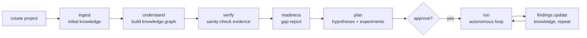

# 26. Autonomous Research — Project → Knowledge → Loop

> **Audience:** End users (researchers)
> **Goal:** Create a project, seed it with your initial knowledge, and start the
> autonomous research loop — then watch it work in the Research Workspace.

This tutorial walks the full path from an empty project to a running autonomous
research loop. It covers the full knowledge pipeline:
- **Phase 0** — ingestion, extraction, and canonical `KnowledgeIR` records
- **Phase 1** — derived knowledge-graph index, regenerable from canonical records
- **Phase 2** — optional OCR fallback for scanned PDFs (vision-model, opt-in)
- **Phase 3** — human-reviewed compiled skills (continuous learning)

> **Refreshed 2026-09-24** against the code (skill review, parallel tracks,
> ask-policy stages). Sections not named here still describe the
> implementation as of their own dates.

It uses the `r4 project` command family and shows how to monitor progress live
in the Research Workspace TUI.

For the engineering-side validation matrix and the demo-to-workflow mapping, see
[../autonomous-science/FUNCTIONAL_VALIDATION_AND_DEMOS.md](../autonomous-science/FUNCTIONAL_VALIDATION_AND_DEMOS.md).

---

## Mental model

R4 turns a pile of your material (papers, code, notebooks, data) into a
knowledge graph, checks whether it understands enough to act, proposes a
research plan, and — once you approve — runs an autonomous loop that generates
hypotheses, designs and runs experiments, analyzes results, and updates its own
knowledge.



Each stage maps to one command:

| Stage | Command | What it does |
|-------|---------|--------------|
| Create | `r4 project create` | Register a new project context |
| Seed | `r4 project import` | Load papers/code/notebooks/data into the knowledge store (alias: `ingest`, deprecated) |
| Understand | `r4 project init` | Extract structured knowledge, build the graph, persist canonical IR (alias: `understand`, deprecated) |
| Verify | `r4 project verify` | Answer a question with evidence + confidence |
| Readiness | `r4 project readiness` | Report knowledge gaps and a go/no-go recommendation |
| Plan | `r4 project plan` | Generate a graph-grounded research plan |
| Skills | `r4 skill pending` / `approve` / `reject` | Review the skills `init` proposed (merge-on-green) |
| Run | `r4 project loop start --approve [--workflow NAME]` | Start the server-hosted autonomous research loop (a durable UMRS job) |

> **One spine (2026-09-07, WP-07):** research runs are UMRS loops. The former
> local `r4 project run` (RC1, with its `--simulate` placeholder findings) is
> retired. A loop runs each experiment as a **registered UMRS workflow**:
> pass `--workflow NAME` (discover names with `r4 workflow list`), or omit it
> when exactly one workflow is registered — UMRS picks it automatically and
> records the choice on the loop. With none or several registered, the start
> fails closed and names the candidates instead of dying at the first
> iteration. The loop only starts after readiness approval (`--approve`, or a
> prior `r4 project readiness --approve`). In `--mode ask` the loop parks at
> each workflow trigger; answer with `r4 project loop approvals` /
> `r4 project loop decide`. Import, init, verify, readiness and plan work
> end-to-end with real data; `plan` lists the registered workflows so you never
> have to know an internal identifier.

---

## Prerequisites

- The `r4` CLI is installed and you are authenticated (`r4 auth login`). See
  [3. Authentication](03-authentication.md).
- At least one model endpoint is reachable for reasoning/analysis. See
  [6. Endpoints](06-endpoints.md). Check with `r4 model list`.
- Your source material is on disk (directories of PDFs, source code, notebooks,
  CSV/experimental data, a README, etc.).
- **(OCR only, optional)** A vision-capable model endpoint is provisioned (see
  [Step 3a — OCR for scanned PDFs](#step-3a--ocr-for-scanned-pdfs-optional))
  and `pymupdf` is installed in your client environment (`pip install pymupdf`).

---

## Step 1 — Create a project

```bash
r4 project create demo --name "Demo Project"
# Optionally set a default model for this project:
r4 project create demo --name "Demo Project" --model rivault-gpt-oss-static

# Make it the active project so later commands can omit the ID:
r4 project switch demo
r4 project current
```

- `project_id` (`demo`) is the stable identifier used by every later command.
- `--model` sets the project's default reasoning model (optional).
- `--security-level high` enforces secure mode for all chat sessions in the
  project (optional).

---

## Step 2 — Seed initial knowledge

Point `import` at one or more directories. Everything under them is loaded into
the project's knowledge store and a manifest is persisted to the project
workspace.

```bash
r4 project import demo ./papers ./code ./notebooks ./data
```

Expected output:

```
✓ Ingested 42 artifact(s) into project demo
  Workspace: ~/.r4/projects/demo
```

Tips:
- You can run `import` multiple times to add more material later.
- For document-only RAG uploads you may also use `r4 rag bulk-upload <dir> --project demo`
  (see [7. RAG](07-rag.md)); `project import` is the right entry point for the
  research loop because it registers artifacts in the knowledge store.
- Follow the "blank project test": upload only your real material (papers,
  notebooks, git repo, experimental data, README) and then let R4 do the rest.

---

## Step 3 — Build understanding

`init` extracts structured knowledge from every imported artifact,
persists an immutable `KnowledgeIR` record per artifact (Phase 0/1), and
builds and writes a derived `knowledge_graph.json` index to the project
workspace (Phase 1). All records are stored under `~/.r4/projects/<id>/`.

```bash
r4 project init demo
```

Expected output:

```
✓ Understood 42 artifact(s) for demo
  Graph: 318 nodes, 512 edges, coverage 0.71
```

**What gets written to disk:**

```
~/.r4/projects/demo/
  knowledge_ir/          ← one <ir_id>.json per artifact (write-once, canonical)
  knowledge_graph.json   ← derived index, regenerable from the IR records
  compiled_skills/       ← populated by compile_knowledge_skills() (see Step 3b)
  skill_reviews.json     ← human review decisions
```

The `knowledge_ir/` directory is **immutable** — records are content-hashed and
never overwritten. Re-running `init` on unchanged artifacts is idempotent.

Then sanity-check what it learned with evidence-backed questions:

```bash
r4 project verify demo "What is this project about?"
r4 project verify demo "Which experiments have already been run?"
```

Expected output:

```
Q: What is this project about?
A: <grounded answer>
Confidence: 0.82
Evidence (3):
  - [paper] smith2024.pdf: ...
  - [code] train.py: ...
  - [notebook] eda.ipynb: ...
```

If answers are weak or low-confidence, ingest more material and re-run
`understand`.

---

## Step 3a — OCR for scanned PDFs (optional)

If your material includes scanned PDFs (no embedded text layer), you can enable
an OCR fallback. OCR sends page images to a vision-capable model inside the
platform and is **off by default** — the `TRANSFORMERS_OFFLINE=1` / no-egress
invariant is always preserved.

### 1. Provision a vision-capable model endpoint

OCR sends page images, so the model must accept image input. Use a `*-VL` /
`*-V` model — text-only models will ignore the images.

```bash
r4 endpoint up --model <vision-model-name> --tier system --ttl-sec 0 --wait
# confirm it's live:
r4 model list
```

### 2. Install the client-side rasterizer

```bash
pip install pymupdf
```

Without PyMuPDF, the OCR path silently returns empty text and extraction
falls back to the non-OCR result — it never raises.

### 3. Export the OCR env vars in the shell where you run `r4 project init`

```bash
export KNOWLEDGE_OCR_ENABLED=1
export KNOWLEDGE_OCR_BASE_URL="<gateway-url>/gw/llm/v1"     # Gateway line from `r4 config show`
export KNOWLEDGE_OCR_MODEL="<served-vision-model-name>"   # exactly as in r4 model list
export KNOWLEDGE_OCR_API_KEY="<your-api-key>"             # same key used with r4 auth login
```

All four vars are read by the `get_ocr_backend()` call inside
`ResearchProject.__init__()`, which runs on the client. They point at the
Gateway's OpenAI-compatible route (`/gw/llm/v1`) — never at LiteLLM directly.

### 4. Run init as usual

```bash
r4 project init demo
```

When a scanned PDF has no embedded text, the page images are sent to the vision
model, the transcribed text is fed to the extractor, and the OCR backend name
(`litellm:<model>`) is recorded in the artifact's `KnowledgeIR` provenance:

```json
// ~/.r4/projects/demo/knowledge_ir/<ir_id>.json
{
  "provenance": {
    "ocr_engine": "litellm:glm-ocr-vl",
    ...
  }
}
```

See [Appendix B](appendix-b-env-vars.md#knowledge--ocr) for the full env-var
reference.

---

## Step 3b — Review proposed skills (Phase 3, optional)

`r4 project init` distills the knowledge graph into *compiled skills* —
procedural units describing methods, algorithms and execution flows found in
your artifacts. This is the **continuous learning** path: every proposal is
registered on UMRS **disabled, `pending_review`**, and only a human review
can enable it.

```bash
r4 skill pending                      # proposals awaiting review (--json for scripts)
r4 skill approve <id-or-name> --skill-dir ./my-skill --note "method checked"
r4 skill reject  <id-or-name> --note "duplicates skill X"
```

**Merge-on-green.** Approving *is* the merge, and it is refused unless the
skill's test suite passes: `approve` runs `<skill-dir>/tests/run.sh`
(exit 0 = green, `--timeout` seconds, default 120) and sends the result with
the decision. No suite, a timeout or a red suite prints the reason and
nothing merges (the server answers `skills.merge_not_green`). Compiled
proposals do not ship tests — write the suite in a local skill directory and
pass it with `--skill-dir`, or reject the proposal.

- Only people review: an agent caller is refused by name.
- Two reviewers deciding at once: one wins, the other gets `skills.conflict`.
- The pass/fail result is reported by your client today; running the suite on
  the server is a later sandbox leg.

Recompiling the same understanding is **idempotent**: a skill id is a content
hash of its source IR lineage, so a proposal is registered once.

> **Local-runtime note.** Offline projects (`--runtime local`) keep the older
> Python API (`ResearchProject.compile_knowledge_skills()` /
> `review_compiled_skill()`), which records decisions in
> `~/.r4/projects/<id>/skill_reviews.json`. It is not the server review above.

---

## Step 4 — Readiness and plan

Ask R4 whether it knows enough to act, and what it would do:

```bash
r4 project readiness demo
```

Expected output:

```
Readiness: ready
Confidence: high
Critical issues: 0
Recommendation: Proceed to planning.
```

Generate a graph-grounded research plan for a goal you care about:

```bash
r4 project plan demo "What research should we perform next?"
```

Expected output:

```
✓ Research plan for demo
  Objectives: 3, hypotheses: 5, experiments: 4
  Success probability: 0.68
  Grounded in 27 knowledge artifact(s)
```

The plan and its goal are saved to the project workspace, so `run` can pick them
up automatically.

---

## Step 5 — Start the autonomous research loop

The loop is **human-gated**: it will not run until readiness is approved. On the
first run, approve with `--approve`. The loop is a durable job on UMRS, so the
command returns as soon as the loop exists; watch it afterwards:

```bash
r4 project loop start demo --approve --max-iterations 10   # add --workflow NAME when several are registered
r4 project loop watch <loop-id>
```

Expected output (start, then watch):

```
✓ started: loop loop-3f2a… → running (workflow demo08_yield_eval)
Loop loop-3f2a… — project demo
  Status: stopped  phase: completed  iteration 10/10
  Hypotheses: 10  experiments: 8  findings: 6  success: 75%
```

Findings of real iterations are minted into the project knowledge graph with
lineage (`knowledge_show` / `knowledge_query` see them); simulated placeholder
findings no longer exist.

What happens each iteration: retrieve relevant knowledge → rank and select a
hypothesis (evidence overlap with the retrieved knowledge) → pick an
experiment → run it as the registered UMRS workflow → collect outputs →
analyze → evaluate → mint findings into the knowledge graph. The loop stops
when the goal is met, the iteration budget is exhausted, or a project budget
cap (wall clock) is hit. (The 2026-07 note that execution was stubbed is
superseded: experiments are real workflow runs since WP-07.)

### Parallel hypothesis tracks

```bash
r4 project loop start demo --approve --tracks 3
```

`--tracks N` (1–4) pursues up to N hypotheses at once. Iterations serve the
active tracks round-robin, each with its own experiment sequence. If there
are more candidate hypotheses than tracks, the loop asks you once which to
pursue (`competing_hypotheses`). A question pending on one track never idles
the others, and rejecting a track's experiment closes that track without
failing the loop. The loop stops when every track is closed.

### When the loop asks you (ask policy)

The loop pauses for your decision according to the project's ask policy.
Answer from the console inbox or with
`r4 project loop approvals` / `r4 project loop decide <approval-id> --decision once|always|no`.
Set the policy per project — the easiest way is a maturity stage:

```bash
r4 project ask_policy demo --stage learning
```

| Stage | Pauses on |
|---|---|
| `bootstrapped` | every gated step |
| `learning` | cost, competing hypotheses, direction change, physical action |
| `competent` | competing hypotheses, direction change, physical action |
| `autonomous` | physical action only |

- **Cost:** every workflow run.
- **Physical action:** a run of an experiment that declares
  `metadata.physical_action: true` (it drives an instrument). It keeps asking
  at every stage above `bootstrapped`.
- **Direction change:** the single-track loop is about to switch to a
  different hypothesis. Answering "no" keeps it on its previous branch.

For finer control use `--mode profile --triggers A,B`; `--clear` removes the
project default. A stage change applies to the next loop start.

- Omit `--approve` on later runs once readiness is already approved.
- Use `--max-iterations N` to bound the run.
- Add `--json` to any command for machine-readable output.

---

## Monitoring in the Research Workspace (TUI)

The Research Workspace gives you a live, visual view of the loop: agents,
knowledge graph, approvals, timeline, strategy, and explainability.

### Launch

From `packages/r4-tui-v3`:

```bash
# Live mode — drives the real r4/umrs CLI:
R4_TUI_BACKEND=cli bun run start

# Offline demo mode — seeded with sample data (no backend needed):
R4_TUI_BACKEND=offline bun run start
```

> **Note:** In offline mode the workspace is pre-seeded with **demo data** so it
> is explorable without a backend. Those placeholder strings are expected. Use
> `R4_TUI_BACKEND=cli` to see your real project and loop.

### Navigate

Select **🔬 Research Workspace** in the **Command Center** (left navigator).
Press `Ctrl+P` for the command palette and `?` or `Ctrl+H` for help at any time.

### Layout and keys

| Area | Purpose | Keys |
|------|---------|------|
| **Mission Control** (top) | Goal, budget, agent + approval counts, progress | — |
| **Agent Monitor** | Running agents, tasks, confidence, reasoning | — |
| **Knowledge Graph** | Live graph nodes/edges, current selection | — |
| **Verification Chat** | Ask "why?" questions against the graph | type + `Enter` |
| **Bottom Panel** | Tabbed detail views | `1` Ops · `2` Strategy · `3` Explain |
| **Autonomous Loop** (Strategy tab) | Drive the loop | `S` start · `T` stop · `R` run one iteration |
| **Approval Gates** (Ops tab) | Human-in-the-loop decisions | `A` approve · `R` reject · `C` comment |

The loop pauses at approval gates; approve (`A`) to let it continue.

---

## Alternative: `r4 research` (standalone loops)

If you want a hypothesis-driven loop that is not tied to a project's knowledge
store, use the `r4 research` family:

```bash
r4 research start "Does learning rate affect convergence?" --domain ml --max-iterations 20
r4 research list
r4 research status <loop-id>
r4 research auto <loop-id>        # run autonomously to completion
r4 research export <loop-id> --format report   # report | paper | json
```

Use `r4 project loop start` when the loop should be grounded in ingested
project knowledge; use `r4 research` for a lighter, self-contained objective.

---

## Command summary

```bash
# 1. Project
r4 project create demo --name "Demo Project"
r4 project switch demo

# 2. Knowledge
r4 project import demo ./papers ./code ./notebooks ./data
r4 project init demo                                        # Phase 0+1: extracts, writes IR + graph
r4 project verify demo "What is this project about?"

# 2a. OCR for scanned PDFs (optional — set env vars first, see Step 3a)
export KNOWLEDGE_OCR_ENABLED=1
export KNOWLEDGE_OCR_BASE_URL="<gateway-url>/gw/llm/v1"
export KNOWLEDGE_OCR_MODEL="<vision-model-name>"
export KNOWLEDGE_OCR_API_KEY="<your-api-key>"
r4 project init demo                                        # Phase 2: scanned PDFs now extracted via OCR

# 2b. Review skills proposed by init (merge-on-green, see Step 3b)
r4 skill pending
r4 skill approve <id> --skill-dir ./my-skill

# 3. Plan + readiness
r4 project readiness demo
r4 project plan demo "What research should we perform next?"

# 4. Autonomous loop (durable UMRS job; --workflow when several are registered)
r4 workflow list
r4 project loop start demo --approve --max-iterations 10
r4 project loop start demo --approve --tracks 3              # parallel hypothesis tracks
r4 project ask_policy demo --stage learning                  # when the loop pauses for you
r4 project loop approvals && r4 project loop decide <approval-id> --decision once
r4 project loop watch <loop-id>

# 5. Loop under a durable session (survives client disconnect)
r4 project sessions
r4 project loop start demo --session latest --runtime hybrid --requires '{"gpu": 1}'
r4 project loop status <loop-id>
r4 project loop stop <loop-id>

# 6. Research Workspace TUI
r4 console            # live backend; --demo for fixture data
```

Start loops only after import/init produced a non-empty knowledge graph.
`r4 project loop` also supports `list`, `iterations [--watch]`, `pause`, and
`resume`; `--runtime {umrs|local|hybrid}` routes cluster-class requirements
to UMRS in hybrid mode. Sessions (`r4 project sessions`) keep several loops
resumable under one investigation across clients and restarts.

---

## Troubleshooting

| Symptom | Cause | Fix |
|---------|-------|-----|
| `✗ No artifacts for <id>` | Nothing imported yet | Run `r4 project import <id> <dirs...>` |
| `✗ No research goal` | `loop start` before `plan` | Run `r4 project plan <id> "<goal>"` first (or pass the goal) |
| `Research readiness not approved` (403) | First start without approval | Re-run `r4 project loop start <id> --approve` |
| `none is registered` / `Several workflows are registered` (400) | Loop start could not pick the workflow | `r4 workflow list`, then `--workflow NAME` (register one with `r4 workflow upload`) |
| Low `verify` confidence | Sparse knowledge graph | Import more material, re-run `init` |
| TUI shows placeholder data | Offline demo mode | Launch with `R4_TUI_BACKEND=cli` |
| Scanned PDFs produce empty graph nodes | No OCR configured | See [Step 3a](#step-3a--ocr-for-scanned-pdfs-optional) |
| OCR runs but returns empty | PyMuPDF not installed | `pip install pymupdf` |
| OCR backend warning at startup | `KNOWLEDGE_OCR_ENABLED=1` but URL/model not set | Export `KNOWLEDGE_OCR_BASE_URL` and `KNOWLEDGE_OCR_MODEL` |
| `compile_knowledge_skills()` returns `[]` | Artifacts have no method/algorithm signal | Ingest papers or code with documented methods |
| Review decision not persisted | `storage_path` not set | Pass `storage_path` to `ResearchProject()`|

---

## Related chapters

- [5. Projects & Models](05-projects-models.md) — project lifecycle and model discovery
- [7. RAG](07-rag.md) — document upload, embedding, and search
- [12. Ask: Agent, Search & Teamup](12-ask.md) — agentic workflows
- [15. TUI Reference](15-tui-reference.md) — interactive UI modes and commands
- [13. CLI Reference](13-cli-reference.md) — complete command tree
