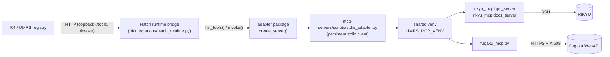

# AI4S Platform Default Hatch! Registry

Default set of Hatch! MCP packages shipped with the platform. These are
thin, stdlib-only MCP servers that talk to the Platform Gateway — no
extra dependencies beyond a working `r4` login.

## Packages

| Package | Tools | Purpose |
|---------|-------|---------|
| `platform-tools` | `list_models`, `list_endpoints`, `list_jobs`, `endpoint_health` | Read-only platform resource queries |
| `rag-search` | `rag_search`, `rag_list_documents`, `rag_status` | RAG retrieval via `/gw/rag/*` |
| `knowledge-tools` | `knowledge_status`, `knowledge_readiness`, `knowledge_search`, `knowledge_verify` | Project knowledge via `/gw/knowledge/*` |
| `rikyu-hpc` | `submit_job`, `get_job_status(es)`, `cancel_job`, `fs_*`, `get_resources` (17+) | RIKYU Slurm/filesystem — stdio adapter, **privileged** |
| `rikyu-docs` | `search_docs`, `list_doc_sections`, `read_doc_section` | RIKYU docs search — stdio adapter, read-only, offline-safe |
| `fugaku` | `run_job`, `submit_job`, `job_status`, `stage_in/out`, `search_manual` (12+) | Fugaku ops — stdio adapter, **privileged** |

## HPC adapter packages (`rikyu-hpc`, `rikyu-docs`, `fugaku`)

These wrap vendor **stdio** MCP servers (`RIKEN-RCCS/Rikyu-Agent`,
`RIKEN-RCCS/fugaku-mcp`). The
`mcp-servers/hatch-registry/packages/*/server.py` entries are thin
manifest-driven modules; all adapter logic lives in
`mcp-servers/scripts/adapter_package.py` (manifest load, offline fallback,
deny env parsing) and `mcp-servers/scripts/stdio_adapter.py` (JSON-RPC
stdio client) — the Hatch runtime still only sees the HTTP contract, R4
never knows the transport. They need:

- Runtime venv: `UMRS_MCP_VENV` (default `/opt/umrs/mcp-runtimes/venv`)
  with `mcp` + `hpc-agent-core` (Rikyu) installed; Fugaku checkout at
  `FUGAKU_MCP_HOME` (default `/opt/umrs/mcp-runtimes/fugaku-mcp`).
- Credentials: `RIKYU_HOST` + SSH key (Rikyu), `FUGAKU_CERT` X.509 PEM
  (Fugaku). Paths/secrets come from the deployment `.env`, never the repo.
- Policy: dangerous tools are filtered at registration time by the launcher
  (`run_command_on_cluster`; Fugaku `run_command`, `check_update`) and each
  package's `hatch.json` carries a `capabilities` block (category, risk,
  network, approval) that lands in UMRS `metadata` for downstream policy
  enforcement.

See `docs/development/default-mcp-expansion-plan.md` for the full design,
egress matrix, and phased roadmap.

### Bridge: vendor stdio → Hatch HTTP (R4 transport-blind)



The bridge is a **persistent stdio client**: it spawns the vendor server
once per runtime, keeps it alive, lazily respawns on child death, enforces
a per-call timeout, and appends an audit JSONL line per invocation
(child stderr is retained alongside for operator evidence). R4 and UMRS
only ever talk HTTP — the vendor's stdio transport is fully contained
inside the Hatch layer.

**Trust boundary.** R4 ⇄ adapter traffic is confined to loopback
(127.0.0.1) only. Invoke arguments pass through to the vendor server
unvalidated today; validation stays with the vendor where it exists
(e.g. `fugaku_policy.py`) and UMRS-side policy enforcement is tracked as
Phase-2 work in the expansion plan. Privileged tools are flagged
declaratively via `capabilities.approval.dangerous_tools` in each
`hatch.json`. TODO(hardening): per-package `call_timeout` in `hatch.json`,
and an invoke-argument size cap before the child round-trip.

### Harness

The bridge is covered by two suites, both fully offline (no vendor deps, no
HPC access), under `mcp-servers/tests/`:

- `test_persistent_mcp_client.py` — 6 tests on the JSON-RPC transport
  mechanics (subprocess spawn, newline-delimited frames, request/response
  id routing) plus contract behavior: initialize handshake, tool listing
  with runtime deny filtering, invoke round-trip + audit-record write,
  **failure paths**: denied-tool refusal, child-death restart, timeout
  kill, spawn failure (fake stdio MCP server).
- `test_adapter_fallback.py` — 6 tests on the package guarantee: each of
  the three adapter packages builds with the vendor venv absent,
  `list_tools()` serves the full static manifest list (26/3/14 unique
  tools), and `invoke()` surfaces a clean `StdioMcpError`.

### Verification (run 2026-07-31, all green)

1. `pytest mcp-servers/tests/test_persistent_mcp_client.py mcp-servers/tests/test_adapter_fallback.py -q`
   → **12 passed** (6 client + 6 fallback; client suite:
   `test_list_tools_filters_denied_tools`,
   `test_invoke_returns_content_and_audits`, `test_denied_tool_refused`,
   `test_restart_after_child_death`, `test_timeout_kills_child`,
   `test_spawn_failure_raises`)
2. Package fallback smoke — 3 packages serve static manifest tools with
   vendor venv absent; `invoke()` surfaces `StdioMcpError` cleanly.
3. `ruff check` + `ruff format --check` on all new/edited Python files → clean.
4. Boundary validators (`import_boundary_validator`, `contracts_fence`,
   `stale_name_validator`) → pass.
5. Codacy CLI analysis on every new/edited source file → zero findings.
6. Ansible YAML parse-check → valid.

## Usage

Point the Hatch registry at this directory (comma-separated list supported):

```bash
export R4_HATCH_REGISTRIES=/path/to/ai4s-platform/mcp-servers/hatch-registry

r4 mcp hatch search                    # discover default packages
r4 mcp hatch install platform-tools    # install from this registry
r4 mcp hatch connect platform-tools    # launch + register with Gateway
r4 mcp list                            # tools now visible to chat/inference
```

Or install directly from the checkout without registry configuration:

```bash
r4 mcp hatch install ./mcp-servers/hatch-registry/packages/knowledge-tools
r4 mcp hatch connect knowledge-tools
```

## Authentication

Each server resolves Gateway credentials in this order:

1. `R4_GATEWAY_URL` + `R4_GATEWAY_TOKEN` environment variables
2. The active source in `~/.config/r4/sources.json` (written by `r4 auth login`)

## Package contract

Every package is a directory containing `hatch.json` (manifest) and
`server.py` defining `create_server()` that returns an object with
`list_tools()` and `invoke(tool_name, args)`. See any package here as a
reference, or generate a skeleton with `r4 mcp hatch create <name>`.
